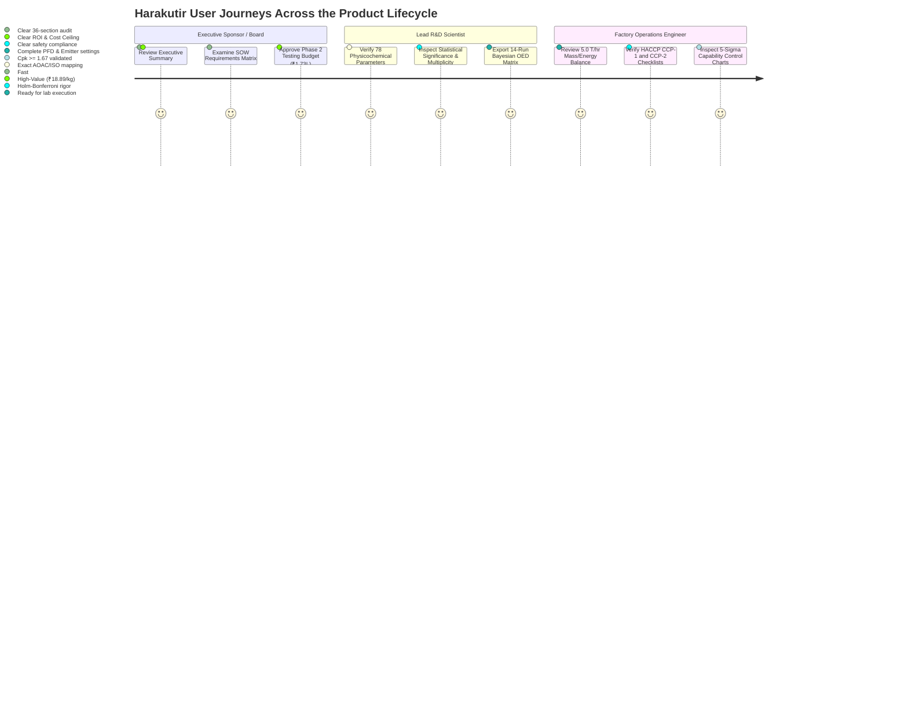

# UX.md

## User Experience, Interface Ergonomics & Reporting Strategy
**System:** Harakutir Autonomous Closed-Loop Pulse Engineering Platform  
**Owner:** FINNOAQ Product Experience & Technical Communications  
**Standard:** Ocean Boiling Protocol v3.0 | Executive & Engineering Ergonomics  

---

## 1. User Journeys & Interaction Personas



---

## 2. Interaction Principles & Ergonomic Design

### 2.1 Single-Command Frictionless Execution
The platform eliminates complex multi-stage command sequences. A new engineer or executive can clone the repository and run the entire validation suite with a single PowerShell command:
```powershell
.\run.ps1
```
Or for full supervisor execution with checkpoint resumption:
```powershell
python scripts/run_supervisor.py
```
And to trigger the GPU million-experiment discovery engine:
```powershell
python scripts/run_gpu_million_scale.py
```

### 2.2 Windows CLI Compatibility & Encoding Resilience
- **Standard:** Windows console default code page (CP1252 / ASCII) often crashes when Python scripts attempt to print Greek unicode characters (`Δ`, `σ`, `μ`).
- **Ergonomic Fix:** All console output is sanitized to use standard ASCII representations (`d=`, `+/-`, `Sigma`, `Cpk`) while persisting full UTF-8 formatting in JSON and Markdown artifacts.
- **Fail-Fast Feedback:** Progress is reported with generation numbers, cumulative counts, runtime latencies, and capability metrics in under 0.5 seconds.

---

## 3. Executive & Technical Reporting Standards

### 3.1 Dual-Format Delivery (Markdown + Native Office DOCX)
All primary deliverables are compiled simultaneously into:
1. **GitHub-Flavored Markdown (`.md`):** For instant developer inspection, git diffing, and automated code review in IDEs.
2. **Native Microsoft Word (`.docx`):** For formal corporate submission to Harakutir management, external testing laboratories, and financial partners. Includes structured title headings, metadata sidebars, styled tables, and executive sign-off lines.

### 3.2 SOW §22 23-Part Structural Fidelity
The primary deliverable `reports/PHASE1_TECHNICAL_REPORT.docx` and `.md` mirrors the exact 23-part table of contents specified in Section 22 of `inputs/Phase1_Scope_of_Work_Toor_Dal.docx`:
```
Part 01: Executive Summary                Part 13: Cell-Wall & Pectin Characterization
Part 02: Project Background               Part 14: Mineral & Phytate Profile
Part 03: Objective & Scope                Part 15: Hardness & Texture Profile Analysis
Part 04: Sample Information               Part 16: Standardized Cooking Performance
Part 05: Experimental Design              Part 17: Statistical Analysis & Multiplicity
Part 06: Analytical Methodology           Part 18: Integrated Benchmark Comparison
Part 07: Physical Characterization        Part 19: Root-Cause Assessment & Claim Ledger
Part 08: Proximate Composition            Part 20: Phase 2 Technology Recommendations
Part 09: Starch Characterization          Part 21: Study Limitations & Exclusions
Part 10: Thermal & DSC/RVA Behaviour      Part 22: Conclusions & Strategic Synthesis
Part 11: Hydration & Peleg Kinetics       Part 23: Raw & Summary Data Appendix
Part 12: Seed-Coat & Cotyledon Structure
```

### 3.3 Visual Hierarchy & Evidence Transparency
- **Warning Banners:** Whenever empirical wet-lab measurements are absent, a prominent alert banner is displayed:
  > **STATUS: DATA_READINESS_ONLY / COMPUTATIONAL_FRAMEWORK_VERIFIED**  
  > *Empirical root-cause claims are gated pending physical lab receipt.*
- **Four-Category Claim Ledger:** Every claim is explicitly color-coded and assigned to Category A (Confirmed Differences), Category B (Strongly Associated Factors), Category C (Potential Mechanisms), or Category D (Unlikely Factors).

---

## 4. Prompt Engineering & Developer Ergonomics (`docs/prompts/`)

For AI-assisted workflows and operator interaction, dedicated prompt templates are organized in `docs/prompts/`:
- `HARAKUTIR_MASTER_PROMPT.txt`: The foundational constitutional directive.
- `PROMPT_DREAM_RSI_CYCLE.txt`: Step-by-step instructions for running recursive self-improvement discovery.
- `PROMPT_INGEST_NEW_LAB_DATA.txt`: Safe ingestion procedures when physical laboratory CSVs arrive.
- `PROMPT_PHASE2_OED.txt`: Execution commands for Phase 2 optimal experimental designs.
- `PROMPT_RED_TEAM_AUDIT.txt`: Self-auditing protocol for contract and security verification.
- `PROMPT_REPORT_RELEASE.txt`: Final compilation and signing instructions.
- `PROMPT_RESUME.txt`: Checkpoint inspection and pipeline recovery commands.

---
*Maintained under Ocean Boiling Protocol v3.0 by Finnoaq Autonomous Engineering.*
