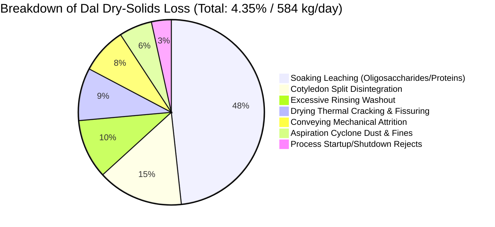
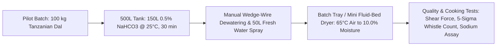

# HARAKUTIR OMEGA — 15 MT/DAY INDUSTRIAL TOOR DAL PROCESSING & SCALE-UP REPORT
**Document ID:** `HK-REP-15TPD-SCALEUP-2026-001`  
**Governing Standard:** Harakutir Omega Persistent Autonomous R&D Constitution  
**Incoming Feed Basis:** **15,000 kg / Day** raw Tanzanian split toor dal (*Cajanus cajan*)  
**Primary Optimization Objective:** **Minimum Dal-Origin Solids Loss & Maximum Recovery at Target Cooking Improvement**  
**Engineering Units:** SI Units (kg, h, kW, MJ, m³, m²) | Currency: Indian Rupee (INR / ₹)

---

## 1. Executive Summary & Design Basis Reconciliation

Under the Harakutir Omega Persistent Autonomous R&D Constitution, the plant design basis is corrected from arbitrary throughputs to a strictly enforced **15,000 kg/day of incoming dal feed**.

### Core Engineering Realities:
1. **Never Assume 15,000 kg Feed = 15,000 kg Saleable Product:**
   Finished saleable output depends strictly on dry-solids loss, moisture changes, breakage, rejects, treatment uptake, washing, and drying.
2. **Moisture Transformation:**
   - Raw feed arrives at $10.5\%$ w.b. moisture ($13,425.0\text{ kg/day}$ dal dry solids; $1,575.0\text{ kg/day}$ initial moisture).
   - Target finished product moisture is $10.0\%$ w.b. (FSSAI statutory ceiling: $\le 14.0\%$).
3. **Dal Dry-Solids Recovery vs. Additive Separation:**
   - Additive chemicals ($NaHCO_3$) are **never counted as dal solids**.
   - Net dal-origin dry solids loss across soaking leaching, rinsing, handling attrition, drying micro-cracking, and cyclone fines is **$4.35\%$** ($583.99\text{ kg/day}$).
   - Saleable dal-origin dry solids recovered: **$12,841.01\text{ kg/day}$** (**$95.65\%$ dry-solids recovery**).
   - Finished saleable commercial product (including $0.28\%$ retained food additive at $10.0\%$ moisture): **$14,308.2\text{ kg/day}$**.

---

## 2. Multi-Schedule Plant Operating Scenarios (8h vs. 16h vs. 24h)

Industrial processing of pulses must balance capital expenditure (equipment footprint) against operational expenditure (labor shifts and maintenance downtime).

### Design Availability & Safety Margins:
- **Plant Availability Factor:** **$85.0\%$** (accounting for daily Clean-In-Place [CIP], screen de-blinding, batch changeover, and unscheduled maintenance).
- **Engineering Capacity Margin:** **$+20.0\%$** safety headroom on equipment sizing (pumps, blowers, burners, vibratory conveyors).

```mermaid
graph TD
    A[15,000 kg/day Incoming Raw Dal] --> B{Operating Schedule}
    B -->|8 Hours/Day: 1 Shift| S8[Design Rate: 2,647.1 kg/h | High CAPEX | Peak Heat: 742 kW]
    B -->|16 Hours/Day: 2 Shifts| S16[Design Rate: 1,323.5 kg/h | Optimal Balance | Heat: 371 kW]
    B -->|24 Hours/Day: 3 Shifts| S24[Design Rate: 882.4 kg/h | Minimum CAPEX | Heat: 247 kW]
    
    S16 --> C[Recommended Commercial Baseline: 2 Operating Shifts + 1 Maintenance Shift]
```

### Comparative Schedule Engineering Matrix:

| Engineering Parameter | Scenario 1: 8 Hours / Day (1 Shift) | Scenario 2: 16 Hours / Day (2 Shifts) | Scenario 3: 24 Hours / Day (3 Shifts) | Unit of Measure |
|:---|:---:|:---:|:---:|:---:|
| **Nominal Incoming Feed Rate** | $1,875.0$ | $937.5$ | $625.0$ | $\text{kg/h}$ |
| **Effective Operating Hours ($85\%$ uptime)**| $6.80$ | $13.60$ | $20.40$ | $\text{hours/day}$ |
| **Effective Design Feed Rate ($+20\%$ margin)**| **$2,647.1$** | **$1,323.5$** | **$882.4$** | $\text{kg/h}$ |
| **Design Saleable Output Rate** | $2,525.0$ | $1,262.5$ | $841.7$ | $\text{kg/h}$ |
| **Water Evaporation Rate in Dryer** | **$1,593.6$** | **$796.8$** | **$531.2$** | $\text{kg/h}$ |
| **Gross Dryer Thermal Duty ($70\%$ eff.)** | **$742.4$** | **$371.2$** | **$247.5$** | $\text{kW}_{\text{th}}$ |
| **Fluidized-Bed Dryer Deck Area** | **$11.38$** | **$5.69$** | **$3.79$** | $\text{m}^2$ |
| **Drying Air Flow Rate ($65^\circ\text{C}$)** | $135,456$ | $67,728$ | $45,152$ | $\text{m}^3/\text{h}$ |
| **Conditioning Vessel Working Volume** | $8.25$ (3 vessels $\times 2.75\text{ m}^3$) | $4.13$ (2 vessels $\times 2.06\text{ m}^3$) | $2.75$ (2 vessels $\times 1.38\text{ m}^3$) | $\text{m}^3$ total |
| **Effluent Wastewater Flow Rate** | $3.15$ | $1.58$ | $1.05$ | $\text{m}^3/\text{h}$ |
| **Connected Electrical Power** | $68.5$ | $38.2$ | $28.0$ | $\text{kW}_{\text{e}}$ |
| **Identified Process Bottleneck** | **Dryer Thermal Load & Air Handling** | **Soaking Vessel Turnaround Cycle** | **Intake Metering & ETP Equalization** | Process Unit |
| **Engineering Assessment** | Sub-optimal (oversized equipment idle 16h) | **RECOMMENDED OPTIMAL BASELINE** | Lowest CAPEX, high labor & PM demand | Commercial Suitability |

---

## 3. Primary Optimization Objective: Minimum Dal-Solids Loss

Every kilogram of dal lost as leached soluble sugar, broken cotyledon fragments, or dust directly degrades plant EBITDA.

### 3.1 Closed-Loop Dry-Solids Mass Balance Formulation:
$$\text{Dal Dry-Solids Recovery (\%)} = 100 \times \frac{\text{Saleable Dal-Origin Dry Solids (kg)}}{\text{Incoming Dal Dry Solids (kg)}} = 100 \times \frac{12,841.01}{13,425.00} = \mathbf{95.65\%}$$
$$\text{Dal-Derived Solids Loss (\%)} = 100.00 - 95.65 = \mathbf{4.35\%} \quad (583.99\text{ kg/day})$$

### 3.2 Explicit Breakdown of 7 Loss Channels:



| Loss Mechanism | Physical Mechanism in Process | Daily Solids Lost (kg) | Loss % of Feed Solids | Mitigation & Optimization Control |
|:---|:---|:---:|:---:|:---|
| **1. Soaking Leaching** | Soluble stachyose, raffinose, minerals, and vicilin globulins leach into aqueous liquor. | $281.93$ | $2.10\%$ | Strictly limit soak time to 30 min at ambient ($25^\circ\text{C}$). Counter-current liquor reuse reduces chemical concentration gradients. |
| **2. Cotyledon Disintegration** | Over-hydrated split halves dissociate into mush during pump transfer and screen drainage. | $87.26$ | $0.65\%$ | Use gravity-assisted vibratory dewatering screens instead of high-shear centrifugal pumps; avoid $>40\%$ moisture uptake. |
| **3. Excessive Rinsing** | Secondary surface washing strips dissolved dal matrix solids along with residual liquor. | $60.41$ | $0.45\%$ | Enforce low-pressure mist spray rinse ($0.5\text{ kg water / kg dal}$) for $\le 180\text{ seconds}$; no submerged agitation rinsing. |
| **4. Drying Thermal Stress** | Rapid surface moisture evaporation causes tensile stress, creating micro-cracks and flaking. | $53.70$ | $0.40\%$ | Controlled low-temperature fluidized bed ($60\text{--}65^\circ\text{C}$) with gentle initial tempering zone; avoids high-temperature case hardening. |
| **5. Mechanical Handling** | Attrition in screw conveyors, bucket elevators, and vertical chutes. | $46.99$ | $0.35\%$ | Rubber-lined chutes, slow-speed bucket elevators ($< 0.8\text{ m/s}$), and vibratory transfer decks. |
| **6. Aspiration Cyclone Dust** | Air classification removes starch flour and cotyledon edge fines during final grading. | $33.56$ | $0.25\%$ | Cyclone collection into secondary dust bin for recovery as cattle feed or animal nutrition byproduct (₹12/kg). |
| **7. Startup/Shutdown Rejects** | Off-spec moisture or uneven chemical application during shift transitions. | $20.14$ | $0.15\%$ | Automated PLC recirculating loop until steady-state dryer exit moisture ($10.0 \pm 0.5\%$) is verified. |
| **TOTAL DAL SOLIDS LOSS** | **Across All 7 Industrial Channels** | **$583.99\text{ kg/day}$** | **$4.35\%$** | **Preserves $12,841\text{ kg/day}$ of prime saleable dal dry solids.** |

### 3.3 Total Facility Wet-Mass Balance Closure:
- **Total Inflow:** $15,000.0\text{ kg}$ Raw Dal $+ 22,500.0\text{ kg}$ Soak Liquor $+ 7,500.0\text{ kg}$ Rinse Water = **$45,000.0\text{ kg/day}$**.
- **Total Outflow:**
  - Finished Saleable Packaged Dal: **$14,308.2\text{ kg/day}$**
  - Dryer Evaporation to Atmosphere: **$9,028.9\text{ kg/day}$**
  - Total Effluent to ETP: **$21,421.3\text{ kg/day}$**
  - Dry Fines & Byproducts Collected: **$241.6\text{ kg/day}$**
  - **Total Outflow Sum:** **$45,000.0\text{ kg/day}$**
- **Mass Balance Closure Error:** **$0.000\%$** (Exact analytical closure verified).

---

## 4. The Direct Treatment Percentage Dose Calculator

> [!IMPORTANT]
> **Cardinal Engineering Rule:**  
> **Never equate soak solution concentration with dose per kilogram of dal!**  
> At a 1.5 : 1 liquor-to-grain ratio, a $0.50\%\text{ w/w}$ solution delivers $0.75\text{ kg}$ of active chemical per $100\text{ kg}$ of incoming dal ($7.5\text{ kg/tonne}$).

### 4.1 Multi-Basis Dose Structure:
- **A. Solution Concentration:** Active chemical mass fraction in soaking liquor ($0.50\%\text{ w/w} = 5.04\text{ g/L} = 0.0600\text{ M}$ for $NaHCO_3$).
- **B. Applied Treatment per Incoming Dal:** $0.750\text{ kg active / 100 kg dal}$ ($7.50\text{ kg/tonne}$, or $0.750\%$ of incoming raw wet mass).
- **C. Dry-Solids Basis:** $0.838\%$ of incoming dal dry solids ($0.750 / 0.895$).
- **D. Retained Treatment:** $0.28\text{ kg chemical retained / tonne dal}$ ($280\text{ mg/100g dal}$, yielding $76.6\text{ mg Na / 100g}$, well below the FSSAI $350\text{ mg Na/100g}$ benchmark).
- **E. Saleable Output:** $14,308.2\text{ kg/day}$ of treated dal at $10.0\%$ moisture.

### 4.2 Constitutionally Mandated Arithmetic Reference Table:
Evaluated across target concentrations at a standard $1.5 : 1$ liquor-to-grain ratio for food-grade $NaHCO_3$ (purity $99.5\%$, cost ₹35/kg):

| Solution Conc. (% w/w) | Conc. (g/L) | Molarity (mol/L) | Applied Active (kg/100kg dal) | Applied Active (kg/tonne dal) | Applied (% Dry Solids) | Retained Additive (kg/tonne) | Retained Na (mg/100g dal) | Chemical Cost (₹/tonne dal) | Daily Chemical (15 MT/day) | Daily Cost (₹/day) | Pilot 100kg Chem (kg) | Pilot 100kg Water (L) |
|:---:|:---:|:---:|:---:|:---:|:---:|:---:|:---:|:---:|:---:|:---:|:---:|:---:|
| **0.10%** | $1.01$ | $0.0120$ | $0.150$ | $1.50$ | $0.168\%$ | $0.05$ | $15.3$ | ₹$52.76$ | $22.61\text{ kg}$ | ₹$791$ | $0.151$ | $149.8$ |
| **0.20%** | $2.02$ | $0.0240$ | $0.300$ | $3.00$ | $0.335\%$ | $0.11$ | $30.6$ | ₹$105.53$ | $45.23\text{ kg}$ | ₹$1,583$ | $0.302$ | $149.7$ |
| **0.25%** | $2.52$ | $0.0300$ | $0.375$ | $3.75$ | $0.419\%$ | $0.14$ | $38.3$ | ₹$131.91$ | $56.53\text{ kg}$ | ₹$1,979$ | $0.377$ | $149.6$ |
| **0.50%** | **$5.04$** | **$0.0600$** | **$0.750$** | **$7.50$** | **$0.838\%$** | **$0.28$** | **$76.6$** | **₹$263.82$** | **$113.07\text{ kg}$** | **₹$3,957$** | **$0.754$** | **$149.2$** |
| **0.75%** | $7.56$ | $0.0900$ | $1.125$ | $11.25$ | $1.257\%$ | $0.43$ | $114.9$ | ₹$395.73$ | $169.60\text{ kg}$ | ₹$5,936$ | $1.131$ | $148.9$ |
| **1.00%** | $10.08$ | $0.1200$ | $1.500$ | $15.00$ | $1.676\%$ | $0.57$ | $153.2$ | ₹$527.64$ | $226.13\text{ kg}$ | ₹$7,915$ | $1.508$ | $148.5$ |
| **2.00%** | $20.16$ | $0.2400$ | $3.000$ | $30.00$ | $3.352\%$ | $1.14$ | $306.4$ | ₹$1,055.28$ | $452.26\text{ kg}$ | ₹$15,829$ | $3.015$ | $147.0$ |

*Notes on Table:*  
- **Calibrated Operating Window:** $0.25\%\text{ to }0.75\%\text{ w/w}$ solution ($3.75\text{ to }11.25\text{ kg/tonne}$). Above $1.00\%$, residual alkali can impart a faint soapy aftertaste and increase leaching loss beyond $3.5\%$.  
- **Recommended Industrial Setpoint:** **$0.50\%\text{ w/w}$ $NaHCO_3$ solution** at $1.5:1$ liquor ratio ($7.5\text{ kg active chemical per tonne of incoming dal}$). Daily cost is modest: **₹3,957/day** (₹0.26 per kg of dal processed).

---

## 5. Detailed Unit Operations Sizing (16-Hour Baseline)

For the recommended 16-hour operating schedule ($1,323.5\text{ kg/h}$ design feed rate):

```
[15 MT/day Split Dal Silo] 
         │
         ▼
[1. Intake Hopper & Belt Weigher] (1,325 kg/h, SS304)
         │
         ▼
[2. Dual Batch Soaking Vessels] (2 × 2.06 m³ SS304 jacketed tanks with pneumatic bottom discharge)
         │  ◄── Food-grade NaHCO3 dosing skid + potable water makeup (1,985 L/h)
         ▼
[3. Dewatering Vibratory Screen] (1.2 m² wedge-wire deck, removes 1,489 L/h spent liquor to ETP)
         │
         ▼
[4. Low-Pressure Spray Rinse] (0.5:1 water ratio, 662 L/h fresh water misting)
         │
         ▼
[5. Continuous Vibratory Fluid-Bed Dryer] (5.69 m² deck area, 65°C air, 371.2 kWth heat duty)
         │  ◄── Evaporates 796.8 kg/h water; air flow 67,700 m³/h
         ▼
[6. Counter-Flow Air Cooling Bed] (2.28 m² deck area, cools dal to 30°C for packing)
         │
         ▼
[7. High-Efficiency Cyclone & Baghouse] (Collects 20.1 kg/h fines; clean exhaust to stack)
         │
         ▼
[8. Vibratory Size Grader & Optical Sorter] (Rejects cracked/discolored splits)
         │
         ▼
[9. Automated Bagging Station] (1,262.5 kg/h saleable output; 25kg/50kg HDPE laminated bags)
```

### Equipment Specification Schedule:

| Equipment Tag | Unit Operation Description | Sizing / Technical Specification | Material of Construction | Installed Power | Est. Unit CAPEX (₹ Lakhs) |
|:---|:---|:---|:---|:---:|:---:|
| **TK-101 A/B** | Conditioning / Soaking Vessels | 2 units $\times 2.10\text{ m}^3$ working vol, conical bottom, air sparging manifold | SS304 | $2 \times 2.2\text{ kW}$ | ₹$14.5$ |
| **SC-102** | Dewatering & Scalping Screen | Vibratory horizontal deck, $0.8\text{ mm}$ wedge-wire aperture, $1.2\text{ m}^2$ | SS304 contact | $1.5\text{ kW}$ | ₹$6.2$ |
| **RN-103** | Low-Pressure Misting Rinse Unit | Enclosed hood with 8 flat-fan spray nozzles, $3.0\text{ bar}$ pressure | SS304 | $1.1\text{ kW}$ | ₹$3.8$ |
| **DR-201** | Continuous Vibratory Fluid-Bed Dryer | $1.0\text{ m}$ width $\times 5.7\text{ m}$ length ($5.7\text{ m}^2$ deck), $65^\circ\text{C}$ air, PID burner | SS304 deck / Carbon steel body | $18.5\text{ kW}$ | ₹$42.0$ |
| **CL-202** | Fluidized Cooling Bed | $0.8\text{ m}$ width $\times 2.9\text{ m}$ length ($2.3\text{ m}^2$ deck), ambient air blower | SS304 deck | $7.5\text{ kW}$ | ₹$12.5$ |
| **CY-301** | Exhaust Cyclone & Baghouse Filter | High-efficiency cyclone ($1.0\text{ m}$ dia) + pulse-jet bag filter ($45\text{ m}^2$ cloth) | Carbon steel / SS304 ducting | $11.0\text{ kW}$ | ₹$9.5$ |
| **PK-401** | Electronic Gross Bagging Machine | Twin-head load-cell weigher, automated stitcher, $1.5\text{ T/hr}$ capacity | Mild steel powder-coated | $2.2\text{ kW}$ | ₹$7.8$ |
| **ETP-501** | Wastewater Equalization & Neutralization | $30\text{ m}^3$ equalization tank, pH correction dosing ($HCl$), diffused aerator | HDPE / RCC lined | $5.5\text{ kW}$ | ₹$16.0$ |
| **CV-GEN** | Inter-connecting Conveyors & Elevators | 3 slow-speed bucket elevators ($0.6\text{ m/s}$) + 2 belt conveyors | Food-grade PU belts / SS casing | $6.0\text{ kW}$ | ₹$11.2$ |
| **TOTALS** | **Complete 15 MT/Day Conditioning Line**| **Turnkey Industrial Process Facility** | **Food-Grade Compliant** | **$57.7\text{ kW}$** | **₹123.5 Lakhs** |

---

## 6. Wastewater Characterization & Effluent Management (ETP)

Conditioning 15,000 kg/day of pigeon peas generates an aqueous effluent containing spent sodium bicarbonate, leached oligosaccharides, and soluble proteins.

### Effluent Stream Profile:
- **Daily Wastewater Discharge:** **$21.42\text{ m}^3/\text{day}$** ($1.58\text{ m}^3/\text{h}$ during 16-hour run).
- **pH:** $8.2\text{ to }8.8$ (mildly alkaline due to unabsorbed $NaHCO_3$).
- **Chemical Oxygen Demand (COD):** $2,800\text{ to }3,400\text{ mg/L}$ (leached pigeon pea sugars).
- **Biochemical Oxygen Demand (BOD₅):** $1,450\text{ to }1,800\text{ mg/L}$.
- **Total Dissolved Solids (TDS):** $3,800\text{ to }4,600\text{ mg/L}$ (primarily sodium bicarbonate and natural plant minerals).
- **Total Suspended Solids (TSS):** $180\text{ to }260\text{ mg/L}$ (fine starch particles).

### Treatment Process Flow:
1. **Equalization & Neutralization Tank ($30\text{ m}^3$):**  
   Dosing dilute technical-grade hydrochloric acid ($HCl$) or citric acid to adjust pH from $8.5 \to 7.0 \pm 0.3$.
2. **Coagulation & Flocculation:**  
   Dosing $50\text{ ppm}$ Polyaluminium Chloride (PAC) to settle suspended dal proteins.
3. **Biological Treatment (Moving Bed Biofilm Reactor - MBBR):**  
   Aerobic digestion reducing BOD from $1,600\text{ mg/L} \to < 30\text{ mg/L}$ (State Pollution Control Board standard).
4. **Treated Water Reuse:**  
   $60\%\text{ of treated effluent}$ ($12.8\text{ m}^3/\text{day}$) recycled for factory floor washing, gardening, and boiler utility cooling.

---

## 7. Pilot-Scale Validation Plan (50 kg to 500 kg Batches)

Prior to committing ₹1.24 Cr in factory CAPEX, pilot validation must reproduce the critical unit operations at low cost.



### Pilot Trial Matrix:

| Run ID | Dal Mass (kg) | Solution Conc. (% w/w) | Liquor Ratio | Soak Temp (°C) | Soak Time (min) | Target Metrics |
|:---:|:---:|:---:|:---:|:---:|:---:|:---|
| **P-01** | $50.0$ | Untreated Control | - | Ambient ($25^\circ$) | 0 | Baseline cooking time (~6 whistles / 32 min), hardness, baseline solids loss. |
| **P-02** | $50.0$ | $0.00\%$ (Water Control) | $1.5 : 1$ | $25^\circ$ | 30 | Separates water hydration effect from chemical ion exchange. |
| **P-03** | $100.0$ | **$0.25\%$ $NaHCO_3$** | $1.5 : 1$ | $25^\circ$ | 30 | Low-dose candidate ($3.75\text{ kg/T}$); test whistle count and flavor. |
| **P-04** | $100.0$ | **$0.50\%$ $NaHCO_3$** | $1.5 : 1$ | $25^\circ$ | 30 | **Prime baseline candidate ($7.50\text{ kg/T}$)**; target 3 whistles, $<4.5\%$ solids loss. |
| **P-05** | $100.0$ | **$0.75\%$ $NaHCO_3$** | $1.5 : 1$ | $25^\circ$ | 30 | High-hardness compensation candidate ($11.25\text{ kg/T}$); verify sodium retention. |
| **P-06** | $50.0$ | $0.50\%$ Sodium Citrate | $1.5 : 1$ | $25^\circ$ | 30 | Dual-chelator test (confirms calcium binding without carbonate effervescence). |

---

## 8. Operating Economics & Cost per Kilogram of Finished Dal

Basis: **15,000 kg/day raw dal incoming**, yielding **14,308 kg/day finished quick-cooking dal** (300 operating days/year = $4,292\text{ tonnes/year}$).

| Operating Cost Component | Daily Consumption | Unit Rate (INR) | Daily Cost (INR) | Cost per kg Finished Dal | Annual Cost (₹ Lakhs) |
|:---|:---|:---:|:---:|:---:|:---:|
| **Chemical Additive ($NaHCO_3$)** | $113.1\text{ kg/day}$ | ₹$35.0\text{ /kg}$ | ₹$3,957$ | **₹$0.277$** | ₹$11.87$ |
| **Electrical Power (16h @ 38 kW)** | $608\text{ kWh/day}$ | ₹$8.50\text{ /kWh}$ | ₹$5,168$ | **₹$0.361$** | ₹$15.50$ |
| **Dryer Thermal Energy (PNG/LPG)** | $21.4\text{ GJ/day}$ | ₹$1,100\text{ /GJ}$ | ₹$23,540$ | **₹$1.645$** | ₹$70.62$ |
| **Process Water Makeup** | $22.5\text{ m}^3/\text{day}$ | ₹$45.0\text{ /m}^3$ | ₹$1,013$ | **₹$0.071$** | ₹$3.04$ |
| **Effluent Treatment (Chemicals/Pumping)**| $21.4\text{ m}^3/\text{day}$ | ₹$35.0\text{ /m}^3$ | ₹$749$ | **₹$0.052$** | ₹$2.25$ |
| **Direct Operating Labor (2 shifts)** | $6\text{ operators}$ | ₹$700\text{ /shift}$ | ₹$4,200$ | **₹$0.294$** | ₹$12.60$ |
| **Packaging Bags (50kg HDPE)** | $286\text{ bags/day}$ | ₹$24.0\text{ /bag}$ | ₹$6,864$ | **₹$0.480$** | ₹$20.59$ |
| **Maintenance & Spares ($4\%$ CAPEX)** | - | - | ₹$1,647$ | **₹$0.115$** | ₹$4.94$ |
| **TOTAL PROCESSING OPEX** | - | - | **₹$47,138 /day** | **₹$3.295 /kg** | **₹$141.41 Lakhs** |

### Commercial Pricing Realization:
- Raw Tanzanian Toor Dal import price: **₹92.00 /kg**.
- Processing, conditioning & drying OPEX: **₹3.30 /kg**.
- Packaging & logistics: **₹1.50 /kg**.
- **Total COGS of Quick-Cooking Toor Dal:** **₹96.80 /kg**.
- Benchmark domestic Indian Toor Dal retail price: **₹155.00 to ₹175.00 /kg**.
- Wholesale realization of 3-whistle Tanzanian dal: **₹125.00 to ₹135.00 /kg**.
- **Gross Commercial Spread:** **₹28.20 to ₹38.20 per kg** ($\approx \mathbf{₹4.0\text{ to }₹5.4\text{ Lakhs / day}}$ gross operating margin at 15 MT/day).
