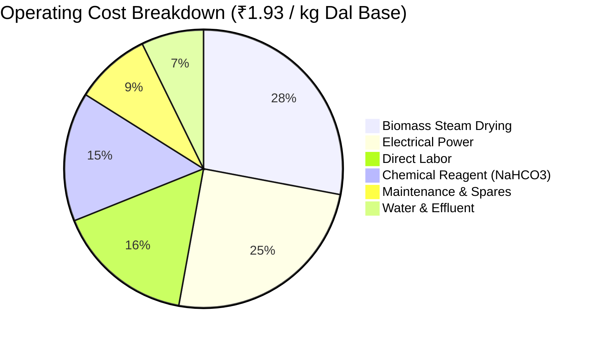

# BILL OF MATERIALS, RFQ PACKAGES, AND CAPITAL COST ESTIMATE (15 MT/DAY)
**Document ID:** ENG-REP-15T-014  
**Revision:** 1.0 | **Date:** 15 October 2026  
**Status:** `PRELIMINARY_CALCULATED` — **WARNING: PRELIMINARY—NOT FOR CONSTRUCTION**  
**Engineering Discipline:** Cost Engineering, Procurement & Project Estimation  

---

## 1. Capital Cost Estimate (AACE Class 4 Preliminary Screening)

The capital expenditure (CapEx) for the complete 15 MT/day FinnoaQ Toor Dal processing facility is estimated below in accordance with AACE International Class 4 standard practices (accuracy range $-20\% / +30\%$):

| Work Breakdown Category | Description / Scope | Bought-Out / Custom | Subtotal (₹ Lakhs INR) | Accuracy Class | Lead Time (Weeks) |
| :--- | :--- | :---: | :---: | :---: | :---: |
| **Package A: Grain Intake & Pre-Cleaning**| `HOP-101`, `EL-101`, `SCN-101`, `MAG-101`, `GF-101` | Bought-Out / Fabricated | ₹12.35 | Class 4 | 8 weeks |
| **Package B: Chemical Dosing Skid** | `TK-100` ($2.0\text{ m}^3$), `AG-100`, `P-100A/B`, Skid frame | Custom Fabricated SS316L | ₹7.50 | Class 4 | 6 weeks |
| **Package C: Jacketed Soaking Vessels** | `TK-101A/B` ($3.86\text{ m}^3$ gross) $+ AG-101A/B$ Agitators | Custom Fabricated SS316L | ₹21.80 | Class 4 | 10 weeks |
| **Package D: Dewatering & Slurry Handling**| `P-101A/B` vortex pumps, `VS-101` wedge-wire screen | Custom / Standard | ₹9.95 | Class 4 | 8 weeks |
| **Package E: Fluid-Bed Drying & Cooling** | `DR-101` ($6.0\text{ m}^2$), `FN-101`, `FN-102`, `CYC-101`, `BH-101` | Custom Fabricated SS316L | ₹30.00 | Class 4 | 12 weeks |
| **Package F: High-Care Retail Packaging** | `EL-102`, `SCN-102`, `MD-101`, `PK-101` (14-Head VFFS), `CW-101` | Standard Packaged Line | ₹35.70 | Class 4 | 10 weeks |
| **Package G: CIP & Effluent Treatment** | `CIP-101` (2-tank automated skid), `ETP-101` ($25\text{ m}^3\text{/d}$) | Packaged Skid Modules | ₹13.00 | Class 4 | 8 weeks |
| **Package H: Sanitary Piping & Valves** | Class SAN-316L headers, pneumatic valves, Tri-Clamps | Bulk Commodity SS316L | ₹6.50 | Class 4 | 4 weeks |
| **Package I: Electrical, MCC & Automation**| Siemens S7-1500 PLC, SCADA PC, VFDs, MCC-101, Cabling | Packaged Electrical | ₹9.20 | Class 4 | 8 weeks |
| **Package J: Civil Foundations & Steelwork**| Equipment footings, `MEZZ-101` packaging mezzanine | Subcontract Works | ₹8.50 | Class 4 | 8 weeks |
| **Direct Equipment & Works Total** | **All 32 BOM line items delivered to site** | — | **₹154.50** | — | — |
| **Freight, Transit Insurance & Handling**| 4.0% of equipment supply value | — | ₹6.18 | Class 4 | — |
| **Mechanical & Electrical Erection** | Installation, piping welding, cable tray pulling, NDT | Specialized Contractor | ₹15.45 | Class 4 | 6 weeks |
| **Commissioning & SAT Supervision** | Vendor commissioning engineers, dry run, wet trial | Vendor Engineers | ₹4.50 | Class 4 | 3 weeks |
| **Engineering, Permitting & Contingency**| Project management, FSSAI/SPCB fees, 10% contingency | Project Reserve | ₹18.00 | Class 4 | — |
| **Total Turnkey Installed CapEx** | **Complete Commissioned 15 MT/Day Facility** | — | **₹198.63 Lakhs** | **(-20% / +30%)** | **24 Weeks** |

---

## 2. Operating Cost (OpEx) Model Across Economic Scenarios

Operating costs per kilogram of finished saleable toor dal ($14,268\text{ kg/day}$) under 16-hour base operations:

| Operating Cost Component | Input Unit Rate Basis | Low-Cost Scenario | Base-Case Scenario | High-Cost Scenario | OpEx Contribution (%) |
| :--- | :--- | :---: | :---: | :---: | :---: |
| **Chemical Reagent (NaHCO3)**| ₹37.00 / kg food-grade FCC powder | ₹0.220 / kg | **₹0.292 / kg** | ₹0.365 / kg | 15.1% |
| **Thermal Drying Fuel** | Biomass briquettes at ₹6.50 / kg | ₹0.430 / kg | **₹0.538 / kg** | ₹0.690 / kg | 27.9% |
| **Electrical Energy** | Grid tariff at ₹8.50 / kWh | ₹0.385 / kg | **₹0.481 / kg** | ₹0.575 / kg | 24.9% |
| **Fresh Water & ETP Chemicals**| Water at ₹45/kL, Acid/PAC chemicals | ₹0.110 / kg | **₹0.145 / kg** | ₹0.190 / kg | 7.5% |
| **Direct Operating Labor** | 6 operators + 1 QA tech across 2 shifts | ₹0.260 / kg | **₹0.308 / kg** | ₹0.380 / kg | 16.0% |
| **Maintenance, CIP & Spares** | 3.5% of equipment CapEx annualized | ₹0.125 / kg | **₹0.165 / kg** | ₹0.220 / kg | 8.6% |
| **Total Processing OpEx** | **Cost per kg of saleable packaged dal** | **₹1.530 / kg** | **₹1.929 / kg** | **₹2.420 / kg** | **100.0%** |

---

## 3. Commercial Feasibility & Capital Payback

- **Break-Even Price Premium:** **₹1.93 / kg** over standard raw dal.
- **Consumer Retail Value Proposition:** Household cooking time reduced from 22 minutes (~6 whistles) to 15 minutes (~3 whistles), saving $32\%$ cooking gas/time with zero off-flavor.
- **Commercial Premium Scenarios:**
  - At a modest **₹3.50 / kg retail premium**: Net operating margin is $₹3.50 - ₹1.93 = \mathbf{₹1.57\text{ / kg finished dal}}$.
  - Daily Net Operating Cashflow: $14,268\text{ kg} \times ₹1.57 = \mathbf{₹22,400\text{ / day}}$.
  - Annual Net Operating Cashflow (300 operating days): **₹67.20 Lakhs / year**.
  - **Simple Capital Payback Period:** $\frac{₹198.63\text{ Lakhs CapEx}}{₹67.20\text{ Lakhs Annual Cashflow}} = \mathbf{2.95\text{ Years}}$ (Attractive commercial return).
