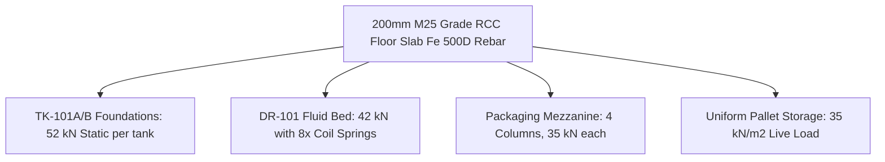

# CIVIL, STRUCTURAL, AND SITE INTERFACE BASIS (15 MT/DAY PLANT)
**Document ID:** ENG-REP-15T-011  
**Revision:** 1.0 | **Date:** 15 October 2026  
**Status:** `PRELIMINARY_CALCULATED` — **WARNING: PRELIMINARY—NOT FOR CONSTRUCTION**  
**Engineering Discipline:** Civil & Structural Engineering  

---

## 1. Civil Building Structure & Superstructure

The processing plant is housed in a modern Pre-Engineered Steel Building (PEB) complying with the National Building Code of India (NBC 2016) and IS 800 (Code of Practice for General Construction in Steel):

| Structural Element | Design Specification | Standards Applied | Structural Purpose |
| :--- | :--- | :--- | :--- |
| **Building Footprint** | $45.0\text{ m Length} \times 20.0\text{ m Clear Span}$ ($900.0\text{ m}^2$) | NBC 2016 Industrial Occupancy | Single-span column-free manufacturing floor |
| **Clear Eaves Height** | $7.50\text{ m}$ to bottom of primary rafter | Factory Act 1948 Ventilation | Accommodates 6.5m elevators and mezzanine |
| **Roof Slope & Material** | 1:10 slope, 0.50mm Zincalume profiled color-coated sheets | IS 875 Part 3 (Wind Load $44\text{ m/s}$) | Rainwater runoff with heavy-duty box gutters |
| **Wall Cladding** | $50\text{ mm}$ insulated Polyurethane Foam (PUF) panels | IS 14203 / Food Hygiene | Thermal insulation ($U \le 0.40\text{ W/m}^2\text{K}$) and washability |
| **Plinth Level** | $+750\text{ mm}$ above finished road crown level | Local Flood Mitigation | Prevents monsoon storm water ingress |

---

## 2. Equipment Base Loading Plan & Floor Slab Engineering

The factory floor slab is engineered to carry both distributed pallet truck traffic and heavy concentrated dynamic equipment footings without cracking:

### Static & Dynamic Equipment Load Breakdown:

| Equipment Tag | Description | Operating Dry Wt (kg) | Operating Liquid/Product (kg) | Total Operating Wt (kg) | Dynamic Load Factor | Total Design Load (kN) | Footprint / Support Details |
| :--- | :--- | :---: | :---: | :---: | :---: | :---: | :--- |
| **HOP-101** | Feed Receiving Hopper | 1,200 | 2,800 | 4,000 | 1.25 | **49.1 kN** | 4 nos baseplate pads ($300 \times 300\text{ mm}$) |
| **EL-101** | Bucket Elevator 1 | 1,800 | 250 | 2,050 | 1.20 | **24.1 kN** | Base foundation pit $+ 2$ wall anchor ties |
| **TK-101A** | Soak Vessel A | 2,100 | 2,530 | 4,630 | 1.35 | **61.3 kN** | 4 nos pipe legs ($15.3\text{ kN}$ per leg) |
| **TK-101B** | Soak Vessel B | 2,100 | 2,530 | 4,630 | 1.35 | **61.3 kN** | 4 nos pipe legs ($15.3\text{ kN}$ per leg) |
| **VS-101** | Vibratory Dewatering Screen | 1,400 | 200 | 1,600 | 2.50 | **39.2 kN** | 4 nos vibration dampeners to floor |
| **DR-101** | Fluid-Bed Dryer & Plenum | 3,800 | 450 | 4,250 | 1.80 | **75.0 kN** | 8 nos coil spring foundation isolators |
| **FN-101** | Fluidizing Blower & Motor | 850 | 0 | 850 | 2.00 | **16.7 kN** | Inertia block foundation ($200\text{ mm}$ thick) |
| **PK-101** | Multihead Weigher & VFFS | 2,200 | 350 | 2,550 | 1.15 | **28.8 kN** | Mezzanine 4-column steel frame |

### Ground Slab Design:
- **Slab Thickness:** $200\text{ mm}$ thick RCC grade M25 ($f_{ck} = 25\text{ N/mm}^2$).
- **Reinforcement:** Top and bottom layers of Fe 500D high-yield deformed steel rebar mesh ($10\text{ mm}$ bars at $150\text{ mm}$ centers both ways).
- **Sub-Base:** $150\text{ mm}$ thick dry lean concrete (DLC) over $200\text{ mm}$ well-compacted granular sub-base (CBR $>15\%$) with $250\mu\text{m}$ heavy-duty polyethylene vapor barrier.

---

## 3. Structural Mezzanines & Maintenance Access

- **Packaging Mezzanine (`MEZZ-101`):** A $6.0\text{ m} \times 6.0\text{ m}$ structural steel mezzanine fabricated from ISMB 300 primary beams and ISMC 150 purlins supports multihead weigher `PK-101` at height $+3.60\text{ m}$. Decking consists of $6.0\text{ mm}$ SS304 checkered safety plate with perimeter kickplates ($150\text{ mm}$ high) and standard $1.05\text{ m}$ twin-rail handrails.
- **Soak Tank Top Platform (`MEZZ-102`):** Continuous elevated catwalk ($1.2\text{ m}$ walkway width) provides safe operator access to manways, sight glasses, CIP nozzles, and radar transmitters of `TK-100` and `TK-101A/B`.

---

## 4. Civil Site Data Inquiry Checklist (Pending Client Site Acquisition)

The exact footing sizes and depth of anchor bolts remain provisional until the following geotechnical parameters are formally delivered:
1. Soil Test Report: Minimum 3 boreholes up to $6.0\text{ m}$ depth confirming Safe Soil Bearing Capacity (SBC $\ge 150\text{ kN/m}^2$ assumed).
2. Water Table: Depth of highest water table during peak monsoon season (affects elevator pit waterproofing).
3. Seismic Zone: Assumed Zone III ($Z = 0.16$) per IS 1893:2016; must be updated if plant is sited in Zone IV or V.
