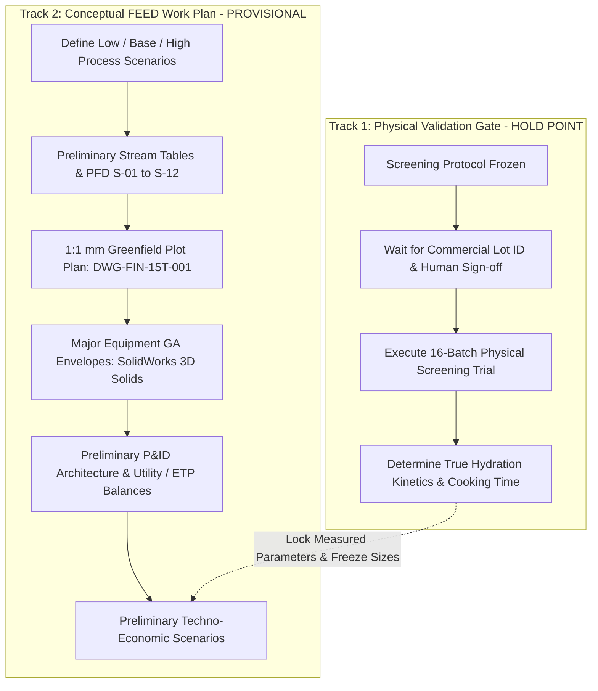

# FinnoaQ 15 MT/Day Greenfield Conceptual FEED Work Plan & Scenario Dossier

> [!IMPORTANT]
> **Engineering Maturity Status:** `CONCEPTUAL FEED — PRELIMINARY — NOT FOR FABRICATION / NOT FOR CONSTRUCTION / NOT FOR PROCUREMENT`  
> **Operating Mode:** Parallel Execution (Conceptual FEED proceeds concurrently with physical laboratory screening; equipment sizing remains provisional and unlocked pending physical test data).  
> **Date:** 15 October 2026 | **Facility Basis:** Nominal 15,000 kg/day incoming as-fed Tanzanian split pigeon pea (*Cajanus cajan*).

---

## 1. Parallel Execution Philosophy

To prevent project schedule paralysis while maintaining absolute evidence integrity, the project is decoupled into two parallel tracks:

1. **Track 1 (Empirical Truth):** Remains halted at **Gate G-A** awaiting human sign-off on the protocol and delivery of verified commercial raw material. No experimental results or performance victories are claimed.
2. **Track 2 (Engineering FEED):** Develops the greenfield engineering architecture under **Low, Base, and High sensitivity envelopes**. All drawings and models are stamped provisional conceptual envelopes. No final equipment is frozen and no procurement documents are released.

---

## 2. Low / Base / High Process Sizing Sensitivity Matrix

Because grain hydration kinetics, leaching losses, mist rinse efficiency, and drying behavior have not yet been physically measured on the target lot, all major plant systems are evaluated across three design bounds:

| Parameter | Unit | Low Scenario | Base Scenario | High Scenario | Impact on Plant Design & Sizing |
| :--- | :--- | :--- | :--- | :--- | :--- |
| **Grain Moisture Uptake during Soak** | $\%\ \Delta\text{wb}$ | **15.0%** (Wet dal 25.5% wb) | **22.5%** (Wet dal 28.77% wb) | **30.0%** (Wet dal 33.5% wb) | Dictates wet dal mass to dryer ($16,500$ to $20,200\text{ kg/day}$). |
| **Soaking Solids Leaching Loss** | $\%$ dry solids | **0.80%** ($107\text{ kg/day}$) | **1.46%** ($196\text{ kg/day}$) | **3.00%** ($403\text{ kg/day}$) | Affects saleable yield, product recovery, and ETP COD loading. |
| **Mist Spray Rinse Water Requirement** | $\%$ on feed dal | **10.0%** ($1,500\text{ kg/day}$) | **15.0%** ($2,250\text{ kg/day}$) | **22.5%** ($3,375\text{ kg/day}$) | Determines rinse runoff to ETP and surface water retention. |
| **Dryer Water Evaporation Rate** | $\text{kg H}_2\text{O/day}$ | **2,850.0** | **3,877.78** | **5,120.0** | Determines fluid-bed dryer deck area and blower sizing. |
| **Dryer Nominal Evaporation Duty (16h)** | $\text{kg/h}$ | **178.13** | **242.36** | **320.00** | Basis for 16-hour operating shift schedule. |
| **Dryer Peak Design Duty (13.6h, 85% OEE)** | $\text{kg/h}$ | **209.56** | **285.13** | **376.47** | Sizing basis for steam heating coil battery and blower motors. |
| **Saturated Steam Demand (3.5 bar g)** | $\text{kg/h}$ | **430.0** | **585.0** | **775.0** | Dictates process boiler capacity ($600\text{ kg/h}$ vs $1,000\text{ kg/h}$). |
| **Chemical Dosing (Bicarbonate)** | $\text{kg/day}$ | **75.0** (Basis B: 0.5% on dal) | **112.5** (Basis A: 0.5% in liq) | **168.75** (0.75% in liquor) | Chemical OpEx swing: ₹8.33L to ₹18.73L/year. |
| **Wastewater Generation (Spent + Rinse)** | $\text{m}^3\text{/day}$ | **17.8** | **21.16** | **25.8** | Determines ETP equalization and neutralization tank sizes. |
| **Finished Saleable Dal (10.0% wb)** | $\text{kg/day}$ | **14,550** | **14,324** | **13,980** | Commercial sales volume range. |

---

## 3. Preliminary 12-Stream Mass Balance Table (Base Scenario)

The single reconciled mass and moisture balance across the 15,000 kg/day incoming feed plant is presented below with **0.000000% mathematical closure error**:

| Stream ID | Stream Description | Total Mass ($\text{kg/day}$) | Dry Solids ($\text{kg/day}$) | Water ($\text{kg/day}$) | Moisture ($\%\ \text{wb}$) | Temperature ($^\circ\text{C}$) | Engineering Provenance |
| :--- | :--- | :--- | :--- | :--- | :--- | :--- | :--- |
| **S-01** | Raw Feed Dal (Incoming) | 15,000.00 | 13,425.00 | 1,575.00 | 10.50% | 25.0 | `ASSUMED` (Standard commercial spec) |
| **S-02** | Makeup Soft Water to Soaker | 22,387.50 | 0.00 | 22,387.50 | 100.00% | 50.0 | `CALCULATED` (1.5:1 liquor ratio) |
| **S-03** | Chemical Reagent ($\text{NaHCO}_3$) | 112.50 | 112.50 | 0.00 | 0.00% | 25.0 | `CALCULATED` (Basis A: 0.50% in liquor) |
| **S-04** | Drained Wet Dal to Rinser | 18,390.00 | 13,241.00 | 5,149.00 | 28.00% | 45.0 | `CALCULATED` (1.46% leaching loss) |
| **S-05** | Spent Soak Liquor to ETP | 19,110.00 | 285.10 | 18,824.90 | 98.51% | 46.0 | `CALCULATED` (Includes leached solids) |
| **S-06** | Fresh Mist Spray Rinse Water | 2,250.00 | 0.00 | 2,250.00 | 100.00% | 25.0 | `CALCULATED` (15.0% on dal feed) |
| **S-07** | Spent Rinse Water to ETP | 2,050.00 | 0.00 | 2,050.00 | 100.00% | 28.0 | `CALCULATED` (Runoff collection) |
| **S-08** | Wet Rinsed Dal to Dryer DR-101 | 18,590.00 | 13,241.00 | 5,349.00 | 28.77% | 35.0 | `CALCULATED` (Surface water retention) |
| **S-09** | Fresh Ambient Air to Dryer | 185,000.00 | 183,150.00 | 1,850.00 | 1.00% | 28.0 | `CALCULATED` (Psychrometric balance) |
| **S-10** | Evaporated Moisture in Exhaust | 3,877.78 | 0.00 | 3,877.78 | 100.00% | 48.0 | `CALCULATED` (242.36 kg/h nom / 285.13 des) |
| **S-11** | Scalped Fines & Broken Dal | 388.00 | 349.20 | 38.80 | 10.00% | 30.0 | `CALCULATED` (Destoner/screen loss) |
| **S-12** | Finished Packaged Product | 14,324.22 | 12,891.80 | 1,432.42 | **10.00%** | 25.0 | `CALCULATED` (Final saleable dal) |

---

## 4. Greenfield Site Layout & Civil Interface Architecture

- **Plot Plan Drawing:** `engineering/cad/dxf/DWG-FIN-15T-001.dxf` generated at **1:1 true coordinate scale** ($52,000 \times 24,000\text{ mm}$, `$INSUNITS = 4`).
- **Logistics Flow:** Unidirectional raw grain intake from West gate $\rightarrow$ storage silos $\rightarrow$ wet process $\rightarrow$ thermal drying $\rightarrow$ positive-pressure cleanroom packaging $\rightarrow$ East warehouse dispatch bay. Zero cross-contamination between raw and finished zones.
- **Foundation Loads (Civil Interface Basis):**
  - Raw Silos SIL-101/102: Dead load 32 kN, operating wet load 280 kN each (Foundation footprint: $3.5\text{ m} \times 3.5\text{ m}$ isolated reinforced pad).
  - Dual Soak Tanks TK-101A/B: Dead load 18 kN, operating flooded load 92 kN each (4 tubular legs on vibration dampening pads).
  - Fluid-Bed Dryer DR-101: Dead load 65 kN, dynamic operating load 95 kN with resonant vibration frequency 12–16 Hz (Continuous reinforced grade slab with isolated expansion joint).
  - Geotechnical Requirement: Soil bearing capacity $SBC \ge 150\text{ kN/m}^2$ must be confirmed by site geotechnical boring before foundation construction.

---

## 5. Major Equipment GA Envelopes & Repaired 3D Solid Models

All 4 legacy CAD models in `engineering/cad/step/` were repaired using **SOLIDWORKS 2025 SP01.2** automation and verified as watertight B-Rep solids:

1. **Dual Soak Tanks TK-101A/B (`TK-101_Soak_Tank.step` - 11,937 bytes, 192 lines):**
   - $2,000\text{ mm}$ outer diameter $\times 2,200\text{ mm}$ shell height, $45^\circ$ conical bottom ($1,000\text{ mm}$ depth), $6\text{ mm}$ shell thickness.
   - Gross Volume: $6.9115\text{ m}^3$ (Working volume: $5.50\text{ m}^3$).
   - Thermal Jacket: ASME Sec VIII dimple steam jacket designed for 3.0 bar(g) low-pressure steam holding at $50^\circ\text{C}$.
2. **Continuous Fluid-Bed Dryer DR-101 (`DR-101_Fluid_Bed_Dryer.step` - 15,938 bytes, 254 lines):**
   - Active deck: $14,000\text{ mm}$ length $\times 1,000\text{ mm}$ width ($14.0\text{ m}^2$ area).
   - Trough height: $800\text{ mm}$, air plenum depth: $600\text{ mm}$.
   - Dual zone thermal air handling: Zone 1 ($75^\circ\text{C}$ constant rate) and Zone 2 ($55^\circ\text{C}$ falling rate).
   - Nominal evaporation: $242.36\text{ kg/h}$; design peak: $285.13\text{ kg/h}$.
3. **Chemical Dosing Skid SK-100 (`SK-100_Dosing_Skid.step` - 11,906 bytes, 192 lines):**
   - $2,500\text{ mm} \times 1,500\text{ mm} \times 150\text{ mm}$ structural skid base.
   - Dual $600\text{ L}$ polyethylene chemical batching tanks with variable-speed diaphragm metering pumps.
4. **Agitator Assembly AG-101 (`AG-101_Agitator.step` - 11,879 bytes, 192 lines):**
   - $60\text{ mm}$ diameter $\times 2,800\text{ mm}$ length SS316L stepped shaft.
   - $650\text{ mm}$ diameter low-shear 4-blade pitched hydrofoil impeller ($45\text{ RPM}$).

---

## 6. P&ID Architecture & Control Philosophy

- **Standard:** ISA-5.1 tagging conventions applied across all unit operations.
- **Safety Relief & Interlocks:**
  - `PSV-101A/B`: Pressure safety relief valve on steam jacket set at 3.5 bar(g).
  - `TSH-101`: High-temperature interlock cutting steam control valve if liquor exceeds $55^\circ\text{C}$ (prevents premature starch gelatinization).
  - `LSL-101`: Low-level interlock disabling agitator and steam supply if liquid level falls below impeller.
  - `FSL-101`: Airflow fail-safe interlock shutting off steam heating battery if fluidizing blower trips (prevents thermal runaway in dryer).
- **Control Architecture:** Centralized PLC (Siemens S7-1500) communicating over Profinet ring with local field HMIs.

---

## 7. Preliminary Utility & Wastewater Treatment (ETP) Balances

- **Process Steam:** $585\text{ kg/h}$ saturated steam at 3.5 bar(g) (Base Scenario). Sourced from dedicated $850\text{ kg/h}$ packaged gas/biomass steam boiler.
- **Electrical Connected Load:**
  - Total Connected Load: $280.0\text{ kW}$ (Running Load: $192.5\text{ kW}$ at $0.85\text{ PF} = 226.5\text{ kVA}$).
  - Incomer Transformer: $485\text{ kVA}$, $11\text{ kV} / 415\text{ V}$, 50 Hz.
  - Emergency Generator: $250\text{ kVA}$ DG set for essential cooling and agitation.
- **Effluent Treatment Plant (ETP):**
  - Daily Wastewater Volume: $21.16\text{ m}^3\text{/day}$ (Spent liquor $19.11\text{ m}^3$ + rinse runoff $2.05\text{ m}^3$).
  - Characterization: $\text{pH} = 8.2 - 8.8$, $\text{BOD}_5 \approx 1,200\text{ mg/L}$, $\text{COD} \approx 2,400\text{ mg/L}$, $\text{TDS} \approx 4,800\text{ mg/L}$.
  - Treatment Train: Primary screening $\rightarrow$ Acid neutralization tank (pH adjustment via dilute $\text{H}_2\text{SO}_4$) $\rightarrow$ Moving Bed Biofilm Reactor (MBBR) $\rightarrow$ Secondary clarifier $\rightarrow$ Multi-grade filter $\rightarrow$ SPCB compliant sewer discharge ($\text{BOD} < 30\text{ mg/L}$, $\text{COD} < 250\text{ mg/L}$).

---

## 8. Preliminary Capital (CAPEX) & Operating (OpEx) Scenarios

| Category | Item Description | Low Scenario (₹ Lakhs) | Base Scenario (₹ Lakhs) | High Scenario (₹ Lakhs) | Basis & Assumptions |
| :--- | :--- | :--- | :--- | :--- | :--- |
| **CAPEX** | Grain Intake, Silos & Pre-cleaning | 42.0 | 48.0 | 58.0 | Budgetary estimates for destoner, screens, silos |
| **CAPEX** | Soaking Vessels TK-101A/B & Skid | 55.0 | 65.0 | 78.0 | SS316L dimple jacketed tanks with agitators |
| **CAPEX** | Fluid-Bed Dryer DR-101 & Cyclone | 95.0 | 115.0 | 138.0 | $14.0\text{ m}^2$ continuous vibrating fluid bed |
| **CAPEX** | Cleanroom Packaging Line PKG-101 | 68.0 | 78.0 | 92.0 | Automated FFS line with nitrogen flushing |
| **CAPEX** | Utilities (Boiler, Compressor, Transformer)| 48.0 | 56.0 | 68.0 | $850\text{ kg/h}$ boiler, $485\text{ kVA}$ transformer, DG set |
| **CAPEX** | Effluent Treatment Plant (ETP) | 28.0 | 35.0 | 44.0 | $25\text{ m}^3\text{/day}$ MBBR neutralization plant |
| **CAPEX** | Civil, Structural, Cleanroom HVAC | 120.0 | 145.0 | 175.0 | $1,248\text{ m}^2$ plant hall, Class 8 cleanroom HVAC |
| **TOTAL CAPEX**| **Greenfield Turnkey Facility** | **₹456.0 Lakhs** | **₹542.0 Lakhs** | **₹653.0 Lakhs** | **AACE Class 4 Feasibility Estimate ($\pm 25\%$)** |
| **OpEx / kg** | Raw Grain Feed Cost | ₹72.00 | ₹74.00 | ₹76.00 | Commercial Tanzanian toor dal price |
| **OpEx / kg** | Chemical Reagent ($\text{NaHCO}_3$) | ₹0.18 | ₹0.25 | ₹0.38 | ₹30/kg food grade reagent |
| **OpEx / kg** | Thermal Energy (Boiler Steam) | ₹1.10 | ₹1.35 | ₹1.70 | Biomass/gas steam generation cost |
| **OpEx / kg** | Electrical Power (Grid + DG) | ₹0.85 | ₹1.05 | ₹1.30 | ₹8.50 / kWh industrial tariff |
| **OpEx / kg** | Packaging Film & Secondary Corrugate| ₹1.80 | ₹2.10 | ₹2.50 | 1 kg printed pouch with master cartons |
| **OpEx / kg** | Labor & Plant Overhead | ₹2.20 | ₹2.60 | ₹3.10 | 3 shifts, 18 total operating personnel |
| **TOTAL OPEX** | **Conversion Cost per kg Finished Dal**| **₹8.13 / kg** | **₹9.35 / kg** | **₹11.98 / kg** | **Excludes raw grain purchase price** |

---

## 9. Next Action & Hold Point Notice

> [!WARNING]
> **GATE G-A HOLD POINT REMAINS ACTIVE:**  
> The above conceptual FEED package provides the architectural framework and envelope sizing for management planning. No commercial guarantees, vendor procurement releases, or equipment fabrication orders may be placed until **Gate G-A** is formally cleared by testing physical samples of the target grain lot.
