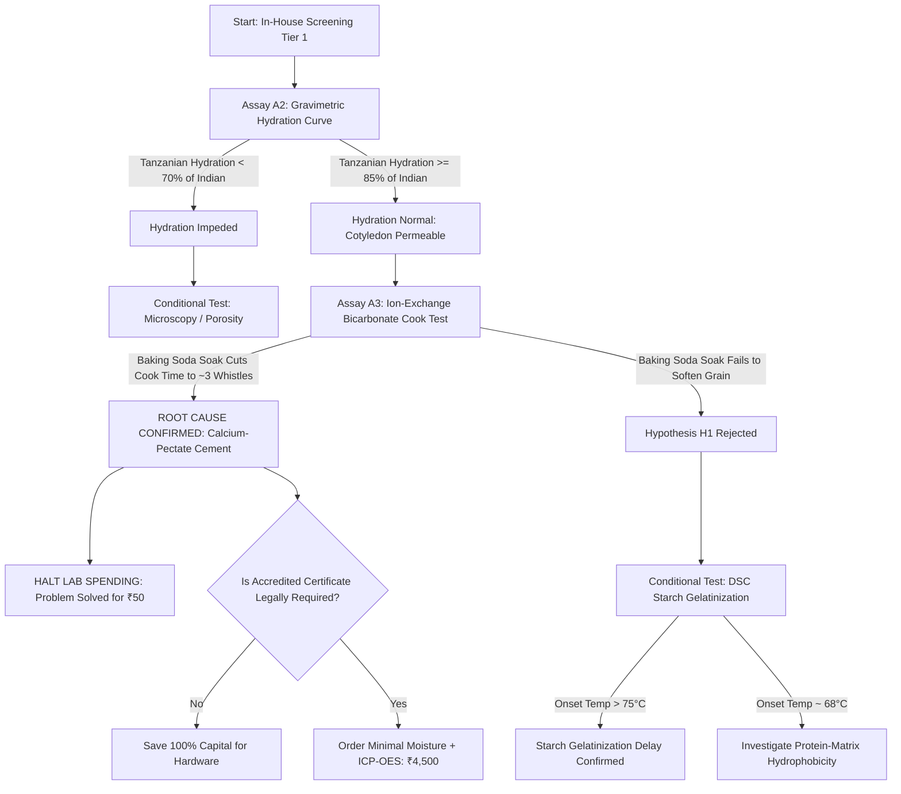

# CONDITIONAL ASSAY DECISION TREE: DECISION-GATED LAB SPENDING

**Project:** FinnoaQ Toor Dal Diagnostic R&D (Phase 1)  
**Objective:** Provide a formal logical decision tree that blocks unnecessary analytical spending.  
**Principle:** An expensive laboratory assay is authorized ONLY if a low-cost screening assay yields an ambiguous result.  

---

## 1. THE LOGICAL DECISION FLOW

---

## 2. CONDITIONAL TRIGGER GATES

### Trigger 1: Hydration Divergence
- **Test:** In-house gravimetric water absorption curve ($M(t)$ at 25°C).
- **Trigger Condition:** If the 4-hour water uptake of Tanzanian dal is within 15% of the Indian benchmark, **IMMEDIATELY CANCEL all outsourced porosity, seed-coat, and SEM microscopy assays (Saving: ₹30,000)**.
- **Scientific Rationale:** If water physically enters the cotyledon, structural pores are open.

### Trigger 2: Ion-Exchange Softening Response
- **Test:** 0.75% Sodium bicarbonate ($\text{NaHCO}_3$) soak followed by boiling.
- **Trigger Condition:** If the pre-treated Tanzanian dal softens in $\le 25\text{ minutes}$ (or $\le 3.5\text{ whistles}$), **IMMEDIATELY CANCEL all outsourced pectin fractionation and HPLC phytic acid assays (Saving: ₹34,000)**.
- **Scientific Rationale:** Cleaving the ionic crosslinks with monovalent $\text{Na}^+$ proves that divalent pectate crosslinking was the sole bottleneck.

### Trigger 3: Failure of Ion-Exchange
- **Trigger Condition:** If and only if the bicarbonate-treated dal still takes $> 45\text{ minutes}$ to soften, authorize:
  1. *Differential Scanning Calorimetry (DSC)* for starch gelatinization enthalpy (Cost: ~₹5,000).
  2. *SDS-PAGE Cotyledon Protein Profiling* (Cost: ~₹6,000).
- **Status:** Currently **BLOCKED / DEFERRED** pending Tier 1 results.
