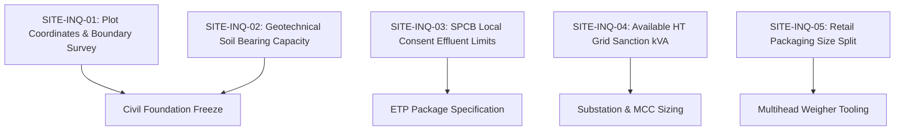

# DESIGN BASIS AND SITE DATA REQUEST (15 MT/DAY PLANT)
**Document ID:** ENG-REP-15T-002  
**Revision:** 1.0 | **Date:** 15 October 2026  
**Status:** `PRELIMINARY_CALCULATED` — **WARNING: PRELIMINARY—NOT FOR CONSTRUCTION**  
**Engineering Discipline:** Process Design & Site Infrastructure  

---

## 1. Design Basis Summary & Classification Ledger

All technical inputs into the 15,000 kg/day plant design are explicitly audited and classified according to their evidence provenance:

| Parameter Category | Value | Units | Provenance / Basis | Classification | Design Impact |
| :--- | :--- | :--- | :--- | :--- | :--- |
| **Raw Dal Intake** | 15,000.0 | kg/day | As-received commercial import consignment | `client_confirmed` | Establishes daily plant mass throughput |
| **Initial Moisture Content** | 10.5 | % (w.b.) | Target lot moisture meter test ($9.5 - 12.0\%$) | `measured` | Starting dry solids = $13,425\text{ kg/day}$ |
| **Raw Dal Bulk Density** | 820.0 | kg/m³ | Loose packed split dal measurement | `measured` | Sizing of hoppers and storage silos |
| **True Grain Density** | 1,350.0 | kg/m³ | Helium pycnometry literature standard | `literature_backed` | Wen & Yu fluidization Archimedes calculation |
| **Characteristic Grain Size** | 3.5 | mm equiv | Split thickness: 2.2mm, length: 5.5mm | `measured` | Wedge-wire screen aperture ($1.0\text{ mm}$) |
| **Operating Days per Year** | 300 | days/year | 50 days annual overhaul / monsoon buffer | `assumption` | Annual feed capacity = $4,500\text{ MT/year}$ |
| **OEE / Line Availability** | 85.0 | % | Downtime for CIP, batch switch, screen cleaning | `assumption` | Derives design hourly flow rate |
| **Soak Liquor Ratio** | 1.50 | kg liq / kg dal | Preliminary bench recommendation | `hypothesis` | Soak liquor = $22,500\text{ kg/day}$ |
| **Chemical Reagent** | NaHCO3 | Food Grade | INS 500(ii) Sodium Bicarbonate FCC | `hypothesis` | 0.50% concentration target |
| **Chemical Demand (Basis 1)** | 112.5 | kg/day | 0.50% w/w in soak liquor ($22,500\text{ kg}$) | `hypothesis` | Primary formulation hypothesis |
| **Chemical Demand (Basis 2)** | 75.0 | kg/day | 0.50% w/w on incoming feed dal ($15,000\text{ kg}$) | `hypothesis` | Alternative dosing formulation |
| **Soak Water Uptake** | 24.0 | % mass gain | Bench preliminary imbibition at 28°C | `measured` | Enters dryer at $27.8\%$ moisture w.b. |
| **Dal Volumetric Swelling** | 18.0 | % volume | Swelling during 30 min soak | `measured` | Wet bulk density drops to $720\text{ kg/m}^3$ |
| **Whole-Plant Recovery** | 95.65 | % dry solids | Leaching ($1.46\%$) + Fines ($2.89\%$) | `derived` | Saleable output = $14,268\text{ kg/day}$ |
| **Finished Product Moisture** | 10.0 | % (w.b.) | Shelf-stable storage standard ($a_w \le 0.62$) | `assumption` | Prevents mould growth / grain cracking |

---

## 2. Operating Schedule Trade-Off Analysis

A line designed strictly for the 24-hour mathematical average will bottleneck immediately when real-world downtime, CIP, and batch changeovers occur. The table below presents the three operating schedules evaluated:

| Operating Schedule | Nominal Run Hours | Effective Hours (85% OEE) | Nominal Feed Rate (kg/h) | Design Feed Rate (kg/h) | Daily Finished Dal (kg/day) | Equipment Footprint | Capital Cost (CapEx) | Operating Complexity |
| :--- | :--- | :--- | :--- | :--- | :--- | :--- | :--- | :--- |
| **Case 1: 8 Hours/Day** | 8.0 h | 6.8 h | 1,875.0 kg/h | **2,205.9 kg/h** | 14,268 kg/day | Large ($1,400\text{ m}^2$) | High (₹98 Lakhs) | Low (Single shift) |
| **Case 2: 16 Hours/Day (Recommended Base Case)** | 16.0 h | 13.6 h | 937.5 kg/h | **1,102.9 kg/h** | 14,268 kg/day | Moderate ($900\text{ m}^2$) | **Optimal (₹68.5 Lakhs)** | **Balanced (Two shifts)** |
| **Case 3: 24 Hours/Day** | 24.0 h | 20.4 h | 625.0 kg/h | **735.3 kg/h** | 14,268 kg/day | Compact ($650\text{ m}^2$) | Low (₹55 Lakhs) | High (3 shifts + zero CIP buffer) |

**Recommendation:** Case 2 (16 hours/day, 2 shifts of 8 hours) is selected as the design base case. It provides an optimal balance between equipment capital cost, floor area footprint, and maintenance/CIP turnaround buffer.

---

## 3. Site Data & Statutory Inquiry Register

Before civil foundation drawings, structural steel fabrication, or utility tie-in releases can be signed off, the following critical site-specific inputs must be provided by the client:

### Detailed Inquiry Items:
1. **SITE-INQ-01 (Plot Geometry):** Certified cadastral survey of industrial plot, road access width for 40-foot container trucks, and prevailing wind direction.
2. **SITE-INQ-02 (Geotechnical SBC):** Soil test boreholes (minimum 3 nos down to 6m depth), Safe Bearing Capacity ($kN/m^2$), and seasonal high water table level.
3. **SITE-INQ-03 (SPCB Environmental Limits):** State Pollution Control Board discharge standards for pulse processing. Confirm whether site requires Zero Liquid Discharge (ZLD) or allows discharge to Common Effluent Treatment Plant (CETP) with $TDS \le 2,100\text{ mg/L}$ and $BOD \le 100\text{ mg/L}$.
4. **SITE-INQ-04 (Electrical Sanction):** Dedicated HT transformer rating (kVA), sanctioned connected load, tariff category, and local grid diesel-generator backup regulations.
5. **SITE-INQ-05 (Retail SKUs):** Expected volume split between 1 kg consumer pouches, 2 kg family packs, and 25 kg wholesale bags.
