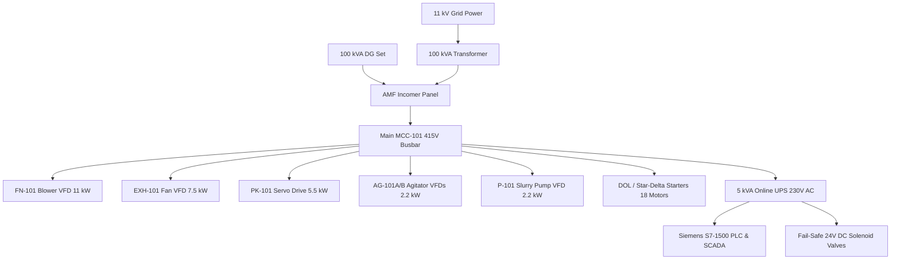

# ELECTRICAL LOAD AND AUTOMATION DESIGN (15 MT/DAY PLANT)
**Document ID:** ENG-REP-15T-010  
**Revision:** 1.0 | **Date:** 15 October 2026  
**Status:** `PRELIMINARY_CALCULATED` — **WARNING: PRELIMINARY—NOT FOR CONSTRUCTION**  
**Engineering Discipline:** Electrical, Instrumentation & Automation Engineering  

---

## 1. Electrical Load Schedule & Transformer Sizing

The plant electrical system is designed for 415 V $\pm 10\%$, 3-phase, 50 Hz, 4-wire supply in accordance with IS 732 and IEC 60364:

| Process Area / Load Group | Tag Count | Total Connected Load (kW) | Demand Factor | Running Operating Load (kW) | Full Load Current (A) |
| :--- | :---: | :---: | :---: | :---: | :---: |
| **Zone 1: Raw Intake & Pre-Cleaning** | 4 motors | 3.37 kW | 0.85 | 2.86 kW | 5.8 A |
| **Zone 2: Wet Chemical Prep & Soaking** | 9 motors | 12.95 kW | 0.65 | 8.42 kW | 17.1 A |
| **Zone 3: Fluid-Bed Drying & Air Handling**| 7 motors | 26.32 kW | 0.82 | 21.58 kW | 43.8 A |
| **Zone 4: Finished Dal & Packaging Line** | 6 motors | 10.05 kW | 0.70 | 7.04 kW | 14.3 A |
| **Zone 5: Utilities, CIP, ETP & Compressor**| 4 motors | 17.00 kW | 0.41 | 6.95 kW | 14.1 A |
| **Plant Lighting, HVAC & Small Power** | Bulk | 5.00 kW | 0.70 | 3.50 kW | 7.1 A |
| **Total Plant Summary** | **31 drives** | **74.69 kW** | **0.63** | **50.35 kW** | **102.2 A** |

### Substation & Power Sizing:
- **Operating Power Factor:** $0.88$ lagging (Automatic Power Factor Correction capacitor bank installed at main incomer).
- **Maximum Operating Apparent Power:** $S = \frac{50.35\text{ kW}}{0.88} = \mathbf{57.22\text{ kVA}}$.
- **Starting Inrush Allowance:** Largest motor is $11.0\text{ kW}$ blower (`FN-101`) driven by VFD (soft start inrush limited to $1.1 \times I_{FLC} = 23.6\text{ A}$).
- **Selected Main Transformer:** **$100\text{ kVA}$ (11 kV / 415 V)** outdoor oil-cooled transformer ($+74.8\%$ future expansion margin).
- **Standby Diesel Generator (DG):** **$100\text{ kVA}$ Silent CPCB-II compliant DG set** with Auto Mains Failure (AMF) panel provides 100% emergency backup within 15 seconds of grid power outage.

---

## 2. Motor Control Center (MCC) & VFD Architecture

The Motor Control Center (`MCC-101`) is located in the clean Electrical Room (Zone 5) and built to IEC 61439 Form 4b segregation:

### VFD Applications (12 drives):
- Precision flow and frequency control implemented via Allen-Bradley PowerFlex 525 or Danfoss FC-102 variable frequency drives.
- All motor power cables from VFDs to field motors are $1000\text{V}$ grade, double-shielded copper with 360° EMC grounding glands to prevent electromagnetic interference with sensitive RTD and load cell instruments.

---

## 3. Automation Hardware Architecture & SCADA

- **Main Controller:** Siemens S7-1500 Modular PLC (CPU 1515-2 PN) with redundant power supply modules.
- **Field Communications:** High-speed Profinet industrial Ethernet bus communicating with distributed ET200SP I/O drops in stainless washdown junction boxes.
- **Field Enclosure Rating:** All field push-button stations, junction boxes, and local isolators in Zone 2 (wet area) are **IP66 SS304** with silicone hygienic door seals.
- **Supervisory SCADA:** Industrial IPC running WinCC Professional with dual 24-inch LED monitors, historical batch logging database, recipe version lock, and password-protected operator privilege tiers (Operator, Supervisor, QA Manager, Maintenance Admin).
- **Uninterruptible Power Supply (UPS):** $5.0\text{ kVA}$ true online double-conversion UPS with 30-minute maintenance-free VRLA battery rack powers the PLC, field instruments, flowmeters, and SCADA servers during grid fluctuations.
