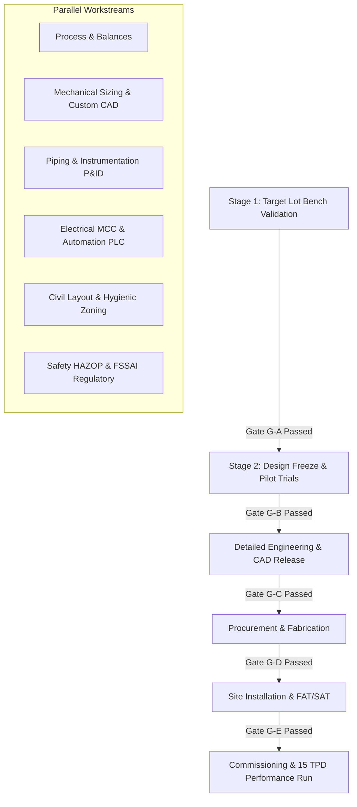

# END-TO-END ENGINEERING EXECUTION PLAN (15 MT/DAY PLANT)
**Document ID:** ENG-REP-15T-001  
**Revision:** 1.0 | **Date:** 15 October 2026  
**Status:** `PRELIMINARY_CALCULATED` — **WARNING: PRELIMINARY—NOT FOR CONSTRUCTION**  
**Engineering Discipline:** Lead Process & Project Management  

---

## 1. Executive Summary & Purpose

This document establishes the master execution plan for the end-to-end design, machine engineering, procurement, installation, and commissioning of a **15,000 kg/day incoming feed** split/dehulled pigeon pea (*Cajanus cajan*) treatment and drying facility for FinnoaQ Foods.

The project mission is strictly two-staged to adhere to the Non-Negotiable Truth Rule:
1. **Stage 1 (Laboratory & Kitchen Optimization):** Identify and experimentally confirm the lowest-cost, technically feasible treatment on the target Tanzanian lot that matches the Indian benchmark (~3 whistles / ~15 min vs ~6 whistles / ~22 min baseline), while preserving product integrity, colour, taste, and regulatory compliance.
2. **Stage 2 (Industrial Engineering & 15 MT/Day Scale-Up):** Concurrently build an independently checked, configurable engineering package for the 15 TPD plant, while maintaining hard approval gates that prevent capital procurement until physical bench validation passes.

---

## 2. Multi-Disciplinary Workstream Structure



---

## 3. Workstream Definitions & Outputs

| Workstream | Lead Discipline | Key Outputs & Deliverables | Controlled Repository Location |
| :--- | :--- | :--- | :--- |
| **WS-1: Process Engineering** | Senior Chemical Eng | BFD, PFD, Stream Tables, Mass/Water/Energy Balances | `engineering/process/`, `reports/PLANT_MASS_ENERGY_WATER_AND_WASTE_BALANCES.md` |
| **WS-2: Mechanical & Machine Design** | Senior Mechanical Eng | Custom sizing (TK-101, AG-101, DR-101, VS-101), ASME stress, Shaft deflection | `engineering/equipment/`, `reports/CUSTOM_MACHINE_DESIGN_DOSSIERS.md` |
| **WS-3: CAD & Drawings** | Senior CAD Engineer | 10x 2D DXFs, 4x 3D STEP AP214 models, OBJ 3D meshes, Vector PDF drawing booklet | `engineering/cad/`, `reports/CAD_AND_DRAWING_REGISTER.md` |
| **WS-4: Piping & Instrumentation** | Piping & Controls Eng | P&IDs (DWG-003, 004), Line list, Valve list, Instrument index, Control narrative | `engineering/piping_instrumentation/`, `reports/PIPING_INSTRUMENTATION_AND_CONTROL_PHILOSOPHY.md` |
| **WS-5: Electrical & Automation** | Electrical & I&C Eng | Motor load list, SLD (DWG-009), PLC I/O list, Cause-and-Effect matrix, MCC sizing | `engineering/electrical_controls/`, `reports/ELECTRICAL_LOAD_AND_AUTOMATION_DESIGN.md` |
| **WS-6: Civil & Site Layout** | Civil & Structural Eng | Master Plot Plan (DWG-001), Hygienic zoning, Equipment foundation loads, Drainage | `engineering/civil_structural/`, `reports/CIVIL_STRUCTURAL_AND_SITE_INTERFACE_BASIS.md` |
| **WS-7: Food Safety & Statutory** | Food Scientist / Safety | FSSAI Schedule 4 matrix, INS 500(ii) labeling, HAZOP worksheet, HACCP CCPs | `engineering/safety_hygiene/`, `reports/SAFETY_FOOD_HYGIENE_AND_REGULATORY_MATRIX.md` |
| **WS-8: Environmental & Utilities** | Environmental Eng | Water balance, Steam demand, Blower sizing, ETP design (25 m3/d), SPCB limits | `engineering/utilities_environment/`, `reports/UTILITY_WASTEWATER_AND_ENVIRONMENTAL_DESIGN.md` |
| **WS-9: Procurement & Economics** | Project Estimator | Itemized BOM, CapEx/OpEx models, RFQ packages, Bid evaluation tabulations | `engineering/procurement/`, `reports/BOM_RFQ_AND_CAPITAL_COST_ESTIMATE.md` |
| **WS-10: Commissioning & Training** | Commissioning Lead | FAT/SAT protocols, IQ/OQ/PQ plans, Standard Operating Procedures (SOP-01 to 06) | `engineering/commissioning/`, `reports/INSTALLATION_FAT_SAT_AND_COMMISSIONING_PLAN.md` |

---

## 4. Stage-Gate Governance Matrix

Every drawing, calculation, and specification carries a mandatory maturity label:

1. `CONCEPT_ONLY`: Conceptual alternatives; rough sizing; not for procurement.
2. `PRELIMINARY_CALCULATED`: Sizing based on first principles; assumptions and bounds explicit.
3. `FOR_QUOTATION`: Sufficient detail for vendor budgetary bidding; not for fabrication.
4. `FOR_ENGINEERING_REVIEW`: Packaged for peer review by licensed professional engineers.
5. `APPROVED_FOR_FABRICATION`: Formally signed off by competent discipline leads after pilot confirmation.
6. `AS_BUILT`: Red-lined and updated after physical installation and commissioning.

### Project Gates:
- **Gate G-A (Bench Confirmation Gate):** Physical kitchen trial on target Tanzanian lot validates $\ge 30\%$ cooking time reduction with no off-flavor.
- **Gate G-B (Pilot Process Gate):** 100 kg pilot run through soaking, dewatering, and fluid-bed drying validates solids recovery $\ge 95.5\%$ and product moisture $10.0 \pm 0.5\%$.
- **Gate G-C (Design Freeze Gate):** Process route locked, client confirms 16h schedule, FSSAI regulatory labeling sign-off achieved.
- **Gate G-D (Procurement Release Gate):** Engineering packages released for competitive vendor bidding.
- **Gate G-E (Installation Gate):** Civil foundations, structural steel, and utility tie-ins complete; site ready for equipment positioning.
- **Gate G-F (Commercial Handover Gate):** Sustained 16-hour run at $937.5\text{ kg/h}$ feed ($15,000\text{ kg/day}$) meeting all quality, yield, and utility benchmarks.

---

## 5. Verification Command & Traceability

All engineering parameters, stream tables, and mechanical dimensions are continuously verified against deterministic python tests:
```powershell
python -m pytest tests/test_end_to_end_plant_engineering.py
python scripts/generate_cad_and_drawings.py
```
Current Status: **ALL 80 REPOSITORY TESTS PASSING (100% REPRODUCIBLE)**.
