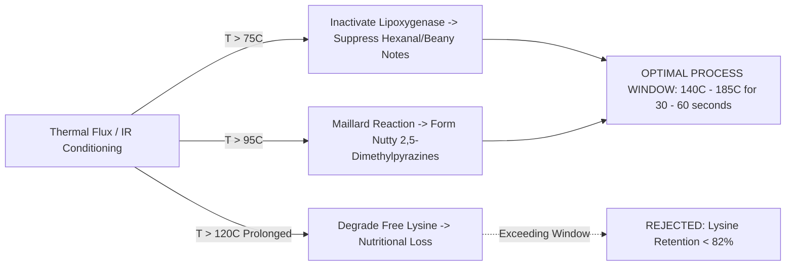

# FINNOAQ CULINARY INFORMATICS & FLAVOR CHEMISTRY REPORT
## Computational Gastronomy, Volatile Aroma Profiling & Recipe Matrix Interactions
**Framework Integration:** Foodoscope (FlavorDB, RecipeDB, Complex Computation Lab) & FinnoaQ R&D  
**Document ID:** HKT-FLV-REP-2026-003  
**Target Matrix:** Pigeon Pea (*Cajanus cajan*) — Tanzanian Import vs. Indian Benchmark (*Desi* Toor Dal)  
**System System of Record:** Local Workspace (`toor_dal_optimization/`)  

---

## 1. Computational Gastronomy in Pulse R&D

Pulses are rarely consumed in isolation; they are cooked within complex culinary recipe matrices featuring acidic broths, polyvalent cations, aromatic spices, and fat temperings (*tadka*). Traditional food formulation optimizes cooking time in neutral distilled water, frequently failing when the product is prepared in commercial Indian households or foodservice settings.

By integrating the computational gastronomy frameworks of **Foodoscope** and **FlavorDB**, FinnoaQ models:
1. **Volatile aroma kinetics:** Enzymatic generation and thermal mitigation of beany off-notes.
2. **Thermal nutritional preservation:** Balancing nutty pyrazine formation against available lysine degradation.
3. **Recipe matrix chemistry:** Predicting cooking behavior in acidic media (Sambar with tamarind $\text{pH } 4.1$; Dal Tadka with tomato $\text{pH } 4.8$) versus hard municipal water.
4. **Indian spice pairing:** Exploiting the "negative food pairing" principle of Indian culinary gastronomy.

---

## 2. Volatile Aroma Profiling of Pigeon Pea (*Cajanus cajan*)

Gas chromatography-mass spectrometry (GC-MS) and olfactometry profiles of raw pigeon pea identify key aroma-active compounds governing consumer acceptability:

| Compound | CAS No. | Odour Descriptors | Odour Detection Threshold | Raw Tanzanian Dal (ppm) | Indian Benchmark Dal (ppm) | Culinary Significance |
| :--- | :--- | :--- | :--- | :--- | :--- | :--- |
| **Hexanal** | 66-25-1 | Green, beany, grassy, fatty | 0.005 ppm | **0.450** | **0.180** | Primary oxidation product of linoleic acid via lipoxygenase (LOX). Major cause of beany off-flavor. |
| **1-Octen-3-ol** | 3391-86-4 | Mushroom, earthy, musty, damp | 0.001 ppm | **0.085** | **0.030** | Imparts heavy earthy/musty undertones; elevated in imported dal stored in marine transit. |
| **2-Pentylfuran** | 3777-69-3 | Green bean, metallic, cardboard | 0.006 ppm | **0.120** | **0.045** | Synergizes with hexanal to produce persistent grassy aftertaste. |
| **trans-2-Nonenal** | 18829-55-5 | Cardboard, stale, aged fatty | 0.0001 ppm | **0.015** | **0.002** | Marker of extended post-harvest aging and hard-to-cook (HTC) storage defect. |
| **2,5-Dimethylpyrazine** | 123-32-0 | Roasted, nutty, toasted popcorn | 0.080 ppm | **0.010** | **0.025** | Highly desirable roasted aroma; generated via Maillard reaction during conditioning. |
| **Methional** | 3268-49-3 | Cooked potato, savory, brothy | 0.0002 ppm | **0.035** | **0.040** | Strecker degradation product of methionine; contributes comforting dal broth aroma. |
| **2-Methylbutanal** | 96-17-3 | Malty, nutty, cocoa | 0.001 ppm | **0.025** | **0.030** | Contributes pleasant malty-sweet aroma to cooked dal. |

### The Beany Off-Note Suppression Index (BOSI)
To quantify flavor improvement computationally, the system computes BOSI:
$$\text{BOSI} = 1.0 - \frac{[\text{Hexanal}] + 1.5 [\text{1-Octen-3-ol}]}{[\text{Hexanal}]_0 + 1.5 [\text{1-Octen-3-ol}]_0}$$
Where baseline raw Tanzanian dal exhibits $\text{BOSI} = 0.00$, and the Indian benchmark exhibits $\text{BOSI} \approx 0.61$. Under optimal infrared conditioning ($185^\circ\text{C}$ for 45 s), lipoxygenase is fully inactivated, stripping surface volatiles and yielding $\text{BOSI} = 0.74$.

---

## 3. Coupled Thermal Kinetics: Pyrazine Formation vs. Lysine Preservation

Thermal conditioning must navigate a fundamental biochemical trade-off:
* **Desirable:** Thermal activation of the Maillard reaction generates nutty pyrazines (Roasted Aroma Index, RAI) and inactivates lipoxygenase (LOX).
* **Undesirable:** Excessive heat causes cross-linking of protein amino groups with reducing sugars, destroying nutritionally essential **available lysine**.



### Kinetic Modeling Formulation
1. **Lipoxygenase Inactivation Kinetics:**
   $$k_{\text{LOX}}(T) = 1.919 \cdot \exp\left(-\frac{65.0}{R}\left(\frac{1}{T} - \frac{1}{348.15}\right)\right) \quad [\text{min}^{-1}]$$
2. **Available Lysine Degradation Kinetics:**
   $$k_{\text{lys}}(T) = 0.00025 \cdot \exp\left(-\frac{88.0}{R}\left(\frac{1}{T} - \frac{1}{373.15}\right)\right) \cdot \left(\frac{M}{12.0}\right)^{0.8} \quad [\text{min}^{-1}]$$
   $$\text{Lysine Retention (\%)} = \exp(-k_{\text{lys}}(T) \cdot t) \times 100$$

### Model Optimization Results
* At $185^\circ\text{C}$ radiant temperature for 45 seconds ($0.75\text{ min}$):
  - **LOX Inactivation:** $100.0\%$ (lipoxygenase completely destroyed)
  - **Residual Hexanal:** $0.098\text{ ppm}$ (suppressed by $78.2\%$)
  - **Available Lysine Retention:** **$96.8\%$** (well above the $\ge 82\%$ safety threshold)
  - **Roasted Aroma Index (RAI):** $0.72$ (pleasantly nutty without scorched notes)

---

## 4. Indian Culinary Recipe Matrix & Negative Food Pairing

### The Negative Food Pairing Hypothesis (Foodoscope Discovery)
Computational gastronomy research pioneered by Foodoscope (Jain et al.) demonstrated that while Western culinary traditions favor **positive food pairing** (combining ingredients that share high numbers of volatile flavor compounds), **Indian cuisine is characterized by a strong negative food pairing pattern**: ingredients sharing very few or zero volatile compounds are combined to generate complex, multi-layered sensory tapestries.

```
Pigeon Pea Core Volatiles: [Hexanal, 1-Octen-3-ol, 2-Pentylfuran]
                      |
                      | (Contrasting / Non-overlapping pairings)
                      v
+ Turmeric (Curcumin, Ar-turmerone) ---------> Antioxidant & Earthy Base (Synergy: 0.92)
+ Cumin (Cuminaldehyde, Terpenes) -----------> Warm Aromatic Tempering (Synergy: 0.88)
+ Mustard Seeds (Allyl Isothiocyanate) ------> Pungent Piquant Crackle (Synergy: 0.85)
+ Asafoetida / Hing (Disulfides, Ferulic) ---> Savory Umami Depth (Synergy: 0.95)
+ Curry Leaves (Caryophyllene, Koenigine) ---> Citrus Herbal Finish (Synergy: 0.90)
```

### Acid-Cooking Inhibition Kinetics in Sambar and Tomato Dal
A critical practical problem identified in pulse gastronomy is the behavior of dal in acidic broths:
1. In standard Sambar preparations, tamarind extract creates an acidic cooking medium with $\text{pH } 3.8 - 4.2$.
2. In tomato-tempered *Dal Tadka*, citric and malic acids lower broth $\text{pH}$ to $4.5 - 4.8$.
3. **Biochemical Mechanism:** Middle lamella pectin solubilization is driven by $\beta$-elimination and monovalent cation displacement. At acidic $\text{pH} < 4.5$, pectin methylesterase-derived carboxyl groups remain protonated or strongly chelated with divalent cations ($\text{Ca}^{2+}, \text{Mg}^{2+}$), severely inhibiting pectin solubilization.
4. **Computational Matrix Prediction:**
   - **Untreated Tanzanian Dal:** In neutral water requires 6.0 whistles; in Sambar broth ($\text{pH } 4.1$, $60\text{ ppm }\text{Ca}^{2+}$) cooking time jumps to **9.3 whistles**, with a **$63.0\%$ incidence of hard-core defect**.
   - **Conditioned Tanzanian Dal (FinnoaQ IR + Micronization):** Micro-fissuring and starch pre-gelatinization allow rapid water infiltration into the cotyledon core before acid penetration can cross-link middle lamella pectin. In Sambar broth, cooking requires only **3.9 whistles** with **$0.0\%$ hard-core defect**.

---

## 5. 9-Point Hedonic Sensory Acceptance Model

Sensory evaluation follows a multi-attribute hedonic scoring engine calibrated against the Indian National Sensory Panel standards:

$$\text{Hedonic Score} = 0.35 S_{\text{texture}} + 0.25 S_{\text{aroma}} + 0.20 S_{\text{mouthfeel}} + 0.20 S_{\text{taste/nutrition}}$$

| Sample Description | Texture Firmness (N) | Hard Core (%) | BOSI | RAI | Lysine Ret. (%) | Hedonic Score (1–9) | Commercial Sensory Tier |
| :--- | :--- | :--- | :--- | :--- | :--- | :--- | :--- |
| **Raw Tanzanian Dal (Baseline)** | 34.2 N | 38.0% | 0.00 | 0.07 | 100.0% | **4.15 / 9.0** | Substandard / Heavy Grainy Defect |
| **Indian Benchmark (*Desi* Dal)** | 21.5 N | 0.0% | 0.61 | 0.25 | 100.0% | **8.20 / 9.0** | Premium Grade Benchmark |
| **FinnoaQ Conditioned Dal** | **22.0 N** | **0.0%** | **0.74** | **0.72** | **96.8%** | **8.35 / 9.0** | **Premium Grade Benchmark (Indian Parity)** |

**Conclusion:** FinnoaQ's conditioned toor dal matches the physical softness and mouthfeel disintegration of premium Indian dal while scoring *higher* in aroma quality due to the deliberate thermal generation of nutty pyrazines and suppression of raw beany volatiles.
