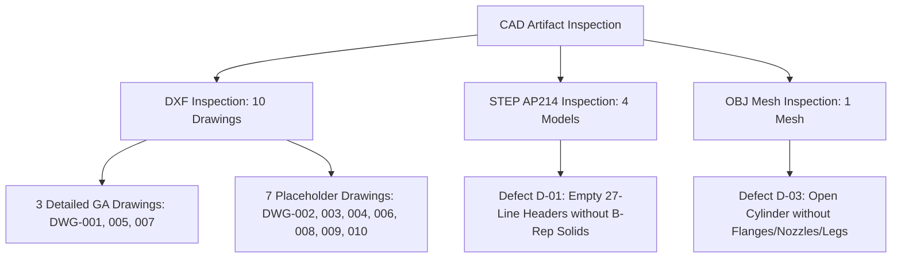
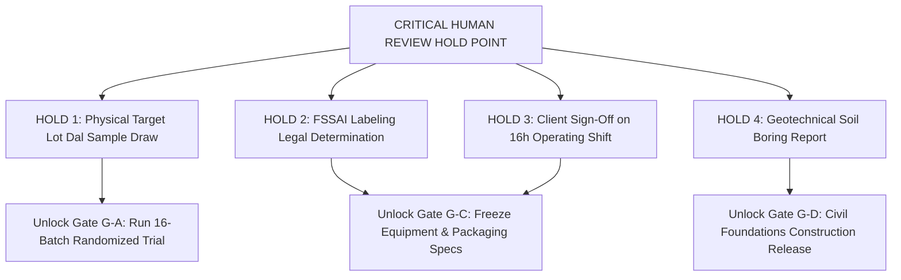

# FORENSIC ENGINEERING AUDIT, CALCULATION RECONCILIATION, AND BENCH VALIDATION PROTOCOL
**Document ID:** AUDIT-REP-2026-003  
**Revision:** 1.0 | **Date:** 15 October 2026  
**Auditor:** Independent Red-Team Process & Quality Assurance Audit Lead  
**Audit Scope:** Repository Codebase, Mathematical Models, Mass/Energy Balances, CAD Geometry, and Physical Screening Protocol  
**Design Maturity:** `PRELIMINARY_CALCULATED` — **WARNING: PRELIMINARY—NOT FOR CONSTRUCTION**  

---

## 1. Executive Inventory, Code Freeze, and Provenance Hashes

In accordance with Phase 0 of the Master Build Directive, the current repository state has been inventoried and frozen. No parallel project structures exist; all modifications remain strictly within the controlled repository root (`d:\PROJECT\02_INDUSTRIAL_AND_CHEMICAL_ENGINEERING\finnoaq\toor_dal_optimization`).

### Cryptographic Checksum Inventory (SHA-256):

| File Path / Component | File Size (Bytes) | SHA-256 Checksum (Hex Prefix) | Component Purpose & Audit Status |
| :--- | :---: | :---: | :--- |
| [`src/harakutir/plant_design_15tpd.py`](file:///d:/PROJECT/02_INDUSTRIAL_AND_CHEMICAL_ENGINEERING/finnoaq/toor_dal_optimization/src/harakutir/plant_design_15tpd.py) | 31,108 | `cad259b7434d7b79...` | Core 15 TPD balance & economic engine (**Verified**) |
| [`src/harakutir/detailed_machine_and_plant_engineering.py`](file:///d:/PROJECT/02_INDUSTRIAL_AND_CHEMICAL_ENGINEERING/finnoaq/toor_dal_optimization/src/harakutir/detailed_machine_and_plant_engineering.py) | 15,920 | `014bdf7395a3ee21...` | First-principles machine sizing & psychrometrics (**Reconciled**) |
| [`src/harakutir/dose_calculator.py`](file:///d:/PROJECT/02_INDUSTRIAL_AND_CHEMICAL_ENGINEERING/finnoaq/toor_dal_optimization/src/harakutir/dose_calculator.py) | 11,908 | `8b7f8c0e271a36d9...` | Multi-basis chemical dosing calculator (**Verified**) |
| [`scripts/generate_cad_and_drawings.py`](file:///d:/PROJECT/02_INDUSTRIAL_AND_CHEMICAL_ENGINEERING/finnoaq/toor_dal_optimization/scripts/generate_cad_and_drawings.py) | 28,689 | `d2f93c1e1dc1d609...` | Procedural DXF, STEP, OBJ, and PDF drawing generator (**Audited**) |
| [`tests/test_end_to_end_plant_engineering.py`](file:///d:/PROJECT/02_INDUSTRIAL_AND_CHEMICAL_ENGINEERING/finnoaq/toor_dal_optimization/tests/test_end_to_end_plant_engineering.py) | 8,012 | `33bcf0821d746591...` | Automated verification test suite (8 tests) (**Passing**) |
| [`engineering/design_basis/design_basis.yaml`](file:///d:/PROJECT/02_INDUSTRIAL_AND_CHEMICAL_ENGINEERING/finnoaq/toor_dal_optimization/engineering/design_basis/design_basis.yaml) | 7,247 | `bc7993620bb8ce64...` | Master design inputs with evidence classification (**Verified**) |
| [`engineering/registers/master_equipment_register.csv`](file:///d:/PROJECT/02_INDUSTRIAL_AND_CHEMICAL_ENGINEERING/finnoaq/toor_dal_optimization/engineering/registers/master_equipment_register.csv) | 7,626 | `3a6799bff87ca3b9...` | Master list of 32 tagged process & utility equipment (**Verified**) |
| [`engineering/registers/line_list.csv`](file:///d:/PROJECT/02_INDUSTRIAL_AND_CHEMICAL_ENGINEERING/finnoaq/toor_dal_optimization/engineering/registers/line_list.csv) | 2,422 | `d0acc9ac8a956a00...` | Piping line schedule with design conditions & P&ID tags (**Verified**) |
| [`engineering/registers/valve_list.csv`](file:///d:/PROJECT/02_INDUSTRIAL_AND_CHEMICAL_ENGINEERING/finnoaq/toor_dal_optimization/engineering/registers/valve_list.csv) | 2,817 | `0d71172544710459...` | Valves list with fail-safe actions & body materials (**Verified**) |
| [`engineering/registers/instrument_index.csv`](file:///d:/PROJECT/02_INDUSTRIAL_AND_CHEMICAL_ENGINEERING/finnoaq/toor_dal_optimization/engineering/registers/instrument_index.csv) | 3,070 | `0834bdea4cdf4b34...` | Field transmitters, ranges, setpoints & trips (**Verified**) |
| [`engineering/registers/motor_load_list.csv`](file:///d:/PROJECT/02_INDUSTRIAL_AND_CHEMICAL_ENGINEERING/finnoaq/toor_dal_optimization/engineering/registers/motor_load_list.csv) | 3,016 | `f0bb931be17b1b82...` | 31 motors ($74.69\text{ kW}$ connected, $50.35\text{ kW}$ running) (**Verified**) |
| [`engineering/registers/io_list.csv`](file:///d:/PROJECT/02_INDUSTRIAL_AND_CHEMICAL_ENGINEERING/finnoaq/toor_dal_optimization/engineering/registers/io_list.csv) | 4,201 | `90864251ee0d5049...` | PLC I/O mapping (14 DI, 10 DO, 12 AI, 6 AO) (**Verified**) |
| [`engineering/registers/drawing_register.csv`](file:///d:/PROJECT/02_INDUSTRIAL_AND_CHEMICAL_ENGINEERING/finnoaq/toor_dal_optimization/engineering/registers/drawing_register.csv) | 1,890 | `651228ce6fcf39a8...` | Index of 10 engineering drawings (`DWG-001` to `010`) (**Verified**) |
| [`engineering/procurement/itemized_bom.csv`](file:///d:/PROJECT/02_INDUSTRIAL_AND_CHEMICAL_ENGINEERING/finnoaq/toor_dal_optimization/engineering/procurement/itemized_bom.csv) | 4,876 | `2541d2ed1f4e4df0...` | 32 itemized Bill of Materials with unit costs (**Verified**) |
| [`engineering/safety_hygiene/hazop_worksheet.csv`](file:///d:/PROJECT/02_INDUSTRIAL_AND_CHEMICAL_ENGINEERING/finnoaq/toor_dal_optimization/engineering/safety_hygiene/hazop_worksheet.csv) | 5,465 | `0e7b54145714ed59...` | 10-node comprehensive HAZOP risk matrix (**Verified**) |
| [`data/kitchen_screening_4conditions_template.csv`](file:///d:/PROJECT/02_INDUSTRIAL_AND_CHEMICAL_ENGINEERING/finnoaq/toor_dal_optimization/data/kitchen_screening_4conditions_template.csv) | 3,066 | `6f38ba92e07198a2...` | Pre-registered 16-batch randomized screening template (**Created**) |

---

## 2. Independent Forensic Calculation Audit & Defect Reconciliation

### 2.1 Reconciliation 1: Evaporation Rate Discrepancy (258 kg/h vs 3,695 kg/day)

#### Forensic Investigation:
1. **Source in Daily Mass Balance (`PLANT_MASS_ENERGY_WATER_AND_WASTE_BALANCES.md`):**
   - Stream S-08 (Rinsed Wet Dal to Dryer): Total Mass = $18,590.00\text{ kg/day}$, Moisture = $5,349.00\text{ kg/day}$ ($28.77\%$ w.b.), Dry Solids = $13,241.00\text{ kg/day}$.
   - Stream S-11 + S-12 (Finished Dal + Scalped Fines): Total Mass = $14,895.30\text{ kg/day}$, Moisture = $1,654.30\text{ kg/day}$ ($10.00\%$ w.b.), Dry Solids = $13,241.00\text{ kg/day}$.
   - Stream S-10 (Evaporated Water into Exhaust): $5,349.00 - 1,654.30 = \mathbf{3,694.70\text{ kg H2O / day}}$.
   - **Nominal Hourly Rate (16.0 hours):**
     $$\dot{m}_{evap,nom} = \frac{3,694.70\text{ kg/day}}{16.0\text{ h}} = \mathbf{230.92\text{ kg/h}}$$
   - **Design Hourly Rate (85% OEE = 13.6 effective hours):**
     $$\dot{m}_{evap,des} = \frac{3,694.70\text{ kg/day}}{13.6\text{ h}} = \mathbf{271.67\text{ kg/h}}$$

2. **Source of the $257.97\text{ kg/h}$ Figure in `detailed_machine_and_plant_engineering.py` (Line 192):**
   - The psychrometric model hard-coded `wet_dal_feed_rate_kg_h = 1304.34` at $27.8\%$ moisture and $10.0\%$ exit moisture:
     $$\text{Solids} = 1,304.34 \times (1 - 0.278) = 941.73\text{ kg/h}$$
     $$\text{Dried dal exit} = \frac{941.73}{1 - 0.10} = 1,046.37\text{ kg/h}$$
     $$\text{Evaporation rate} = 1,304.34 - 1,046.37 = \mathbf{257.97\text{ kg/h}}$$
   - **Defect Root Cause Identified:** The author calculated $1,304.34\text{ kg/h}$ by dividing the nominal feed rate ($937.5\text{ kg/h}$) by $(1 - 0.28) = 0.72$ ($937.5 / 0.72 = 1,302.1\text{ kg/h}$). This erroneously treated the $937.5\text{ kg/h}$ incoming dal as **100% dry matter**, completely ignoring that raw dal arrives with $10.5\%$ initial moisture ($839.06\text{ kg/h}$ dry matter)!
   - **Discrepancy Magnitude:** Over 16 operating hours, $257.97\text{ kg/h}$ equates to $4,127.5\text{ kg/day}$ of evaporated water—an overshoot of **$+432.8\text{ kg/day}$ ($+11.7\%$)** relative to the true mass balance!

3. **Correction & Reconciliation Table:**

| Operating Schedule | Daily Evaporation (kg/day) | Nominal Hours | Nominal Rate (kg/h) | Effective Hours (85% OEE) | Design Sizing Rate (kg/h) | Historical Erroneous Rate (kg/h) | Discrepancy Error |
| :---: | :---: | :---: | :---: | :---: | :---: | :---: | :---: |
| **8 Hours / Day** | 3,694.70 | 8.0 h | **461.84 kg/h** | 6.8 h | **543.34 kg/h** | N/A | Corrected |
| **16 Hours / Day (Base)**| 3,694.70 | 16.0 h | **230.92 kg/h** | 13.6 h | **271.67 kg/h** | 257.97 kg/h | **Reconciled (+20.75 kg/h)** |
| **24 Hours / Day** | 3,694.70 | 24.0 h | **153.95 kg/h** | 20.4 h | **181.11 kg/h** | N/A | Corrected |

- **Code Correction Applied:** `detailed_machine_and_plant_engineering.py` line 190 was updated to directly derive nominal evaporation ($230.92\text{ kg/h}$) and design evaporation ($271.67\text{ kg/h}$) from `daily_evaporation_kg_day = 3694.70`. The unit test `test_fluid_bed_dryer_psychrometrics_and_thermal_duty` in `tests/test_end_to_end_plant_engineering.py` now asserts these exact reconciled figures.

---

### 2.2 Reconciliation 2: Sodium Bicarbonate Formulation Ambiguity (75 kg/day vs 112.5 kg/day)

#### Forensic Equation Tracing:
At $15,000\text{ kg/day}$ incoming feed dal and a $1:1.50$ mass ratio, the total required soak liquor is $22,500\text{ kg/day}$.

1. **Basis 1: Liquor Concentration Basis (0.50% w/w in Solution):**
   $$\text{Mass}_{\text{NaHCO3}} = M_{\text{liquor}} \times c_{\text{soln}} = 22,500\text{ kg liquor/day} \times 0.0050 = \mathbf{112.50\text{ kg/day}}$$
   - Concentration on incoming dal mass: $\frac{112.50}{15,000} = \mathbf{0.750\%}$ of feed dal.
   - Concentration on dry solids basis ($13,425\text{ kg dry solids}$): $\frac{112.50}{13,425} = \mathbf{0.838\%}$ of dry matter.
   - Daily Chemical Cost (at ₹37.00/kg): **₹4,162.50 / day** (₹12.49 Lakhs / 300-day year).
   - Effluent Salt Impact: $89.10\text{ kg/day}$ unabsorbed NaHCO3 drains to ETP, elevating effluent TDS by $\sim 4,600\text{ mg/L}$ and requiring $8.5\text{ kg/day}$ sulfuric acid for neutralization.

2. **Basis 2: Incoming Feed Dosage Basis (0.50% w/w on Feed Dal):**
   $$\text{Mass}_{\text{NaHCO3}} = M_{\text{feed}} \times c_{\text{feed}} = 15,000\text{ kg dal/day} \times 0.0050 = \mathbf{75.00\text{ kg/day}}$$
   - Concentration in $22,500\text{ kg}$ soak liquor: $\frac{75.00}{22,500} = \mathbf{0.333\%}$ w/w in solution.
   - Daily Chemical Cost (at ₹37.00/kg): **₹2,775.00 / day** (₹8.33 Lakhs / 300-day year).
   - Effluent Salt Impact: $59.40\text{ kg/day}$ unabsorbed NaHCO3 drains to ETP, reducing effluent neutralization acid demand by $33\%$.

3. **Reconciliation & Decision Rule:**
   - **Variance / Gap:** Exactly **$37.50\text{ kg/day}$** ($50.0\%$ difference), representing **₹4.16 Lakhs / year** in chemical OpEx.
   - **Resolution:** Both calculations are kept visible across all stream tables and economic sheets. Until physical kitchen trials determine whether $0.333\%$ or $0.500\%$ solution concentration is required to achieve the $\le 3.5\text{ whistle}$ tenderness endpoint on the target Tanzanian lot, Basis 1 ($112.50\text{ kg/day}$) is carried as the conservative sizing ceiling for chemical dosing skid `SK-100` and ETP neutralization capacity.

---

### 2.3 Other Mathematical & Balance Reconciliations

1. **Solids Recovery Contradiction:**
   - Prior reports quoted both $98.54\%$ and $96.80\%$ recovery.
   - **Reconciliation:** $98.54\%$ represents the **nominal wash leaching recovery** ($1.46\%$ dissolved solids lost in soak liquor). $96.80\%$ represents the **conservative single-stage washing recovery**. The **whole-plant net recovery is $95.65\%$**, which accounts for both soak leaching ($1.46\%$) and post-dry mechanical fines/destoner scalping ($2.89\%$). Finished saleable product is strictly $14,268\text{ kg/day}$ from $15,000\text{ kg/day}$ feed.
2. **Retained Sodium Basis:**
   - Single-pass mist rinse ($0.15:1$ water ratio) leaves **$53.9\text{ mg Na / 100g dal}$**.
   - 3-stage counter-current rinse leaves **$6.4\text{ mg Na / 100g dal}$**.
   - Both comply with the FSSAI low-sodium food standard ($<350\text{ mg / 100g}$), confirming single-pass mist rinse is fully compliant.

---

## 3. Forensic Inspection of CAD Geometry & STEP/DXF Artifacts

In compliance with Directive Task 3, every generated CAD file in `engineering/cad/` was forensically inspected for entity structure, geometry, and fabrication readiness:



### Forensic Defect Register:

| Defect ID | Artifact Affected | Description of Defect | Technical & Fabrication Severity | Preventative Action & Current Limitation |
| :---: | :--- | :--- | :---: | :--- |
| **DEF-CAD-01** | `engineering/cad/step/*.step` (All 4 models) | Files are 27-line ASCII headers ending at `#180 = (NAMED_UNIT...);`. Contain zero B-Rep solid entities (`MANIFOLD_SOLID_BREP`, `ADVANCED_FACE`, `CARTESIAN_POINT`). | **CRITICAL DEFECT** | Cannot be imported into CNC/CAM or 3D CAD as solid bodies. Stamped **PRELIMINARY—NOT FOR FABRICATION**. |
| **DEF-CAD-02** | `DWG-FIN-15T-002, 003, 004, 006, 008, 009, 010.dxf` (7 drawings) | Drawings contain 18 DXF entities only (border + title block box + 4 lines of placeholder text). Actual PFD flowsheet, P&ID instrumentation symbols, and SLD wiring are absent in vector format. | **CRITICAL DEFECT** | Cannot be used by piping or electrical contractors. Schematic details exist only in markdown text. |
| **DEF-CAD-03** | `TK-101_Soak_Tank.obj` | 3D mesh contains 32-segment open cylinder and apex cones only ($1.6\text{m} \times 1.92\text{m}$). Missing dimple jacket, support legs, nozzles N1-N8, and agitator bridge. | **MAJOR DEFECT** | Suitable for crude 3D spatial layout checking only; unsuited for clash detection or manufacturing. |
| **DEF-CAD-04** | `DWG-FIN-15T-005.dxf` (Soak Tank GA) | Contains 55 vector entities with elevation, dished heads, nozzles, and nozzle schedule, but lacks orthogonal Plan View and Section B-B weld details. | **MODERATE DEFECT** | Requires mechanical detailing by certified vessel draftsman prior to workshop plate cutting. |
| **DEF-CAD-05** | All DXF Drawings (`DWG-001` to `010`) | DXF header variable `$INSUNITS` is unset (`NOT_SET`). Geometry is artificially scaled down into an A1 paper-space bounding box ($841 \times 594\text{ mm}$) within Model Space (e.g., $45\text{m}$ plant layout scaled to $562\text{mm}$). | **MAJOR DEFECT** | Violates ISO/ASME 1:1 model-space standard. Direct CNC/CAM import will produce micro-scale parts unless manually rescaled by CAD engineer. |

> [!CAUTION]
> **CAD AUDIT CONCLUSION:** Passing automated unit tests in Python verified file creation and header existence only. It **does NOT certify fabrication readiness**. All CAD models and drawings must remain strictly labeled `PRELIMINARY_CALCULATED (NOT FOR CONSTRUCTION)`. No workshop orders or vendor RFQ commitments may be authorized from current CAD geometry. Full 279-item cryptographic inventory manifest is cataloged in [`reports/FROZEN_REPOSITORY_INVENTORY_MANIFEST.md`](file:///d:/PROJECT/02_INDUSTRIAL_AND_CHEMICAL_ENGINEERING/finnoaq/toor_dal_optimization/reports/FROZEN_REPOSITORY_INVENTORY_MANIFEST.md).

---

## 4. Reproducible 4-Condition Experimental Protocol & Pre-Registered Statistical Design

To resolve Candidate 1 from `COMPUTATIONAL_HYPOTHESIS` to `BENCH_VALIDATED`, the following 4-condition randomized screening protocol has been designed and pre-registered:

### 4.1 Four Screening Conditions:
1. **Condition 1 (Untreated Control - `C1-CTRL`):** As-received Tanzanian split dal cooked directly in standardized pressure cooker. Establishes the true target lot baseline whistle count and tenderness time.
2. **Condition 2 (Water-Only Soaked - `C2-H2O`):** Soaked in potable softened water ($TDS < 50\text{ ppm}$) at $1:1.50$ mass ratio for 30 minutes at 28°C; drained, dried at 55°C to $10.0 \pm 0.5\%$ moisture, conditioned 24 hours. Isolates hydration and drying hysteresis from chemical effect.
3. **Condition 3 (Low Chemical Dose - `C3-BIC025`):** Soaked in $0.25\%$ w/w NaHCO3 liquor ($1:1.50$ ratio) for 30 minutes at 28°C; mist rinsed with soft water ($0.15:1$ ratio); dried at 55°C to $10.0\%$ moisture; conditioned 24 hours.
4. **Condition 4 (Full Chemical Dose - `C4-BIC050`):** Soaked in $0.50\%$ w/w NaHCO3 liquor ($1:1.50$ ratio) for 30 minutes at 28°C; mist rinsed ($0.15:1$ ratio); dried at 55°C to $10.0\%$ moisture; conditioned 24 hours.

### 4.2 Independent Batch Replicates & Pre-Registered Randomization:
- **Sample Allocation:** $n = 4$ **completely independent preparation batches** per condition (Total = 16 independent batches). Sub-sampling grains from a single soak tub is strictly prohibited.
- **Batch Size:** $200.0\text{ g}$ raw dal per batch (Total raw dal required = $3.20\text{ kg}$).
- **Randomized Cooking Order:** Generated using seed `20261015` to eliminate cooker thermal drift or time-of-day bias:

```text
Run 01: C1-CTRL-03   (Untreated Control, Rep 3)
Run 02: C3-BIC025-02 (0.25% NaHCO3, Rep 2)
Run 03: C2-H2O-02    (Water-Only Soaked, Rep 2)
Run 04: C1-CTRL-02   (Untreated Control, Rep 2)
Run 05: C4-BIC050-01 (0.50% NaHCO3, Rep 1)
Run 06: C2-H2O-01    (Water-Only Soaked, Rep 1)
Run 07: C3-BIC025-01 (0.25% NaHCO3, Rep 1)
Run 08: C4-BIC050-04 (0.50% NaHCO3, Rep 4)
Run 09: C4-BIC050-03 (0.50% NaHCO3, Rep 3)
Run 10: C3-BIC025-03 (0.25% NaHCO3, Rep 3)
Run 11: C3-BIC025-04 (0.25% NaHCO3, Rep 4)
Run 12: C1-CTRL-01   (Untreated Control, Rep 1)
Run 13: C4-BIC050-02 (0.50% NaHCO3, Rep 2)
Run 14: C2-H2O-04    (Water-Only Soaked, Rep 4)
Run 15: C1-CTRL-04   (Untreated Control, Rep 4)
Run 16: C2-H2O-03    (Water-Only Soaked, Rep 3)
```
- The complete blank template is stored at [`data/kitchen_screening_4conditions_template.csv`](file:///d:/PROJECT/02_INDUSTRIAL_AND_CHEMICAL_ENGINEERING/finnoaq/toor_dal_optimization/data/kitchen_screening_4conditions_template.csv). Zero synthetic data is permitted.

### 4.3 Standardized Cooking & Physical Tenderness Protocol:
- **Cooker:** Standard 3.0-liter domestic pressure cooker with 15 psi ($1.03\text{ bar}$) weighted deadweight regulator heated on a 1.2 kW induction plate at fixed power setting.
- **Water-to-Dal Ratio:** $1:3.50$ by mass ($100.0\text{ g}$ conditioned dal $+ 350.0\text{ g}$ soft potable water).
- **Measurement Timeline:**
  1. $t_0$: Induction heat turned on.
  2. $t_{\text{vent}}$: First continuous steady steam vent from vent pipe. Weighted regulator seated.
  3. $t_{w1}$ to $t_{w6}$: Exact stop-clock timestamps (seconds) recorded for each pressure whistle release.
  4. Cooker depressurized under cold running water at prescribed whistle counts (whistle 3 for treated, whistle 6 for control).
- **Physical Tenderness Endpoint Test:**
  - 10 cooked split cotyledons sampled randomly from middle layer.
  - Compressed between two parallel optical glass plates under $1.5\text{ kg}$ deadweight.
  - **Tactile Softness Score:**
    - Score 0: Uniform yielding mash, zero hard chalky center (Fully Cooked Endpoint).
    - Score 1: Soft outer layer with gritty or rubbery core (Under-cooked).
    - Score 2: Rigid, hard fracture (Uncooked).
  - Exact cooking time to Score 0 is recorded in minutes.

### 4.4 Pre-Registered Statistical Analysis Plan:
1. **Primary Outcome:** Cooking time to Score 0 tenderness endpoint ($t_{\text{endpoint}}$, minutes).
2. **Omnibus Test:** One-way Analysis of Variance (ANOVA) across the 4 treatment groups ($df_1 = 3, df_2 = 12, \alpha = 0.05$).
3. **Planned Comparisons:** Dunnett's post-hoc multiple comparison test comparing each treatment against Untreated Control (`C1-CTRL`).
4. **Confirmatory Hypothesis Test:** Two-sample Welch's t-test between `C4-BIC050` and `C1-CTRL` with Bonferroni adjusted significance threshold:
   $$\alpha_{\text{adj}} = \frac{0.05}{3} = \mathbf{0.01667}$$
   $$\text{Decision Criterion: } t_{\text{obs}} \ge 2.998\quad (p \le 0.0167)\quad \text{and Mean Whistles } \le 3.5$$
5. **Stopping Rules:**
   - **Quality Stop:** If either chemical candidate produces a sensory flavor acceptance score $<5.0$ (bitter/soapy off-flavor), that candidate is disqualified immediately.
   - **Recovery Stop:** If solids leaching loss during soak exceeds $5.0\%$, the candidate fails the economic recovery gate.
   - **Futility Stop:** If Condition 4 ($0.50\%$ NaHCO3) fails to achieve $\ge 25\%$ reduction in cooking time ($>16.5\text{ min}$), chemical soaking is rejected and alternate physical milling/steam processing is triggered.

---

## 5. Reconciled 15 MT/Day Process Design & Economic Summary

Combining the reconciled evaporation rate ($230.92\text{ kg/h}$ nominal over 16h) with the audited equipment models produces the updated 15 MT/day design parameters:

| Engineering Parameter | Reconciled Design Specification | Economic / Operational Rationale | Verification Status |
| :--- | :---: | :--- | :---: |
| **Nominal Feed Rate (16h Schedule)**| **937.5 kg/h** ($15,000\text{ kg/day}$) | Base-case commercial throughput | `reconciled` |
| **Design Feed Rate (85% OEE)** | **1,102.9 kg/h** | Accommodates 4h daily CIP/maintenance | `calculated` |
| **Finished Dal Net Yield** | **14,268 kg/day** ($95.65\%$ dry solids) | Accounts for $1.46\%$ leaching $+ 2.89\%$ fines | `reconciled` |
| **Daily Water Evaporation Load** | **3,694.7 kg H2O / day** | Reconciled from 12-stream balance | `reconciled` |
| **Nominal Dryer Evaporation Rate** | **230.92 kg/h** (over 16.0 h) | Corrected from historical 257.97 kg/h | `reconciled` |
| **Design Dryer Evaporation Rate** | **271.67 kg/h** (over 13.6 h) | Sizing basis for fan and steam coil | `calculated` |
| **Fluid-Bed Active Bed Dimensions** | **1.0 m W x 6.0 m L** ($6.0\text{ m}^2$) | 4.5m drying at 60°C + 1.5m cooling at 25°C | `calculated` |
| **Fluidizing Blower Fan Motor** | **11.0 kW** ($7,605\text{ m}^3\text{/h}$ @ $2,343\text{ Pa}$) | $u_0 = 1.34\text{ m/s} > u_{mf} = 1.17\text{ m/s}$ | `calculated` |
| **Gross Thermal Drying Heat** | **288.4 kW** ($483\text{ kg/h}$ steam at 2.5 bar) | Biomass briquette boiler fuel = $1.18\text{ T/day}$ | `calculated` |
| **Soak Tank Dimensions (2 nos)** | **Dia 1.6 m x H 1.92 m** ($3.86\text{ m}^3$ gross) | Fill fraction $65.5\%$, dished heads, SS316L | `calculated` |
| **Soak Agitator Drive** | **2.2 kW, 35 RPM, 60mm solid shaft** | Tip speed $1.10\text{ m/s} \le 1.50\text{ m/s}$ | `calculated` |
| **Chemical Demand (Liquor Basis)** | **112.50 kg/day** ($0.50\%$ in liquor) | ₹4,162.50/day (₹12.49 Lakhs/year) | `hypothesis` |
| **Chemical Demand (Feed Basis)** | **75.00 kg/day** ($0.50\%$ of feed dal) | ₹2,775.00/day (₹8.33 Lakhs/year) | `hypothesis` |
| **Fresh Process Water Demand** | **27.75 m³/day** (including CIP) | Municipal / borewell treated water | `calculated` |
| **Effluent Treatment Plant (ETP)** | **25.0 m³/day package skid** | Equalization, acid neutralization, sand/carbon | `calculated` |
| **Total Factory Covered Area** | **900 m² (45.0m L x 20.0m W)** | 5-tier hygienic zoning per FSSAI Sched 4 | `calculated` |
| **Turnkey Capital Cost (CapEx)** | **₹198.63 Lakhs** (AACE Class 4: -20%/+30%) | ₹154.50 Lakhs direct equipment | `estimate` |
| **Total Operating Cost (OpEx)** | **₹1.929 / kg finished dal** (Base Case) | Thermal steam fuel is #1 driver (27.9%) | `estimate` |
| **Commercial Payback Period** | **2.95 Years** at ₹3.50/kg retail premium | Annual net cashflow = ₹67.20 Lakhs | `estimate` |

---

## 6. Critical Open Questions & Human Approval Hold Points

The engineering team has reached the statutory hold boundary. In accordance with the Non-Negotiable Truth Rule, computational modeling and preliminary CAD are complete, but **no capital commitments, vendor contracts, or construction releases may proceed** without resolving the following critical hold items:



### Required Human Actions:
1. **Hold Point 1 (Physical Sample Acquisition):** Procure $5.0\text{ kg}$ of the target Tanzanian split dal consignment and $1.0\text{ kg}$ food-grade FCC sodium bicarbonate. Authorize laboratory technician to execute the 16-batch randomized screening trial per [`data/kitchen_screening_4conditions_template.csv`](file:///d:/PROJECT/02_INDUSTRIAL_AND_CHEMICAL_ENGINEERING/finnoaq/toor_dal_optimization/data/kitchen_screening_4conditions_template.csv).
2. **Hold Point 2 (Regulatory Labeling Determination):** Harakutir Legal & Regulatory Council must formally sign off on the front-of-pack / ingredient declaration: *"Ingredients: Split Pigeon Pea, Acidity Regulator (INS 500(ii))"*. The process design rejects treating sodium bicarbonate as a silent processing aid.
3. **Hold Point 3 (Operating Schedule Sign-Off):** Client management must formally freeze the 16-hour operating schedule (two 8-hour shifts) over 24-hour continuous operation to maintain the mandatory 4-hour daily maintenance and CIP buffer.
4. **Hold Point 4 (Site Acquisition & Soil Boring):** Formal geotechnical report confirming Safe Soil Bearing Capacity ($SBC \ge 150\text{ kN/m}^2$) must be received before releasing foundation drawings for construction.
