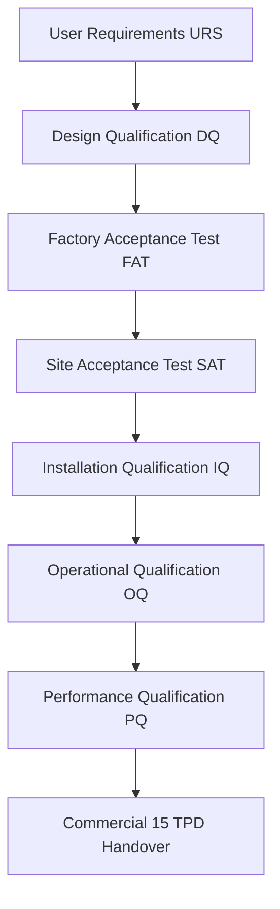

# INSTALLATION, FAT, SAT, AND COMMISSIONING PLAN (15 MT/DAY PLANT)
**Document ID:** ENG-REP-15T-015  
**Revision:** 1.0 | **Date:** 15 October 2026  
**Status:** `PRELIMINARY_CALCULATED` — **WARNING: PRELIMINARY—NOT FOR CONSTRUCTION**  
**Engineering Discipline:** Commissioning, Quality Assurance & Validation  

---

## 1. Quality Qualification Lifecycle (V-Model)

The 15 MT/day facility follows an auditable qualification lifecycle adhering to GAMP 5 and FDA/FSSAI good engineering practices:

---

## 2. Factory Acceptance Testing (FAT) Protocol

Before any machine is dispatched from vendor fabrication workshops, formal FAT inspection is conducted by Harakutir's engineering representative:

| Machine / Skid Tag | Test Description | Acceptance Standard | Method & Tooling | Pass / Fail Criteria |
| :--- | :--- | :--- | :--- | :--- |
| **TK-101A/B Vessels** | Hydrostatic Pressure Test | ASME Sec VIII Div 1 UG-99 | Fill with demineralized water, pressurize to $2.25\text{ bar(g)}$ for 30 min | Zero visible leakage, zero pressure drop on calibrated gauge |
| **TK-101A/B Vessels** | Internal Surface Roughness | EHEDG Doc 8 Sanitary Polish | Mitutoyo surface roughness profilometer (5 random points per quadrant) | **$Ra \le 0.80\mu\text{m}$ (Mirror finish)**, zero crevice/pitting |
| **AG-101A/B Agitators**| Agitator Shaft Mechanical Run | API 670 Vibration Standard | 4-hour continuous run in water test rig at 35 RPM with vibration accelerometers | Shaft radial runout at seal $<0.25\text{ mm}$, bearing temp rise $<30^\circ\text{C}$ |
| **VS-101 Dewater Screen**| Dynamic Amplitude & Stroke | Screen Manufacturer Standard | Optical stroke gauge measuring displacement at 4 corners at 1440 RPM | Stroke $4.5 \pm 0.5\text{ mm}$, uniform linear motion across deck |
| **DR-101 Fluid Dryer** | Thermal Air Circulation Run | Dryer Engineering Specification| Burner fired to $65^\circ\text{C}$; 2-hour hot air circulation through bed deck | Distributor airflow uniformity $\pm 8\%$ across all 6.0m length |
| **PK-101 Packaging** | High-Speed Bagging Trial | Weighing Machine Accuracy | 500 dummy pouch dumps with split dal at 35 bpm rate | **$100\%$ bags within $1000 \pm 1.5\text{ g}$**, zero seal leak |

---

## 3. Site Acceptance Testing (SAT) & Installation Checklist

1. **Equipment Anchor Alignment:** Laser alignment of `DR-101` bed frame, bucket elevators `EL-101/102`, and tank legs `TK-101A/B` to within $\pm 1.0\text{ mm}$ of architectural gridlines.
2. **Sanitary Piping Borescope Inspection:** $100\%$ video borescope inspection of internal orbital TIG welds on sanitary SS316L lines `L-101` through `L-107`. No discoloration, sugaring, or weld bead intrusion exceeding $0.5\text{ mm}$.
3. **Piping Slope & Drainability:** Verified minimum $1:100$ ($1.0\%$) slope on all sanitary slurry and CIP return lines toward tank discharge valves. Zero liquid pooling or dead legs.
4. **Electrical Insulation & Earth Resistance:** Megger testing at $1000\text{V}$ DC confirms all motor windings $\ge 50\text{ M}\Omega$. Dedicated copper chemical earth pits measure $<1.0\ \Omega$ ground resistance.
5. **Hydrostatic Clean-Water Flush:** 8-hour continuous water circulation through dosing skid, tanks, slurry pumps, dewatering screen, and CIP headers. Zero flange or valve weeping.

---

## 4. Commissioning & Performance Qualification (PQ) Protocol

Performance Qualification requires a continuous, monitored **16-hour production run** at the nominal design throughput of $937.5\text{ kg/h}$ incoming Tanzanian split dal ($15,000\text{ kg/day}$):

### Quantitative PQ Acceptance Criteria:

| Performance Metric | Design Target Value | Acceptable Tolerance Band | Measurement Instrument / Frequency | Gate G-F Handover Status |
| :--- | :---: | :---: | :--- | :---: |
| **Processed Daily Dal Feed** | $15,000.0\text{ kg}$ in 16 hours | $\ge 14,700\text{ kg}$ ($>98\%$) | Certified truck weighbridge before & after | **Mandatory Pass Gate** |
| **Finished Dal Net Recovery** | $95.65\%$ dry solids | $\ge 95.00\%$ dry solids | Mass balance totalizer on retail packaging | **Mandatory Pass Gate** |
| **Finished Product Moisture** | $10.00\%$ (w.b.) | $9.50\% - 10.50\%$ | Continuous NIR `MT-101` + hourly bench oven | **Mandatory Pass Gate** |
| **Water Activity ($a_w$)** | $0.58$ | $\le 0.62$ | Rotronic calibrated bench hygrometer | **Mandatory Pass Gate** |
| **Household Cooking Time** | ~15 minutes (~3 whistles) | $\le 3.5\text{ whistles}$ ($<16.5\text{ min}$)| Standardized 3L cooker test at 15 psi | **Mandatory Pass Gate** |
| **Residual Sodium in Dal** | $53.9\text{ mg / 100g dal}$ | $\le 65.0\text{ mg / 100g dal}$ | NABL external ICP-OES laboratory report | **Mandatory Pass Gate** |
| **Split Cotyledon Breakage**| $<1.5\%$ additional fines | $\le 1.8\%$ broken split increase | Laboratory sieving through 2.0mm slotted screen | **Mandatory Pass Gate** |
| **Average Hourly Fuel Demand**| $73.8\text{ kg briquettes/h}$ | $\le 85.0\text{ kg/h}$ | Boiler day-bin digital weigh load cells | Economic Verification |
| **Average Operating Power** | $50.35\text{ kW}$ | $\le 55.00\text{ kW}$ | Main digital multifunction power meter | Economic Verification |

**Gate G-F Release:** Formal commercial handover to Harakutir plant operations occurs only when all nine PQ metrics are achieved simultaneously over three consecutive production shifts.
