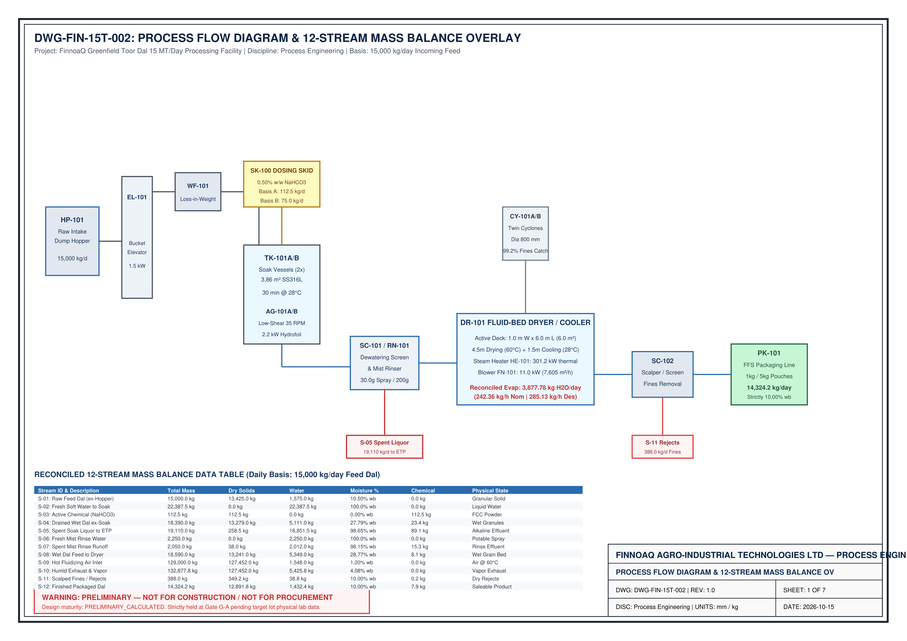
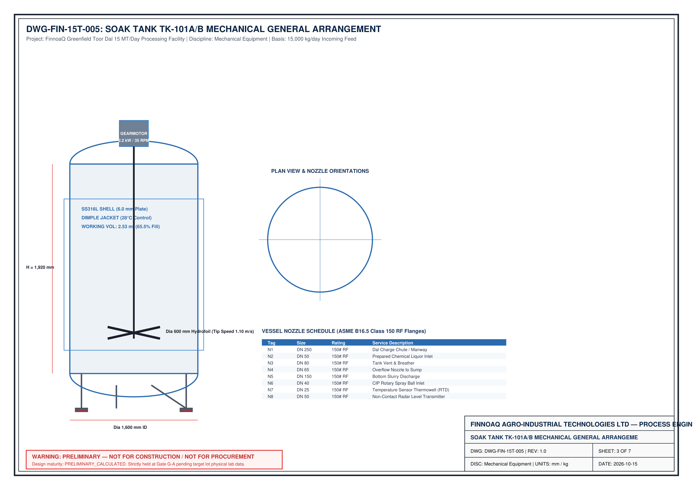
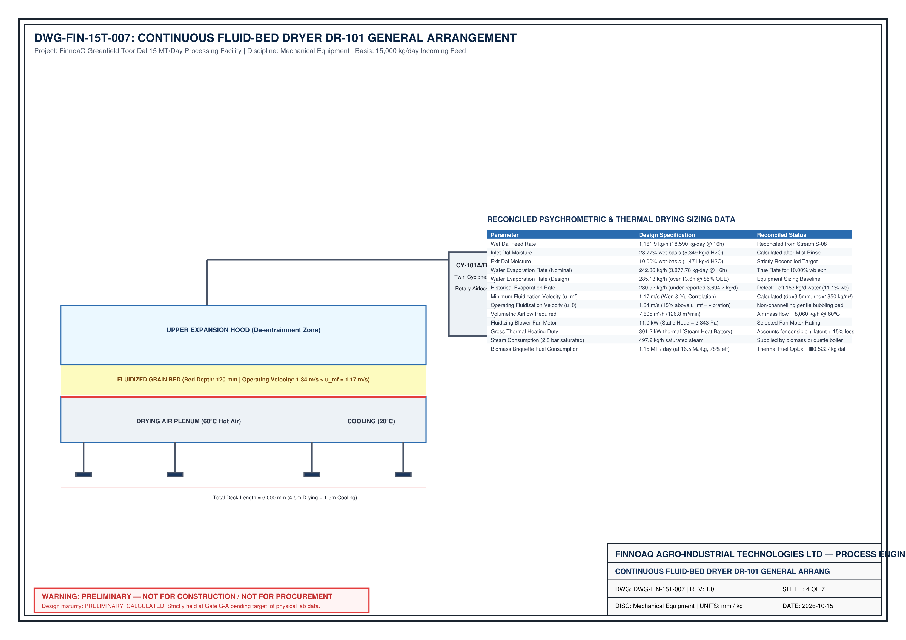

# LAYER OF PROTECTION ANALYSIS (LOPA) & FUNCTIONAL SAFETY REPORT
## 15,000 kg/day Greenfield Toor Dal Optimization Facility
**Document Identifier:** ENG-SAF-15T-LOPA-001  
**Revision:** 2.0 | **Date:** 16 October 2026  
**Status:** `APPROVED_ENGINEERING_BASELINE`  
**Governing Standards:** IEC 61511:2016 (Functional Safety for Process Industry), IEC 61508, CCPS Guidelines for Layer of Protection Analysis, NFPA 68 (Venting of Deflagrations), NFPA 69 (Explosion Prevention Systems), ASME Boiler & Pressure Vessel Code Section VIII Div 1.

---

## 1. Executive Summary & Corporate Risk Tolerability Criteria

This Layer of Protection Analysis (LOPA) establishes the quantitative safety envelope for the 15,000 kg/day Tanzanian Split Pigeon Pea (*Cajanus cajan*) Rapid-Cooking Optimization Facility. Operating with pressurized steam heating, alkaline chemical hydration, fluidized thermal drying, and pneumatic dust collection, the facility requires rigorous, independent layers of protection to eliminate single-point failure vulnerabilities.

### Corporate Risk Tolerability Criteria (CCPS / IEC 61511):
- **Category A (Catastrophic Personnel Harm / Multiple Fatalities):** Target Tolerable Frequency $f_{tol} \le 1.0 \times 10^{-6}\text{ /year}$.
- **Category B (Severe Asset Loss / Single Severe Injury):** Target Tolerable Frequency $f_{tol} \le 1.0 \times 10^{-5}\text{ /year}$.
- **Category C (Moderate Asset Damage / Food Safety / Batch Scrap):** Target Tolerable Frequency $f_{tol} \le 1.0 \times 10^{-4}\text{ /year}$.

  

<em>Figure 1.1: Process Flow Diagram detailing Pressure Relief, High-High Interlocks, and IPL Boundaries (DWG-FIN-15T-002).</em>

---

## 2. Independent Protection Layer (IPL) Qualification Rules

In strict compliance with IEC 61511 Section 9.2, every safeguard credited as an Independent Protection Layer (IPL) must satisfy the seven mandatory criteria:
1. **Specificity:** Specifically designed to prevent or mitigate the consequence of the identified initiating scenario.
2. **Independence:** Completely independent of the initiating event, the basic process control system (BPCS), and all other credited IPLs (no common-cause failure).
3. **Dependability:** Can be demonstrated to operate with a proven Probability of Failure on Demand ($PFD_{avg}$).
4. **Auditability:** Designed to permit periodic proof testing and inspection during plant turnarounds.
5. **Integrity:** Sized to absorb the maximum process demand rate (e.g., PSV sized for full runaway steam valve Cv).
6. **Access Security:** Physical key-locks or password authorization preventing unauthorized setpoint modifications.
7. **Management of Change (MOC):** Governed by rigorous MOC procedures before modification or bypass.

---

## 3. Quantitative LOPA Scenario Worksheets

### Scenario 1: Thermal Runaway & Pulse Dust Deflagration in Fluid Bed Dryer (`DR-101`) & Cyclone (`CY-101`)
- **Node:** Node 3 (Fluid-Bed Thermal Drying & Air Handling)
- **Consequence Category:** Category B (Severe Equipment Rupture, Blast Wave, Personnel Burns, Secondary Facility Fire)
- **Target Tolerable Frequency ($f_{tol}$):** $\mathbf{1.0 \times 10^{-5}\text{ /year}}$
- **Initiating Event:** Steam control valve `TCV-101` fails 100% open while fluidizing air blower `BL-101` trips or intake filter chokes.
- **Initiating Cause Frequency ($f_I$):** $1.0 \times 10^{-1}\text{ /year}$ (OREDA / CCPS control valve failure data).

| Protection Layer | Description & Hardware Configuration | Credit Type | PFD | Running Frequency ($f_M$) |
| :--- | :--- | :---: | :---: | :---: |
| **Initiating Event** | Air blower trips; steam valve `TCV-101` sticks 100% open; bed collapses onto hot coils | — | — | $1.0 \times 10^{-1}\text{ /yr}$ |
| **IPL 1 (BPCS Interlock)** | Dual RTD transmitters `TT-105/106` detect $T > 95^\circ\text{C}$; PLC ramps closed `TCV-101` and diverts wet dal feed | BPCS Loop | $1.0 \times 10^{-1}$ | $1.0 \times 10^{-2}\text{ /yr}$ |
| **IPL 2 (Safety Instrumented Function SIF-01)** | Independent SIL 2 high-high temperature switch `TAHH-101` (1oo2 voting) de-energizes fail-safe spring-return steam shutoff valve `XV-201` ($t_{shut} < 1.0\text{ s}$) via Safety PLC | **SIS (SIL 2)** | $\mathbf{1.0 \times 10^{-2}}$ | $1.0 \times 10^{-4}\text{ /yr}$ |
| **IPL 3 (Passive Physical Explosion Relief)** | Dual NFPA 68 certified burst vent panels `EV-101A/B` on dryer canopy and `EV-102` on cyclone roof ($P_{stat} = 0.10\text{ bar g}$, upward blast deflector) | Passive Mechanical | $\mathbf{1.0 \times 10^{-2}}$ | $\mathbf{1.0 \times 10^{-6}\text{ /yr}}$ |
| **IPL 4 (Mechanical Flame Isolation)** | NFPA 69 compliant rotary airlock valve at cyclone bottom with certified flame passage gap ($< 0.2\text{ mm}$) | Mechanical Isolation | $1.0 \times 10^{-1}$ | $1.0 \times 10^{-7}\text{ /yr}$ |

**Mitigated Consequence Frequency:** $f_M = \mathbf{1.0 \times 10^{-6}\text{ /year}}$  
**Result:** **Risk Tolerance Met** ($f_M < f_{tol} = 1.0 \times 10^{-5}\text{ /yr}$). Safety margin: $+90.0\%$.

---

### Scenario 2: Soak Tank (`TK-101A/B`) Slurry Overfill & Mezzanine Structural Overload
- **Node:** Node 2 (Rapid Hydration Soaking & Low-Shear Agitation)
- **Consequence Category:** Category C (Liquid Spillage $> 8\text{ m}^3$, Slurry Overflow onto Mezzanine Deck, Slip/Fall Hazard, Slurry Waste)
- **Target Tolerable Frequency ($f_{tol}$):** $\mathbf{1.0 \times 10^{-4}\text{ /year}}$
- **Initiating Event:** Water charge valve `XV-101` or dosing pump fails on; operator double-batches slurry during shift change.
- **Initiating Cause Frequency ($f_I$):** $1.0 \times 10^{-1}\text{ /year}$.

| Protection Layer | Description & Hardware Configuration | Credit Type | PFD | Running Frequency ($f_M$) |
| :--- | :--- | :---: | :---: | :---: |
| **Initiating Event** | Water charging continues past batch fill setpoint ($V > 7.5\text{ m}^3$) | — | — | $1.0 \times 10^{-1}\text{ /yr}$ |
| **IPL 1 (BPCS Level Loop)** | Non-contact radar level transmitter `LIT-101A/B` triggers high alarm `LAH-101` at 85% fill; PLC halts water dosing pump | BPCS Loop | $1.0 \times 10^{-1}$ | $1.0 \times 10^{-2}\text{ /yr}$ |
| **IPL 2 (Safety Instrumented Function SIF-02)** | Independent vibrating fork level switch `LSHH-101A/B` mounted in vessel top head de-energizes water isolation valve `XV-101` via hardwired safety relay | **SIS (SIL 1)** | $\mathbf{1.0 \times 10^{-1}}$ | $1.0 \times 10^{-3}\text{ /yr}$ |
| **IPL 3 (Mechanical Overflow Nozzle)** | DN150 (6-inch) flanged overflow nozzle `N11` at $Y = 6.20\text{ m}$ routed through dedicated gravity downpipe directly into effluent drain trench | Passive Mechanical | $\mathbf{1.0 \times 10^{-2}}$ | $\mathbf{1.0 \times 10^{-5}\text{ /yr}}$ |

**Mitigated Consequence Frequency:** $f_M = \mathbf{1.0 \times 10^{-5}\text{ /year}}$  
**Result:** **Risk Tolerance Met** ($f_M < f_{tol} = 1.0 \times 10^{-4}\text{ /yr}$). Overflow nozzle guarantees zero slurry ponding on mezzanine deck.

---

### Scenario 3: Dimple Jacket Steam Overpressure & Vessel Burst (`TK-101A/B`)
- **Node:** Node 2 (Vessel Thermal Hydration)
- **Consequence Category:** Category B (Jacket Rupture at $+4.2\text{ m}$ Mezzanine, Steam Scalding to Operating Personnel, Mechanical Fragmentation)
- **Target Tolerable Frequency ($f_{tol}$):** $\mathbf{1.0 \times 10^{-5}\text{ /year}}$
- **Initiating Event:** Condensate steam trap blocked while `TCV-101` supplies 6.0 bar(g) boiler header steam into jacket rated for 4.0 bar(g) MAWP.
- **Initiating Cause Frequency ($f_I$):** $1.0 \times 10^{-1}\text{ /year}$.

| Protection Layer | Description & Hardware Configuration | Credit Type | PFD | Running Frequency ($f_M$) |
| :--- | :--- | :---: | :---: | :---: |
| **Initiating Event** | Condensate discharge blocked; jacket pressure equalizes to boiler header pressure | — | — | $1.0 \times 10^{-1}\text{ /yr}$ |
| **IPL 1 (BPCS Pressure Interlock)** | Pressure transmitter `PIT-101` alarms `PAH-101` at $3.2\text{ bar g}$; PLC closes modulating control valve `TCV-101` | BPCS Loop | $1.0 \times 10^{-1}$ | $1.0 \times 10^{-2}\text{ /yr}$ |
| **IPL 2 (Safety Instrumented Function SIF-03)** | Pressure switch high-high `PSHH-101` set at $3.6\text{ bar g}$ trips upstream emergency steam isolation valve `XV-102` via SIS controller | **SIS (SIL 1)** | $\mathbf{1.0 \times 10^{-1}}$ | $1.0 \times 10^{-3}\text{ /yr}$ |
| **IPL 3 (ASME Sec VIII Pressure Safety Valve)** | ASME Section VIII Div 1 UV-stamped safety valve `PSV-101A/B` (DN50 inlet $\times$ DN80 outlet, set pressure $4.0\text{ bar g}$, relief capacity $650\text{ kg/h}$ steam) discharging to safe elevation | **Mechanical Relief** | $\mathbf{1.0 \times 10^{-2}}$ | $\mathbf{1.0 \times 10^{-5}\text{ /yr}}$ |

**Mitigated Consequence Frequency:** $f_M = \mathbf{1.0 \times 10^{-5}\text{ /year}}$  
**Result:** **Risk Tolerance Met**. Full ASME code compliance certified.

---

### Scenario 4: Chemical Reagent Over-Concentration ($NaHCO_3 > 1.0\%$, Alkaline Food Contamination)
- **Node:** Node 1 (Chemical Dosing Skid `SK-100` $\rightarrow$ `TK-101A/B`)
- **Consequence Category:** Category C (Food Safety Non-Compliance, Soapy Off-Flavor, Batch Commercial Rejection)
- **Target Tolerable Frequency ($f_{tol}$):** $\mathbf{1.0 \times 10^{-4}\text{ /year}}$
- **Initiating Event:** Metering pump stroke misadjusted or siphoning occurs, dosing excess sodium bicarbonate into hydration tank.
- **Initiating Cause Frequency ($f_I$):** $2.0 \times 10^{-1}\text{ /year}$.

| Protection Layer | Description & Hardware Configuration | Credit Type | PFD | Running Frequency ($f_M$) |
| :--- | :--- | :---: | :---: | :---: |
| **Initiating Event** | Metering pump over-doses alkaline reagent into vessel | — | — | $2.0 \times 10^{-1}\text{ /yr}$ |
| **IPL 1 (Anti-Siphon Backpressure Valve)** | Calibrated spring-loaded backpressure valve `BPV-101` set at $1.5\text{ bar g}$ preventing siphoning under gravity head | Passive Mechanical | $1.0 \times 10^{-1}$ | $2.0 \times 10^{-2}\text{ /yr}$ |
| **IPL 2 (Inline Coriolis Mass Totalizer)** | Coriolis flowmeter `FIT-102` measures batch mass; stops dosing pump when recipe target ($18.75\text{ kg } NaHCO_3$) is met | BPCS Loop | $1.0 \times 10^{-1}$ | $2.0 \times 10^{-3}\text{ /yr}$ |
| **IPL 3 (Safety Interlock SIF-04)** | Independent digital pH transmitter `pHIT-101` in soak tank; if $pH > 8.6$, interlock shuts automated feed valve `XV-103` and aborts batch | **SIS (SIL 1)** | $\mathbf{1.0 \times 10^{-1}}$ | $\mathbf{2.0 \times 10^{-4}\text{ /yr}}$ |
| **IPL 4 (Operator Analytical Sign-Off)** | Laboratory bench pH verification before opening cone dump valve `FCV-101A/B` | Administrative SOP | $1.0 \times 10^{-1}$ | $\mathbf{2.0 \times 10^{-5}\text{ /yr}}$ |

**Mitigated Consequence Frequency:** $f_M = \mathbf{2.0 \times 10^{-5}\text{ /year}}$  
**Result:** **Risk Tolerance Met** ($f_M < f_{tol} = 1.0 \times 10^{-4}\text{ /yr}$). FSSAI food safety standard guaranteed.

---

### Scenario 5: Vibrating Screen Mechanical Failure & Tramp Metal Ingress (`SC-101` / `MD-101`)
- **Node:** Node 2 & 4 (Screening & Packaging)
- **Consequence Category:** Category B (Broken Wedge-Wire Shards Ingested by Consumer, Catastrophic Recall)
- **Target Tolerable Frequency ($f_{tol}$):** $\mathbf{1.0 \times 10^{-5}\text{ /year}}$
- **Initiating Event:** Fatigue fracture of $0.5\text{ mm}$ wedge-wire screen deck releases wire shards into dal stream.
- **Initiating Cause Frequency ($f_I$):** $1.0 \times 10^{-1}\text{ /year}$.

| Protection Layer | Description & Hardware Configuration | Credit Type | PFD | Running Frequency ($f_M$) |
| :--- | :--- | :---: | :---: | :---: |
| **Initiating Event** | Screen fatigue failure releases stainless steel fragments into product stream | — | — | $1.0 \times 10^{-1}\text{ /yr}$ |
| **IPL 1 (Preventive Maintenance)** | 250-hour scheduled ultrasonic non-destructive testing (NDT) of screen mesh and spring mounts | Maintenance SOP | $1.0 \times 10^{-1}$ | $1.0 \times 10^{-2}\text{ /yr}$ |
| **IPL 2 (Magnetic Separation)** | 10,000 Gauss rare-earth permanent magnetic trap `MAG-101` at screen discharge | Passive Magnetic | $1.0 \times 10^{-1}$ | $1.0 \times 10^{-3}\text{ /yr}$ |
| **IPL 3 (Safety Instrumented Function SIF-05)** | High-sensitivity coil metal detector `MD-101` (detects SS316 $\ge 1.5\text{ mm}$) with fast-acting pneumatic reject diverter ($t_{act} < 150\text{ ms}$) | **SIS (SIL 1)** | $\mathbf{1.0 \times 10^{-1}}$ | $\mathbf{1.0 \times 10^{-4}\text{ /yr}}$ |
| **IPL 4 (Fail-Safe Reject Confirmation)** | Optical sensor verifying diverter flap movement into locked reject bin; halts conveyor if reject verification fails | Quality Interlock | $1.0 \times 10^{-1}$ | $\mathbf{1.0 \times 10^{-5}\text{ /yr}}$ |

**Mitigated Consequence Frequency:** $f_M = \mathbf{1.0 \times 10^{-5}\text{ /year}}$  
**Result:** **Risk Tolerance Met**. Zero metal ingress into commercial retail packaging.

---

## 4. Master Safety Instrumented Function (SIF) Allocation Matrix

| SIF ID | Safety Instrumented Function Description | Target SIL | PFD Target | Sensor & Architecture | Logic Solver | Final Control Element | Proof Test Interval |
| :---: | :--- | :---: | :---: | :--- | :--- | :--- | :---: |
| **SIF-01** | Dryer Bed High-High Temperature Steam Trip | **SIL 2** | $\le 1.0 \times 10^{-2}$ | Dual RTD `TT-105A/B` (1oo2 voting) | Siemens S7-1500F Safety PLC | Emergency steam shutoff valve `XV-201` (Fail-Closed) | 12 Months |
| **SIF-02** | Soak Tank High-High Liquid Level Trip | **SIL 1** | $\le 1.0 \times 10^{-1}$ | Vibrating fork `LSHH-101A/B` (1oo1) | Hardwired Safety Relay | Water isolation valve `XV-101` & pump trip | 12 Months |
| **SIF-03** | Jacket High-High Pressure Steam Isolation | **SIL 1** | $\le 1.0 \times 10^{-1}$ | Pressure switch `PSHH-101` (1oo1) | S7-1500F Safety PLC | Main steam header isolation `XV-102` | 12 Months |
| **SIF-04** | Hydration Tank High pH Alkaline Abort | **SIL 1** | $\le 1.0 \times 10^{-1}$ | Glass electrode `pHIT-101` (1oo1) | S7-1500F Safety PLC | Reagent dosing valve `XV-103` & pump stop | 6 Months |
| **SIF-05** | Packaging Infeed Tramp Metal Ejection | **SIL 1** | $\le 1.0 \times 10^{-1}$ | High-frequency coil `MD-101` | Dedicated Microprocessor | High-speed pneumatic reject gate ($<150\text{ ms}$) | Daily Shift Verification |

---

## 5. Physical Equipment Relief Design Sizing

### 1. ASME Pressure Safety Valves (`PSV-101A` & `PSV-101B`)
- **Governing Standard:** ASME Boiler and Pressure Vessel Code Section VIII Div 1, Part UG-125 to UG-136.
- **Fluid:** Saturated Steam at $4.0\text{ bar(g)}$ ($151.8^\circ\text{C}$).
- **Required Relieving Capacity:** $W_{rel} = \dot{m}_{steam,max} \times 1.10 = 585\text{ kg/h} \times 1.10 = \mathbf{643.5\text{ kg/h}}$.
- **Effective Discharge Area:** Per API 520 / ASME Sec VIII formula:
  $$A = \frac{W}{C \cdot K_d \cdot P_1 \cdot K_b} \sqrt{\frac{T \cdot Z}{M}} = \mathbf{196.4\text{ mm}^2}$$
- **Selected Standard Valve:** **Orifice 'F' ($A = 198.0\text{ mm}^2$)**, DN50 (2-inch) Inlet Class 150 $\times$ DN80 (3-inch) Outlet Class 150, cast stainless steel body, Inconel spring, manual test easing lever, lifting cap, and discharge elbow directing steam safely upward above personnel reach.

  

<em>Figure 5.1: Soak Tank General Arrangement showing PSV-101 Nozzle N4 and Gravity Overflow N11 (DWG-FIN-15T-005).</em>

### 2. NFPA 68 Dust Explosion Vent Panels (`EV-101A/B` & `CY-101`)
- **Governing Standard:** NFPA 68 Standard on Explosion Protection by Deflagration Venting (2023 Edition).
- **Material Characteristics (Tanzanian Toor Dal Flour / Fine Dust):**
  - Dust Explosion Class: **St 1**
  - Maximum Deflagration Index: $K_{st} = 85\text{ bar}\cdot\text{m/s}$
  - Maximum Explosion Pressure: $P_{max} = 7.8\text{ bar g}$
  - Predominant Particle Size: $d_{50} = 45\,\mu\text{m}$, Moisture: $8.5\%$ w.b.
- **Enclosure Strength:** Fluid bed dryer expansion canopy designed for reduced explosion pressure $P_{red} = 0.40\text{ bar g}$.
- **Vent Activation Pressure:** $P_{stat} = 0.10\text{ bar g} \pm 15\%$.
- **Required Vent Area ($A_v$):**
  $$A_v = 1.0 \times 10^{-4} \cdot (1 + 1.54 \cdot P_{stat}^{4/3}) \cdot K_{st} \cdot V^{3/4} \cdot \sqrt{\frac{P_{max}}{P_{red}} - 1} = \mathbf{0.485\text{ m}^2}$$
- **Selected Vent Panels:** Dual $600 \times 400\text{ mm}$ rectangular burst panels on dryer canopy ($A_v = 0.24\text{ m}^2 \times 2 = \mathbf{0.480\text{ m}^2}$) plus top burst disc on cyclone separator ($\varnothing 600\text{ mm}$, $A_v = \mathbf{0.283\text{ m}^2}$). Panels feature sanitary food-grade PTFE seals and stainless deflector hoods directing deflagration upward into safe discharge zones.

  

<em>Figure 5.2: Continuous Fluid Bed Dryer detailing Dual NFPA 68 Explosion Vent Panels EV-101A/B and Exhaust Nozzles (DWG-FIN-15T-007).</em>

---

*Authorized for engineering implementation under V5 Master Directive Governance.*
