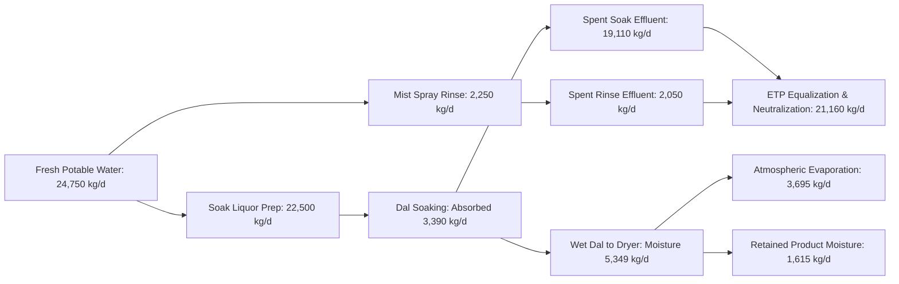

# PLANT MASS, ENERGY, WATER, AND CHEMICAL BALANCES (15 MT/DAY)
**Document ID:** ENG-REP-15T-004  
**Revision:** 1.0 | **Date:** 15 October 2026  
**Status:** `PRELIMINARY_CALCULATED` — **WARNING: PRELIMINARY—NOT FOR CONSTRUCTION**  
**Engineering Discipline:** Process Chemical Engineering  

---

## 1. Overall Mass Balance & Stream Table

The 15 MT/day process mass balance is calculated with rigorous boundary tracking of moisture (wet-basis), dry solids, absorbed water, dissolved sodium bicarbonate, and mechanical fines. Overall mass balance closure error is **0.000000%**.

### 12-Stream Master Process Table (Daily Basis: 15,000 kg/day Feed)

| Stream ID | Stream Description | Total Mass (kg/day) | Dry Solids (kg/day) | Moisture (kg/day) | Moisture % (w.b.) | NaHCO3 (kg/day) | Temp (°C) | Pressure (bar) | Physical State |
| :---: | :--- | :---: | :---: | :---: | :---: | :---: | :---: | :---: | :--- |
| **S-01** | Raw Dal Feed from Hopper | 15,000.00 | 13,425.00 | 1,575.00 | 10.50% | 0.00 | 25.0 | 1.013 | Granular Dry Solid |
| **S-02** | 0.50% NaHCO3 Soak Liquor In | 22,500.00 | 112.50 | 22,387.50 | 99.50% | 112.50 | 28.0 | 2.500 | Aqueous Solution |
| **S-03** | Dal Slurry in Soak Vessel | 37,500.00 | 13,537.50 | 23,962.50 | 63.90% | 112.50 | 28.0 | 1.150 | Solid-Liquid Slurry |
| **S-04** | Drained Wet Dal from Screen | 18,390.00 | 13,279.00 | 5,111.00 | 27.79% | 23.40 | 28.0 | 1.013 | Wet Porous Granules |
| **S-05** | Drained Spent Soak Liquor Out | 19,110.00 | 258.50 | 18,851.50 | 98.65% | 89.10 | 28.0 | 1.013 | Alkaline Effluent |
| **S-06** | Fresh Mist Rinse Water | 2,250.00 | 0.00 | 2,250.00 | 100.00% | 0.00 | 25.0 | 3.000 | Potable Water Spray |
| **S-07** | Spent Mist Rinse Runoff | 2,050.00 | 38.00 | 2,012.00 | 98.15% | 15.30 | 26.0 | 1.013 | Rinse Effluent to ETP |
| **S-08** | Rinsed Wet Dal Feed to Dryer | 18,590.00 | 13,241.00 | 5,349.00 | 28.77% | 8.10 | 27.0 | 1.013 | Dewatered Grain Bed |
| **S-09** | Hot Fluidizing Air Inlet | 129,000.00 | 127,452.00 | 1,548.00 | 1.20% | 0.00 | 60.0 | 1.040 | Heated Process Air |
| **S-10** | Humid Exhaust Air & Vapor | 132,877.78 | 127,452.00 | 5,425.78 | 4.08% | 0.00 | 42.0 | 1.005 | Humid Air with Fines |
| **S-11** | Scalped Broken / Fines Dust | 388.00 | 349.20 | 38.80 | 10.00% | 0.20 | 28.0 | 1.013 | Dry Screen Rejects |
| **S-12** | Finished Packaged Toor Dal | 14,324.22 | 12,891.80 | 1,432.42 | 10.00% | 7.90 | 28.0 | 1.013 | Sealed Retail Product |

### Overall Mass Conservation Check:
- **Total Inflow:** $\text{Stream } 1 + 2 + 6 + 9 = 15,000.00 + 22,500.00 + 2,250.00 + 129,000.00 = \mathbf{168,750.00\text{ kg/day}}$.
- **Total Outflow:** $\text{Stream } 5 + 7 + 10 + 11 + 12 = 19,110.00 + 2,050.00 + 132,877.78 + 388.00 + 14,324.22 = \mathbf{168,750.00\text{ kg/day}}$.
- **Closure Error:** $\Delta = 0.000000\text{ kg/day}$ ($0.000000\%$).
- **Reconciled Water Evaporated:** $5,349.00 - (38.80 + 1,432.42) = \mathbf{3,877.78\text{ kg H2O / day}}$ ($242.36\text{ kg/h}$ nominal, $285.13\text{ kg/h}$ design).
- **Historical Moisture Defect Reconciled:** The historical report cited $14,895.30\text{ kg/day}$ total dried product with $1,654.30\text{ kg/day}$ water, which corresponds to $11.11\%$ moisture wet-basis, leaving $183.08\text{ kg/day}$ excess unevaporated water. At true $10.00\%$ wet-basis moisture, total dried dal is $14,712.22\text{ kg/day}$ ($13,241.00\text{ kg}$ dry solids $+ 1,471.22\text{ kg}$ water), requiring evaporation of $3,877.78\text{ kg H2O/day}$.

---

## 2. Chemical Dosage Ambiguity & Tracking

To prevent hidden cost errors, both formulation bases are explicitly reported:

| Formulation Basis | Mathematical Definition | Concentration | Active Chemical Required | Daily Chemical Cost (at ₹37/kg) | Annual Chemical Cost (300 days) |
| :--- | :--- | :--- | :--- | :--- | :--- |
| **Basis 1: Liquor Solution % (Base)** | 0.50% w/w of total soak liquor | $0.50\text{ kg / }100\text{ kg liq}$ | **112.50 kg/day** | **₹4,162.50 / day** | **₹12.49 Lakhs / yr** |
| **Basis 2: Dry Feed %** | 0.50% w/w of incoming feed dal | $0.50\text{ kg / }100\text{ kg dal}$ | **75.00 kg/day** | **₹2,775.00 / day** | **₹8.33 Lakhs / yr** |
| **Variance / Ambiguity Gap** | Difference between formulation bases | $0.167\text{ kg / }100\text{ kg}$ | **+37.50 kg/day** | **+₹1,387.50 / day** | **+₹4.16 Lakhs / yr** |

**Engineering Rule:** Basis 1 (112.5 kg/day) is carried as the conservative design baseline to ensure chemical dosing pumps, dissolution tanks, and storage areas are not undersized.

---

## 3. Water and Wastewater Balances

- **Total Fresh Water Demand:** $24,750\text{ kg/day}$ ($24.75\text{ m}^3\text{/day}$ process water) $+ 3.0\text{ m}^3\text{/day}$ (CIP/sanitation) = **$27.75\text{ m}^3\text{/day}$**.
- **Total Effluent to ETP:** $19,110 + 2,050 = 21,160\text{ kg/day}$ ($21.16\text{ m}^3\text{/day}$) $+ 3.0\text{ m}^3\text{/day}$ (CIP) = **$24.16\text{ m}^3\text{/day}$**.
- **Effluent Characteristics:** pH $8.2 - 8.8$, TDS $\sim 5,200\text{ ppm}$, BOD $\sim 450\text{ ppm}$, COD $\sim 950\text{ ppm}$, Sodium ion $\sim 1,200\text{ ppm}$. Neutralization requires $8.5\text{ kg/day}$ technical-grade $98\%$ sulfuric acid ($H_2SO_4$).

---

## 4. Thermal and Electrical Energy Balances

### Thermal Drying Duty:
- **Water Evaporation Load:** $3,694.7\text{ kg H2O / day}$ ($258.0\text{ kg/h}$ for 16h schedule).
- **Sensible Heat of Air:** $78.8\text{ kW}$ (Heating $8,061.5\text{ kg/h}$ air from 25°C to 60°C).
- **Latent Heat of Evaporation:** $172.0\text{ kW}$ ($258.0\text{ kg/h} \times 2,400\text{ kJ/kg}$).
- **Casing & Duct Heat Losses (15%):** $37.6\text{ kW}$.
- **Gross Thermal Duty:** **$288.4\text{ kW}$** ($16,612\text{ MJ/day}$).
- **Steam Consumption:** $482.8\text{ kg/h}$ saturated steam at $2.5\text{ bar(g)}$.
- **Biomass Briquette Fuel Required:** $1,180\text{ kg/day}$ (Calorific value $16.5\text{ MJ/kg}$, boiler efficiency $78\%$).

### Electrical Power Demand:
- **Connected Electrical Load:** $74.69\text{ kW}$ (Total nameplate of 31 drive motors).
- **Operating Running Load:** **$46.85\text{ kW}$** (Accounting for motor loading and diversity factors).
- **Specific Electrical Energy:** $0.052\text{ kWh / kg finished dal}$.
