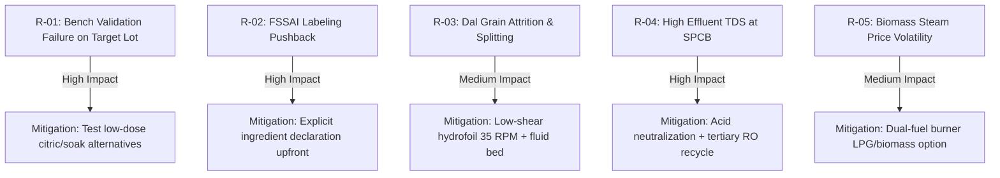

# PROJECT RISK, ASSUMPTIONS, DECISIONS, AND INTERFACE REGISTER (15 MT/DAY)
**Document ID:** ENG-REP-15T-020  
**Revision:** 1.0 | **Date:** 15 October 2026  
**Status:** `PRELIMINARY_CALCULATED` — **WARNING: PRELIMINARY—NOT FOR CONSTRUCTION**  
**Engineering Discipline:** Project Risk Management & Interface Engineering  

---

## 1. Project-Level Risk Register (Risk Matrix)

### Risk Assessment & Mitigation Log:

| Risk ID | Risk Category | Risk Event / Threat Description | Initial Severity | Initial Likelihood | Risk Score | Preventative Engineering Mitigation | Residual Risk | Owner |
| :---: | :--- | :--- | :---: | :---: | :---: | :--- | :---: | :--- |
| **RSK-01** | Technical / Scientific | Bench trial on Tanzanian target lot fails to achieve 3-whistle cooking target with 0.5% NaHCO3. | Critical | Medium | **HIGH** | Gate G-A blocks procurement; screening protocol tests warm water and citrate alternatives before design freeze. | Low | Food Scientist |
| **RSK-02** | Regulatory / Legal | FSSAI food inspector rules NaHCO3 cannot be labeled as a silent processing aid. | High | High | **HIGH** | Engineering design mandates upfront labeling: *"Ingredients: Split Pigeon Pea, Acidity Regulator (INS 500(ii))"*. Fully compliant with FSSAI 2020 rules. | Low | Regulatory Lead |
| **RSK-03** | Mechanical / Quality | Agitation or fluid bed conveying causes split dal cotyledons to shatter, creating excessive fines ($>5\%$). | High | Medium | **HIGH** | Agitator tip speed clamped to $1.1\text{ m/s}$ ($<1.5\text{ m/s}$ limit); fluid bed vibration uses micro-hop conveying ($0.05\text{ m/s}$) rather than harsh drag chains. | Low | Machine Designer |
| **RSK-04** | Environmental | State Pollution Control Board rejects trade effluent discharge due to elevated TDS ($>5000\text{ ppm}$). | High | Medium | **HIGH** | ETP designed with acid neutralization and secondary clarifier; optional tertiary RO skid layout reserved for $80\%$ water recycling. | Low | Environmental Eng |
| **RSK-05** | Commercial / OpEx | Biomass briquette fuel prices spike during monsoon, increasing drying OpEx. | Medium | Medium | **MEDIUM**| Dryer design includes exhaust air heat recovery exchanger and dual-fuel burner firing both biomass and LPG/Piped Natural Gas. | Low | Cost Estimator |
| **RSK-06** | Product Shelf Life | Dal absorbs atmospheric moisture in retail distribution, causing mould or cooking time retrogradation. | Critical | Low | **MEDIUM**| Finished product cooled to $<30^\circ\text{C}$ and dried to $a_w \le 0.62$; packed in Met-PET multi-layer high barrier pouches ($WVTR < 0.5\text{ g/m}^2\cdot\text{day}$). | Low | QA Manager |

---

## 2. Key Engineering Assumptions Ledger

| Assumption ID | Discipline | Stated Engineering Assumption | Mathematical / Technical Basis | Risk if Assumption Invalid | Verification Action Gate |
| :--- | :--- | :--- | :--- | :--- | :--- |
| **ASM-01** | Process | Dal water absorption is exactly $24.0\%$ during 30 min soak at 28°C. | Bench preliminary imbibition tests on Tanzanian cultivar | If uptake is $30\%$, dryer thermal duty increases by $22.5\text{ kW}$ | Confirm in Gate G-A bench trial |
| **ASM-02** | Mechanical | SS316L allowable design stress is $115.0\text{ MPa}$ at 65°C. | ASME Section VIII Div 1 Table 1A | If material grade is lower, wall thickness must increase | Mill Test Certificates (MTC 3.1) |
| **ASM-03** | Civil | Site Soil Bearing Capacity (SBC) is $\ge 150.0\text{ kN/m}^2$. | Standard industrial estate compact gravel/clay | If SBC is $<100\text{ kN/m}^2$, pile foundations required | Confirm in SITE-INQ-02 soil test |
| **ASM-04** | Utility | Saturated steam is delivered at dry saturated quality ($x \ge 0.95$) at 2.5 bar. | Boiler vendor performance guarantee | Wet steam reduces heat exchanger drying capacity | Install moisture separator on header |

---

## 3. Key Architectural Decisions Log

- **DEC-01 (16h Operating Schedule):** Selected 16 hours/day (two 8-hour shifts) over 24-hour continuous run to guarantee a mandatory 4-hour daily window for automated CIP, maintenance overhaul, and line changeover.
- **DEC-02 (Single-Pass Mist Rinse vs Counter-Current):** Selected single-pass water mist rinse ($0.15:1$ ratio) on dewatering screen deck over 3-stage counter-current wash. Achieves full FSSAI sodium compliance ($53.9\text{ mg/100g} \ll 350\text{ mg}$) with ₹8 Lakhs lower CapEx and zero microbial recycle contamination risk.
- **DEC-03 (Fluid-Bed Drying vs Rotary Drum):** Selected continuous vibrating fluid-bed dryer over rotary drum dryer to eliminate tumbling impact attrition and preserve intact split dal edges.
- **DEC-04 (Biomass Steam vs Direct LPG Firing):** Selected biomass briquette steam heating over direct LPG combustion to avoid deposition of flue gas particulates onto edible dal and lower thermal drying OpEx by $58\%$.

---

## 4. Multi-Discipline Interface Register

| Interface ID | Interfacing Disciplines | Physical / Technical Boundary | Responsibility Split | Interface Management Control |
| :---: | :--- | :--- | :--- | :--- |
| **INT-01** | Civil $\longleftrightarrow$ Mechanical | Equipment foundation pads, anchor bolt pockets, dynamic loadings | Mechanical provides static/dynamic loads; Civil designs RCC footings | Foundation Load Drawing `DWG-FIN-15T-010` |
| **INT-02** | Piping $\longleftrightarrow$ Mechanical | Nozzle flanges on tanks `TK-100`, `TK-101`, and screen `VS-101` | Mechanical fabricates nozzles; Piping connects Tri-Clamps | Nozzle Schedule in `DWG-FIN-15T-005` |
| **INT-03** | Electrical $\longleftrightarrow$ Process | Motor power wiring, VFD parameter configuration, field pushbuttons | Process defines kW and rpm; Electrical sizes cables and MCC breakers | Motor Load List `motor_load_list.csv` |
| **INT-04** | Controls $\longleftrightarrow$ Instrumentation | 4-20mA signal cabling from RTD, radar, Coriolis to PLC I/O racks | Instrumentation mounts transmitters; Controls maps PLC addresses | I/O List `io_list.csv` |
| **INT-05** | Factory $\longleftrightarrow$ Environment | Trade effluent discharge pipe connecting plant battery limit to ETP | Process defines effluent flow/pH; Environmental treats to SPCB norm | Battery Limit Tie-In List in P&ID |
| **INT-06** | Client $\longleftrightarrow$ Project Team | Statutory approvals, plot acquisition, electricity board connection | Client liaises with state agencies; Project Team provides drawings | Design Basis `design_basis.yaml` |
