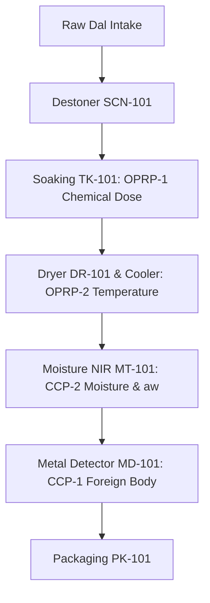

# SAFETY, FOOD HYGIENE, AND REGULATORY MATRIX (15 MT/DAY PLANT)
**Document ID:** ENG-REP-15T-012  
**Revision:** 1.0 | **Date:** 15 October 2026  
**Status:** `PRELIMINARY_CALCULATED` — **WARNING: PRELIMINARY—NOT FOR CONSTRUCTION**  
**Engineering Discipline:** Food Safety, Regulatory Affairs & Process Safety  

---

## 1. Statutory & Regulatory Compliance Matrix

| Regulatory Authority | Standard / Act | Statutory Scope & Requirement | Plant Engineering Compliance Strategy | Verification / Sign-Off Record |
| :--- | :--- | :--- | :--- | :--- |
| **FSSAI** | Food Products Standards & Food Additives (2011) | Sodium Bicarbonate INS 500(ii) permitted under Table 3 (GMP conditions) | Used at $0.50\%$ w/w soak liquor; residual sodium ($53.9\text{ mg/100g}$) complies with FSSAI $<350\text{ mg/100g}$ limit | NABL accredited elemental ICP-OES assay required |
| **FSSAI** | Labelling & Display Regulations (2020) | Active food additives that confer a functional cooking benefit must be declared | Must declare **"Ingredients: Dehulled Split Pigeon Pea, Acidity Regulator (INS 500(ii))"**; cannot hide as processing aid | Harakutir Legal & Regulatory Council sign-off |
| **FSSAI** | Schedule 4 (General Hygiene & Sanitary Requirements) | Sanitary premises, potable water, pest exclusion, positive air pressure in packaging | 5-tier hygienic zoning, MERV 14 filtration in Zone 4, coved epoxy floors, automated hygiene locks | Pre-commissioning FSSAI central inspection |
| **Bureau of Indian Standards (BIS)** | NBC 2016 Part 4 | Fire protection, egress travel distances, industrial occupancy hazard classification | Class G Industrial building, $2.0\text{ m}$ wide escape routes, fire hydrant ring main, CO2 extinguishers | Local Chief Fire Officer (CFO) NOC |
| **SPCB / MoEFCC** | Water (Prevention & Control of Pollution) Act 1974 | Consent to Establish (CTE) & Consent to Operate (CTO) for trade effluent | $25\text{ m}^3\text{/day}$ ETP with neutralization, clarifier, and media filtration ($TDS < 2100\text{ ppm}, BOD < 100\text{ ppm}$) | SPCB CTE application upon layout freeze |
| **ISO / IEC** | ISO 12100 / IEC 60204-1 | Machine risk assessment, safety guarding, emergency stop interlocks | Interlocked safety switches on conveyor skirts, Category 0 emergency stop pushbuttons | CE / Machinery safety declaration file |
| **Legal Metrology** | Legal Metrology (Packaged Commodities) Rules 2011 | Net weight tolerance for 1 kg retail pouch ($\pm 15\text{ g}$ maximum permissible error) | In-line checkweigher `CW-101` set to strict $\pm 10\text{ g}$ rejection threshold ($100\%$ checkweighed) | Model approval certificate from Legal Metrology |

---

## 2. HACCP Plan & Critical Control Points (CCPs)

### Detailed HACCP Master Table:

| Control Point | Process Step | Significant Hazard | Critical Limit | Monitoring Frequency & Method | Corrective Action Protocol | Verification Record |
| :--- | :--- | :--- | :--- | :--- | :--- | :--- |
| **CCP-1** | Gravity-Fall Metal Detection (`MD-101`) | Physical hazard: Ferrous, non-ferrous, or SS wire/metal fragments | **No detectable metal ($\ge 1.0\text{ mm}$ Fe, $\ge 1.2\text{ mm}$ NFe, $\ge 1.5\text{ mm}$ SS)** | Continuous automatic electronic detection with hourly certified test wand challenge | High-speed pneumatic diverter rejects pouch to locked scrap bin; line stops if 3 rejects in 5 min | Daily CCP-1 challenge log signed by Shift QA Lead |
| **CCP-2** | Continuous Post-Dry Moisture (`MT-101`) | Biological hazard: Mould growth, aflatoxin, microbial spoilage | **Final moisture $\le 10.5\%$ (w.b.) and water activity $a_w \le 0.62$** | Continuous in-line microwave NIR sensor $+ 2$-hourly bench moisture analyzer | Dal exceeding $11.0\%$ is automatically diverted by flap valve back to recycle buffer; dryer throttled | Calibrated Sartorius bench moisture balance log |
| **OPRP-1** | Chemical Liquor Dosing (`FT-102`) | Quality / Chemical hazard: Excessive alkaline soapy off-flavor | **Concentration $0.50\% \pm 0.05\%$ w/w NaHCO3 (pH $8.2 - 8.6$)** | Continuous Coriolis mass flow totalization per batch $+$ digital pH check | Batch abort interlock if dose exceeds $1,420\text{ kg}$; liquor isolated by double valve | Batch dosing genealogy report generated by SCADA |
| **OPRP-2** | Post-Dry Grain Cooling (`TT-104`) | Quality hazard: Sweating and moisture condensation inside pouch | **Product exit temperature $<30.0^\circ\text{C}$ before packing** | Continuous infrared optical pyrometer at dryer cooler discharge weir | Alarm sounds if grain $>32^\circ\text{C}$; cooling blower `FN-102` speed boosted via VFD | Automated temperature trend log in SCADA |

---

## 3. Post-Treatment Microbiological & Shelf Stability Protocol

Because soaking introduces warm moisture into dry dal, strict microbiological release criteria are enforced prior to finished product warehousing:
- **Total Viable Count (TVC):** $<10^4\text{ CFU/g}$ (Target $<10^3\text{ CFU/g}$).
- **Yeasts and Moulds:** $<10^2\text{ CFU/g}$ (Inhibited by keeping final $a_w \le 0.62$).
- **Coliforms / E. coli:** Absent in $25\text{ g}$.
- **Salmonella spp.:** Absent in $25\text{ g}$ (Killed during $60^\circ\text{C}$ fluid-bed thermal residence).
- **Shelf-Life Protocol:** 12-month real-time room temperature storage ($25^\circ\text{C} / 60\%\text{ RH}$) alongside 6-month accelerated testing ($38^\circ\text{C} / 90\%\text{ RH}$). Cooking time, free fatty acids (FFA), peroxide value (PV), and sensory panel softness monitored bi-weekly.
