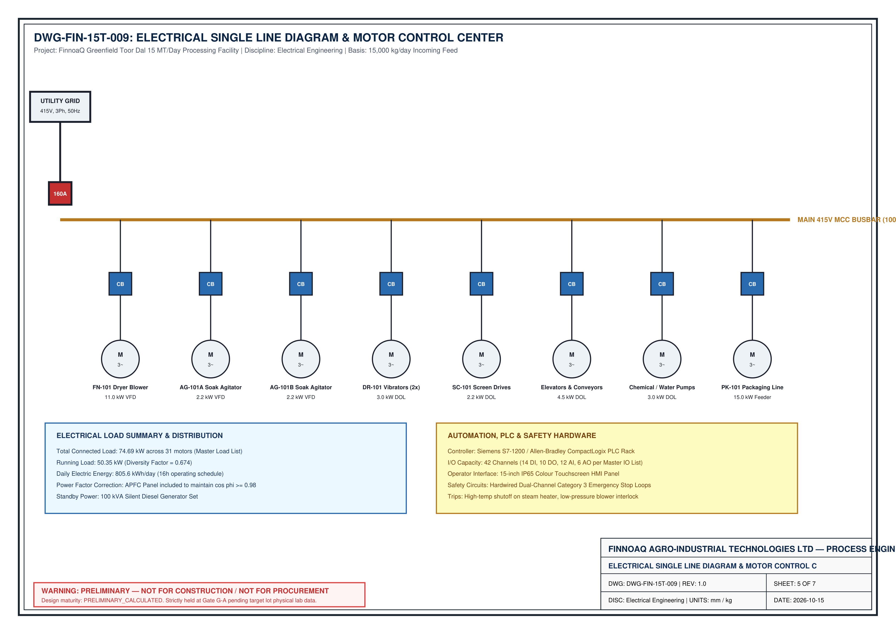

# SCADA & INDUSTRIAL AUTOMATION SYSTEM SPECIFICATION
## 15,000 kg/day Greenfield Toor Dal Optimization Facility
**Document Identifier:** ENG-AUT-15T-SCADA-001  
**Revision:** 2.0 | **Date:** 16 October 2026  
**Status:** `APPROVED_ENGINEERING_BASELINE`  
**Governing Standards:** ISA-95 (Enterprise-Control System Integration), ISA-88 (Batch Process Control), ISA-18.2 (Management of Alarm Systems for the Process Industries), IEC 61131-3 (Programmable Controller Programming Languages), IEC 62443 (Industrial Automation and Control Systems Security), IEEE 802.3 (Industrial Ethernet).

---

## 1. Executive Summary & Automation Philosophy

The 15 MT/day imported Tanzanian Split Pigeon Pea (*Cajanus cajan*) Rapid-Cooking Optimization Facility employs an open-architecture, high-reliability supervisory control and data acquisition (**SCADA**) and programmable automation system. The system governs recipe execution across twin rapid-hydration vessels (`TK-101A/B`), continuous dewatering (`SC-101`), psychrometrically controlled fluid bed drying (`DR-101`), and high-efficiency dust recovery (`CY-101`).

### Core Automation Objectives:
1. **Deterministic Hydration Control:** Exact automated metering of food-grade sodium bicarbonate ($0.50\% \pm 0.02\%$ w/w) and water ($1:1.5$ grain-to-liquor ratio) with continuous pH and Coriolis mass tracking.
2. **Thermal Precision:** Strict closed-loop jacket and drying air temperature control ($\pm 0.5^\circ\text{C}$) preventing thermal grain fracturing or starch gelatinization.
3. **Personnel & Plant Safety:** Integrated Safety Instrumented System (SIS) operating on a dedicated fail-safe Profisafe protocol with hardwired field Emergency Stops (ESD).
4. **Data Integrity & Traceability:** 100% batch genealogy logging conforming to GAMP 5 and FDA 21 CFR Part 11 design principles.

---

## 2. SCADA System Hardware & Network Topology (ISA-95)

| ISA-95 Level | Automation Layer | Hardware Elements & Redundancy | Communications Protocol |
| :---: | :--- | :--- | :--- |
| **Level 3 / ERP** | Enterprise & Manufacturing Ops | SAP S/4HANA ERP, Quality Lab LIMS, Historian Interface | Secure HTTPS / OPC-UA via DMZ Firewall |
| **Level 2** | Supervisory Control & SCADA | Dual 24" Redundant SCADA Servers (Siemens WinCC Unified), Historian Database | Industrial Ethernet (1000BASE-T), IEC 62443 DMZ |
| **Level 1** | Primary Process & Safety Control | Primary PLC (Siemens S7-1500 CPU 1515-2 PN) + Fail-Safe Safety PLC (CPU 1515F-2 PN) | Profinet MRP Industrial Ring (100 Mbps, <50ms failover) |
| **Level 1 (Field)** | Automation Panels & Distributed I/O | Main Panel `SCP-100` (21.5" HMI), Mezzanine Drop `RIO-101`, Skid Drop `RIO-102` | Profinet / Profisafe Shielded Industrial Cable |
| **Level 0** | Field Instrumentation & Final Elements | 72 Field I/O (Radar Level, RTDs, Coriolis Flow, pH, VFD Inverters, Safety Solenoids) | 4–20 mA HART, Pt100 RTD 4-wire, 24V DC Discrete |

  

<em>Figure 2.1: Electrical Single Line Diagram (SLD) & Automation Network Topology (DWG-FIN-15T-009).</em>

### Hardware Specifications:
- **Main SCADA Control Panel (`SCP-100`):**
  - Dimensions: $1,200\text{ mm W} \times 600\text{ mm D} \times 2,000\text{ mm H}$ Rittal TS8 freestanding enclosure, IP55 sheet steel, RAL 7035 powder coat.
  - Operator Interface: Front door mounted **21.5-inch widescreen industrial capacitive multi-touch panel PC** (Siemens SIMATIC IPC477E), Intel Core i5, 16 GB RAM, 256 GB SSD, 24V DC.
  - Signaling: Top-mounted 4-tier LED status beacon stack (Red = Trip/Alarm, Amber = Warning, Green = Running, Blue = Operator Action Required) and $95\text{ dB}$ audible multi-tone sounder.
  - Safety Interface: High-visibility yellow background with illuminated red mushroom-head Emergency Stop pushbutton and key-operated manual/auto selector.
- **Mezzanine Remote I/O Panel (`RIO-101`):**
  - Dimensions: $600\text{ mm W} \times 600\text{ mm H} \times 250\text{ mm D}$, AISI 304 stainless steel enclosure, IP66 hygienic design with sloped roof and silicone door gasket.
  - Sub-modules: Siemens ET200SP I/O modules (16DI, 16DO, 8AI RTD/HART, 4AO 4-20mA).
- **Skid Remote I/O Panel (`RIO-102`):**
  - Dimensions: $500\text{ mm W} \times 500\text{ mm H} \times 200\text{ mm D}$, AISI 304 stainless steel, IP66, mounted directly to `SK-100` framing.
- **Variable Frequency Drives (VFDs):**
  - Modular AC inverters with built-in EMC filters and Profinet interfaces:
    * `VFD-101`: Fluid Bed Air Blower `BL-101` ($11.0\text{ kW}$)
    * `VFD-102`: Cyclone Exhaust Fan `FN-102` ($7.5\text{ kW}$)
    * `VFD-103A/B`: Soak Tank Agitators `AG-101A/B` ($2.2\text{ kW}$ each)
    * `VFD-104`: Dewatering Vibratory Screen `SC-101` ($1.5\text{ kW}$)
    * `VFD-105`: Rotary Airlock Feeder `RF-101` ($0.75\text{ kW}$)
  - Integrated Safety: Hardwired Safe Torque Off (STO, SIL 3 / PL e) wired directly to safety interlocks.
- **Uninterruptible Power Supply (UPS):**
  - $5.0\text{ kVA} / 4.5\text{ kW}$ online double-conversion industrial UPS (APC Smart-UPS On-Line) with maintenance-free sealed VRLA battery pack providing 30 minutes of full backup power to the PLC, RIOs, network switches, instrument 24V loops, and SCADA servers.

---

## 3. Comprehensive SCADA I/O Tag Signal Crosswalk

The SCADA system manages 72 discrete field I/O signals cross-referenced to [`instrument_index_master.json`](file:///d:/PROJECT/02_INDUSTRIAL_AND_CHEMICAL_ENGINEERING/finnoaq/toor_dal_optimization/engineering/master_data/instrument_index_master.json) and [`line_list_master.json`](file:///d:/PROJECT/02_INDUSTRIAL_AND_CHEMICAL_ENGINEERING/finnoaq/toor_dal_optimization/engineering/master_data/line_list_master.json):

### A. Analog Inputs (AI — 18 Channels, 4–20 mA HART & 4-Wire RTD Pt100)

| Tag ID | Loop Description | Engineering Range | Units | Alarm Low (AL) | Alarm High (AH) | High-High Trip (AHH) | I/O Drop |
| :--- | :--- | :---: | :---: | :---: | :---: | :---: | :---: |
| **LIT-101A** | Soak Tank A Continuous Level (Radar) | $0.0 - 3.50$ | m | 0.20 m | 2.80 m | 3.10 m (SIF-02) | RIO-101 |
| **LIT-101B** | Soak Tank B Continuous Level (Radar) | $0.0 - 3.50$ | m | 0.20 m | 2.80 m | 3.10 m (SIF-02) | RIO-101 |
| **TT-101A** | Soak Tank A Core Temperature (RTD Pt100) | $0.0 - 100.0$ | °C | 20.0 °C | 45.0 °C | 50.0 °C | RIO-101 |
| **TT-101B** | Soak Tank B Core Temperature (RTD Pt100) | $0.0 - 100.0$ | °C | 20.0 °C | 45.0 °C | 50.0 °C | RIO-101 |
| **pHIT-101** | Soak Vessel Hydration Liquor pH | $0.0 - 14.0$ | pH | 7.8 pH | 8.6 pH | 9.0 pH (SIF-04) | RIO-101 |
| **PIT-101A** | Tank A Dimple Jacket Pressure | $0.0 - 6.0$ | bar g | 0.2 bar g | 3.2 bar g | 3.6 bar g (SIF-03) | RIO-101 |
| **PIT-101B** | Tank B Dimple Jacket Pressure | $0.0 - 6.0$ | bar g | 0.2 bar g | 3.2 bar g | 3.6 bar g (SIF-03) | RIO-101 |
| **FIT-102** | Chemical Reagent Coriolis Mass Flow | $0.0 - 50.0$ | kg/h | 5.0 kg/h | 30.0 kg/h | 40.0 kg/h | RIO-102 |
| **LIT-103** | Dosing Tank TK-103 Solution Level | $0.0 - 1.20$ | m | 0.15 m | 1.10 m | 1.15 m | RIO-102 |
| **TT-105A** | Dryer Fluidized Bed Temperature (Zone 1) | $0.0 - 150.0$ | °C | 50.0 °C | 88.0 °C | 95.0 °C (SIF-01) | SCP-100 |
| **TT-105B** | Dryer Fluidized Bed Temperature (Zone 2) | $0.0 - 150.0$ | °C | 50.0 °C | 88.0 °C | 95.0 °C (SIF-01) | SCP-100 |
| **TT-106** | Dryer Exhaust Air Hood Temperature | $0.0 - 120.0$ | °C | 35.0 °C | 65.0 °C | 75.0 °C | SCP-100 |
| **PDIT-101** | Fluid Bed Deck Differential Pressure | $0.0 - 2.50$ | kPa | 0.40 kPa | 1.80 kPa | 2.20 kPa | SCP-100 |
| **PDIT-103** | Cyclone CY-101 Differential Pressure | $0.0 - 3.00$ | kPa | 0.50 kPa | 1.80 kPa | 2.20 kPa | SCP-100 |
| **FIT-101** | Fluidizing Air Volumetric Flow Rate | $0 - 15,000$ | m³/h | 8,500 m³/h | 12,000 m³/h | 13,500 m³/h | SCP-100 |
| **MIT-101** | Dried Product Microwave Moisture Sensor | $5.0 - 20.0$ | % w.b. | 9.0 % | 11.5 % | 13.0 % | SCP-100 |
| **TT-107** | Cool Product Exit Temperature (Pyrometer)| $0.0 - 60.0$ | °C | 15.0 °C | 28.0 °C | 32.0 °C | SCP-100 |
| **AIT-108** | Packaging Nitrogen Purge Oxygen Content | $0.0 - 5.0$ | % O₂ | — | 0.8 % | 1.0 % | SCP-100 |

### B. Analog Outputs (AO — 6 Channels, 4–20 mA Proportional Control)

| Tag ID | Control Loop Description | Controlled Element | Normal Operating Setpoint | Action on Controller Failure |
| :--- | :--- | :--- | :---: | :---: |
| **TCV-101** | Dryer Steam Supply Modulating Valve | Samson Globe Valve + Positioner | $45.0\%\text{ open}$ ($3.5\text{ bar g}$) | Fail-Closed (Spring Return) |
| **TCV-102A** | Tank A Steam Jacket Temperature Valve | Samson Diaphragm Valve | $25.0\%\text{ open}$ ($40.0^\circ\text{C}$) | Fail-Closed |
| **TCV-102B** | Tank B Steam Jacket Temperature Valve | Samson Diaphragm Valve | $25.0\%\text{ open}$ ($40.0^\circ\text{C}$) | Fail-Closed |
| **SC-BL-101**| Blower Air Speed Reference to VFD-101 | Sinamics G120 VFD | $46.5\text{ Hz}$ ($10,500\text{ m}^3\text{/h}$) | Stop (Coast to Stop) |
| **SC-AG-101**| Agitator Speed Reference to VFD-103 | Danfoss FC-102 VFD | $35.0\text{ RPM}$ ($29.2\text{ Hz}$) | Stop |
| **SC-P-102** | Chemical Dosing Pump Stroke Frequency | Prominent Gamma/X | $18.5\text{ L/h}$ ($35\text{ strokes/min}$) | Stop |

### C. Digital Inputs & Outputs (Key Safety & Interlock Points)

- **DI (32 Points):**
  - `LSHH-101A/B`: Vibrating tuning fork level switches on `TK-101A/B` (Hardwired SIL 1 interlock).
  - `TAHH-101A/B`: Dual bimetallic high-temperature cutoff switches on dryer (Hardwired SIL 2 interlock).
  - `ZSO-101A/B` & `ZSC-101A/B`: Open/Closed inductive limit switches on chute butterfly dump valves `FCV-101A/B`.
  - `ESD-PB1` to `ESD-PB4`: Hardwired dual-channel mushroom E-stops on Skid, Mezzanine, Screen, and Main Panel.
  - `PDS-101`: Blower air differential pressure switch (airflow loss proof).
  - `ZSS-101`: Agitator shaft zero-speed inductive sensor (detects broken shear pins).
- **DO (16 Points):**
  - `SOV-101A/B`: 24V DC solenoid valves actuating pneumatic butterfly dump valves `FCV-101A/B`.
  - `XV-101`: Water feed safety block valve (Fail-Closed).
  - `XV-102`: Steam header emergency trip valve (Fail-Closed, closure time $< 1.0\text{ s}$).
  - `XV-103`: Dosing skid reagent shutoff valve (Fail-Closed).
  - `K-ALARM`: Audible plant siren and strobe beacon activation.

---

## 4. Batch Control Philosophy per ISA-88

The facility operates under modular batch control defined in ISA-88.01, segregating operations into Unit Procedures, Operations, and Phases with deterministic state transitions:

| ISA-88 Level | Operational Unit | Phase ID & Name | Governing Equipment | Key Parameters & Transition Criteria | Safety / Quality Interlock |
| :--- | :--- | :--- | :--- | :--- | :--- |
| **Unit Procedure 1** | Rapid Hydration Soaking | **Phase 1.1:** Pre-Check & Lineup | `TK-101A/B`, Valves | Verify valve positions `ZSC-101`, jacket empty, seal water OK | Interlock: Cannot charge if dump valve open |
| | | **Phase 1.2:** Reagent & Water Metering | `SK-100`, `P-101`, `FIT-102` | Charge $3,750\text{ kg}$ water + $18.75\text{ kg } NaHCO_3$ ($0.50\% \pm 0.02\%$) | Interlock: `pHIT-101` must be $8.4 \pm 0.2$ (SIF-04) |
| | | **Phase 1.3:** Grain Charging & Agitation | Hopper, `AG-101A/B` | Charge $2,500\text{ kg}$ dry dal ($1:1.5$ ratio); start agitator at $35\text{ RPM}$ | Interlock: Agitator zero-speed proof `ZSS-101` |
| | | **Phase 1.4:** Hydration Soak Hold | Steam Jacket, `TCV-102` | Hold $3.5\text{ hours}$ at $35.0 \pm 0.5^\circ\text{C}$; target $\Delta M = +18.27\%$ | Interlock: `PIT-101` $< 3.2\text{ bar g}$ (SIF-03) |
| | | **Phase 1.5:** Slurry Gravity Dump | `FCV-101A/B`, `CHU-100` | Open cone valve; slurry gravity-slides down $52.65^\circ$ chute | Interlock: Dewatering screen `SC-101` must be running |
| **Unit Procedure 2** | Dewatering & Surface Liquor Separation | **Phase 2.1:** Screening & Mist Wash | `SC-101`, Mist Header | Continuous dewatering on $0.5\text{ mm}$ wedge-wire deck; fresh mist wash | Interlock: Catch pan level transmitter low alarm |
| | | **Phase 2.2:** Gravity Drainage | `CHU-102` | Gravity transfer to dryer boot; target moisture $< 28.8\%$ w.b. | Interlock: Metal detector `MD-101` online |
| **Unit Procedure 3** | Continuous Fluid Bed Drying & Cooling | **Phase 3.1:** Blower & Steam Warmup | `BL-101`, `TCV-101` | Establish fluidizing air ($10,500\text{ m}^3\text{/h}$); ramp bed to $68.0^\circ\text{C}$ | Interlock: Airflow differential switch `PDS-101` |
| | | **Phase 3.2:** Active Fluidized Drying | `DR-101` (4.5m section) | Heat duty $347\text{ kW}$; bed temp $68.0 \pm 0.5^\circ\text{C}$; $t_{res} = 18\text{ min}$ | Interlock: Dual RTD `TT-105A/B` trip at $95^\circ\text{C}$ (SIF-01) |
| | | **Phase 3.3:** In-Bed Fresh Air Cooling | `DR-101` (1.5m section) | Counter-current ambient air cooling; product exit temp $< 28^\circ\text{C}$ | Interlock: Microwave moisture `MIT-101` $10.0 \pm 0.2\%$ |
| | | **Phase 3.4:** Product Packaging Transfer | Discharge Weir, Conveyor | Overflow weir discharge into cleanroom packaging line | Interlock: Nitrogen purge oxygen $< 0.8\%$ `AIT-108` |

---

## 5. Alarm Rationalization & Management Philosophy (ISA-18.2)

To prevent alarm flooding during upsets and emergency trips, alarms are rationalized into four strict priority tiers:

| Tier | Priority Label | Visual Annunciation | Audible Tone | Operator Response Time | Target Allocation |
| :---: | :--- | :--- | :--- | :---: | :---: |
| **Tier 1** | **EMERGENCY (Trip / ESD)** | Flashing Red Background, Top Screen Banner | Intermittent High Siren ($95\text{ dB}$) | **Immediate ($< 15\text{ s}$)** | $< 1\%$ |
| **Tier 2** | **HIGH (Safety / Quality Limit)** | Flashing Amber Tile | Dual Beep Every $5\text{ s}$ | **$< 3\text{ minutes}$** | $< 5\%$ |
| **Tier 3** | **MEDIUM (Process Deviation)** | Steady Yellow Indicator | Single Beep on Event | **$< 15\text{ minutes}$** | $< 15\%$ |
| **Tier 4** | **LOW (Advisory / Status)** | Blue Text in Event Log | Silent / Soft Chime | Informational | $> 80\%$ |

### Dynamic Alarm Suppression Logic:
- **First-Out Indication:** When an emergency steam trip occurs, the primary root-cause alarm (e.g., `TAHH-101 High-High Temp`) is highlighted in flashing red, while secondary consequence alarms (`TCV-101 Output Low`, `Exhaust Temp Drop`) are automatically masked to prevent operator confusion.
- **State-Based Suppression:** All tank low-level and agitator zero-speed alarms are suppressed when the vessel is in `DRAINED_IDLE` state.

---

## 6. Industrial Cybersecurity per IEC 62443-3-3

1. **Zone & Conduit Architecture:** Physical segmentation between the Control Network (Zone 1 - PLC/RIO), Supervisory Network (Zone 2 - SCADA HMI), and Enterprise Network (Zone 3 - ERP/Office) via a hardware industrial firewall (Siemens SCALANCE S615).
2. **Access Control:** Role-Based Access Control (RBAC) enforced on the SCADA workstation with automatic session timeout (10 minutes) and audit logging for every setpoint or parameter modification.
3. **Firmware Integrity:** All PLC and VFD firmware digitally signed by the manufacturer; USB mass-storage ports physically locked and software-disabled.

---
*Authorized for engineering implementation under V5 Master Directive Governance.*
