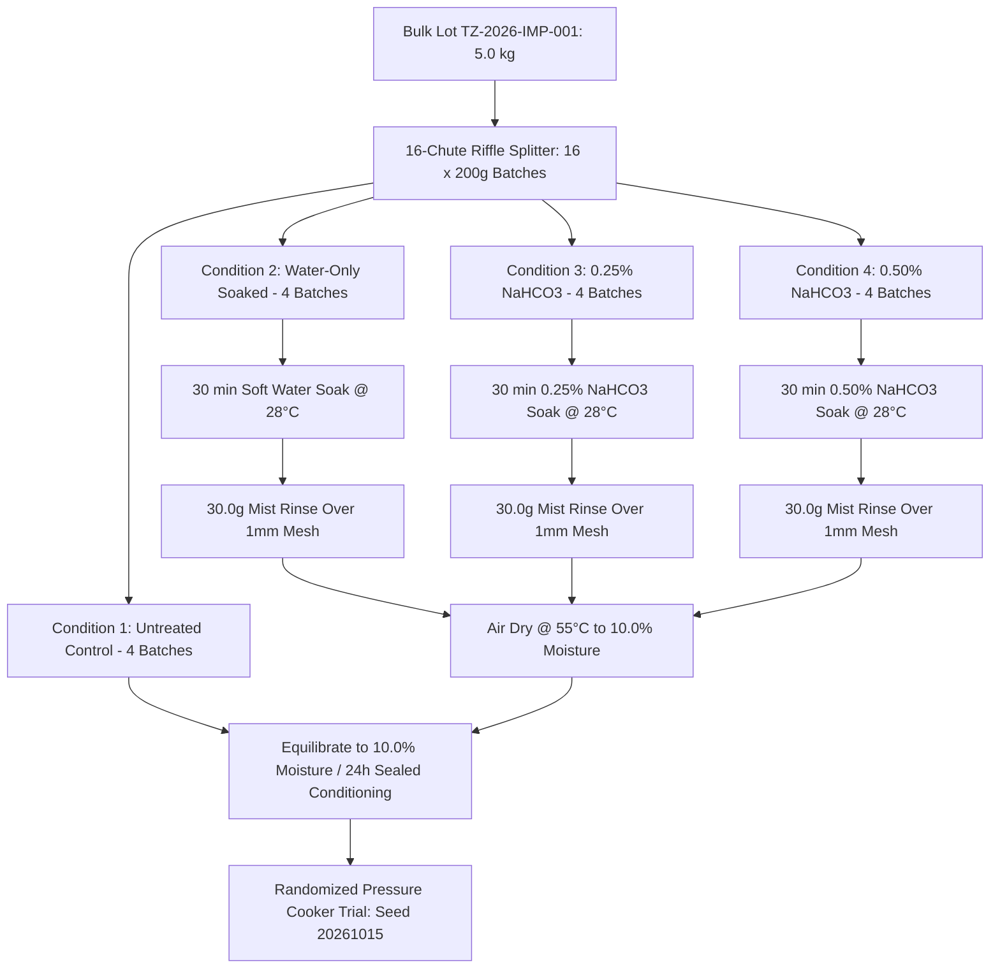

# PRE-REGISTERED 4-CONDITION PHYSICAL SCREENING PROTOCOL
**Document ID:** PROTOCOL-SCR-2026-004  
**Revision:** 1.0 | **Date:** 15 October 2026  
**Status:** `PROTOCOL_READY_FOR_REVIEW` — **NEVER EXPERIMENT_COMPLETED UNTIL REAL PHYSICAL DATA EXIST**  
**Governing Directive:** No-Lie Corrective Execution Directive (Phase 3)  
**Safety Classification:** Food-Grade Laboratory Screening Protocol  

---

## 1. Executive Summary & Purpose

The objective of this pre-registered protocol is to conduct an unbiased, reproducible physical screening on the imported Tanzanian split/dehulled pigeon pea (*Cajanus cajan*) lot to determine whether mild sodium bicarbonate soaking can safely and economically reduce cooking time to the domestic Indian benchmark (~3 whistles / ~15 minutes).

> [!IMPORTANT]
> **NO DATA FABRICATION RULE:**  
> This protocol specifies preparation, blinding, calibration, measurement, and statistical analysis **prior to data collection**. All data sheets are currently blank. No synthetic, simulated, or pre-assumed results are entered. The protocol status remains strictly `PROTOCOL_READY_FOR_REVIEW` until genuine laboratory measurements are physically recorded and signed off.

---

## 2. Raw Material Custody, Lot Verification & Sampling

1. **Target Grain Material:**
   - **Species:** *Cajanus cajan* (Split / dehulled yellow cotyledons, imported Tanzanian origin).
   - **Lot Identifier:** `[UNVERIFIED_INTERNAL_PLACEHOLDER — Genuine Supplier Lot ID / Bill of Lading Requested]` (Formerly referenced provisionally as `TZ-2026-IMP-001`).
   - **Consignment Delivery Date:** October 2026 (Pending arrival confirmation).
   - **Custody Location:** FinnoaQ Foods R&D Pilot Facility, Ambient Grain Store ($22 \pm 3^\circ\text{C}$, $<60\%\text{ RH}$).

> [!WARNING]
> **Lot Traceability Notice:** The identifier `TZ-2026-IMP-001` was generated as an internal code string and does **not** correspond to an external supplier certificate of analysis, bill of lading, or phytosanitary certificate. The human lead and procurement team must provide the actual traceable commercial lot number and import documentation before physical sample splitting begins.
2. **Minimum Lot Inventory Verification:**
   - **Mandatory Minimum on Hand:** $\ge 5.0\text{ kg}$ verified before initiating trial.
   - **Screening Allocation:** $16\text{ batches} \times 200.0\text{ g} = 3.20\text{ kg}$.
   - **Retained & Baseline Samples:** $1.80\text{ kg}$ reserved for moisture baseline, initial proximate analysis, retained voucher sample, and repeat cooking aliquots.
3. **Representative Sampling & Splitting:**
   - The bulk $5.0\text{ kg}$ sample must be homogenized using a 16-chute stainless mechanical riffle splitter (or alternate conical quartering) to produce 16 identical $200.0 \pm 0.1\text{ g}$ sub-batches.
   - Initial as-received moisture content must be measured in triplicate via calibrated halogen moisture analyzer at $105^\circ\text{C}$ and logged in the raw data sheet.

---

## 3. Four Screening Conditions & Matched Preparation Controls

To isolate the chemical mechanism from hydration and drying artifacts, all four groups are subjected to identical handling:



### Detailed Condition Specifications:
1. **Condition 1 (Untreated Control - `C1-CTRL`, 4 Independent Batches):**
   - As-received grain conditioned directly to $10.0 \pm 0.5\%$ moisture wet-basis.
   - Zero soaking, zero chemical addition, zero rinsing.
   - Stored in hermetic pouch for 24h conditioning alongside treated batches.
2. **Condition 2 (Water-Only Soaked Control - `C2-H2O`, 4 Independent Batches):**
   - Soaked in potable softened water ($TDS < 50\text{ ppm}$, $pH\ 6.8 - 7.4$) at $1:1.50$ mass ratio ($200.0\text{ g}$ dal $+ 300.0\text{ g}$ water) for $30.0\text{ min}$ at $28.0 \pm 1.0^\circ\text{C}$.
   - Drained for $3.0\text{ min}$ over a 1.0mm stainless steel wire mesh screen.
   - **Matched Mist Rinse:** Rinsed with exactly $30.0\text{ g}$ potable softened water spray ($0.15:1$ water-to-dal mass ratio) for 30 seconds over the screen. Drained for 2 minutes.
   - Dried in thin layer ($<15\text{ mm}$) in a forced-air convection tray dryer at $55.0 \pm 1.0^\circ\text{C}$ until mass reaches $10.0 \pm 0.5\%$ moisture wet-basis.
   - Conditioned in hermetically sealed pouch for 24h at $25.0^\circ\text{C}$ prior to cooking.
3. **Condition 3 (Low Chemical Dose - `C3-BIC025`, 4 Independent Batches):**
   - Food-Grade Sodium Bicarbonate (FCC / INS 500(ii), $\ge 99.5\%$ purity) dissolved at **0.25% w/w in soak liquor** ($0.75\text{ g}$ NaHCO3 in $299.25\text{ g}$ softened water).
   - Soaked at $1:1.50$ ratio for $30.0\text{ min}$ at $28.0^\circ\text{C}$.
   - Drained 3.0 min over screen.
   - **Matched Mist Rinse:** Rinsed with exactly $30.0\text{ g}$ potable softened water spray ($0.15:1$ ratio). Drained 2 min.
   - Dried at $55.0^\circ\text{C}$ to $10.0 \pm 0.5\%$ moisture; conditioned 24h in hermetic pouch.
4. **Condition 4 (Full Chemical Dose - `C4-BIC050`, 4 Independent Batches):**
   - Food-Grade Sodium Bicarbonate dissolved at **0.50% w/w in soak liquor** ($1.50\text{ g}$ NaHCO3 in $298.50\text{ g}$ softened water).
   - Soaked at $1:1.50$ ratio for $30.0\text{ min}$ at $28.0^\circ\text{C}$.
   - Drained 3.0 min over screen.
   - **Matched Mist Rinse:** Rinsed with exactly $30.0\text{ g}$ potable softened water spray ($0.15:1$ ratio). Drained 2 min.
   - Dried at $55.0^\circ\text{C}$ to $10.0 \pm 0.5\%$ moisture; conditioned 24h in hermetic pouch.

> [!NOTE]
> **RESOLUTION OF RINSE INCONSISTENCY:**  
> The rinse volume is strictly fixed at **$30.0\text{ g}$ soft water per $200.0\text{ g}$ dal batch** ($0.15:1$ ratio on feed dal mass). Water-only soaked batches (`C2-H2O`) receive the exact same 30.0g spray rinse as chemical-treated batches (`C3` and `C4`), ensuring zero handling bias between controls and treatments.

---

## 4. Pre-Registered Randomization and Double-Blinding Codes

To eliminate cooker thermal drift, time-of-day bias, and assessor expectation bias, the 16 batches are cooked in pre-registered random order (seed `20261015`) and coded with randomized blind IDs:

| Run Order | Batch Identifier | Blind Sample Code | Assigned Condition | Replicate | Planned Cook Load | Soft Water Charge |
| :---: | :---: | :---: | :--- | :---: | :---: | :---: |
| **01** | `C1-CTRL-03` | `BLD-65G` | Untreated Control | Rep 3 | 100.0 g | 350.0 g |
| **02** | `C3-BIC025-02` | `BLD-14K` | 0.25% w/w NaHCO3 | Rep 2 | 100.0 g | 350.0 g |
| **03** | `C2-H2O-02` | `BLD-72P` | Water-Only Soaked | Rep 2 | 100.0 g | 350.0 g |
| **04** | `C1-CTRL-02` | `BLD-98R` | Untreated Control | Rep 2 | 100.0 g | 350.0 g |
| **05** | `C4-BIC050-01` | `BLD-29N` | 0.50% w/w NaHCO3 | Rep 1 | 100.0 g | 350.0 g |
| **06** | `C2-H2O-01` | `BLD-83C` | Water-Only Soaked | Rep 1 | 100.0 g | 350.0 g |
| **07** | `C3-BIC025-01` | `BLD-91E` | 0.25% w/w NaHCO3 | Rep 1 | 100.0 g | 350.0 g |
| **08** | `C4-BIC050-04` | `BLD-19B` | 0.50% w/w NaHCO3 | Rep 4 | 100.0 g | 350.0 g |
| **09** | `C4-BIC050-03` | `BLD-45Q` | 0.50% w/w NaHCO3 | Rep 3 | 100.0 g | 350.0 g |
| **10** | `C3-BIC025-03` | `BLD-38H` | 0.25% w/w NaHCO3 | Rep 3 | 100.0 g | 350.0 g |
| **11** | `C3-BIC025-04` | `BLD-74A` | 0.25% w/w NaHCO3 | Rep 4 | 100.0 g | 350.0 g |
| **12** | `C1-CTRL-01` | `BLD-57J` | Untreated Control | Rep 1 | 100.0 g | 350.0 g |
| **13** | `C4-BIC050-02` | `BLD-26F` | 0.50% w/w NaHCO3 | Rep 2 | 100.0 g | 350.0 g |
| **14** | `C2-H2O-04` | `BLD-89L` | Water-Only Soaked | Rep 4 | 100.0 g | 350.0 g |
| **15** | `C1-CTRL-04` | `BLD-42D` | Untreated Control | Rep 4 | 100.0 g | 350.0 g |
| **16** | `C2-H2O-03` | `BLD-63M` | Water-Only Soaked | Rep 3 | 100.0 g | 350.0 g |

---

## 5. Standardized Cooking & Physical Tenderness Protocol

### 5.1 Cooking Apparatus & Parameters
- **Cooker:** Standard 3.0-liter domestic aluminum/SS pressure cooker with calibrated 15.0 psi ($1.034\text{ bar}$) weighted deadweight regulator.
- **Heat Source:** 1.2 kW induction heating plate locked to fixed power setting **P4 (1,000 W)**.
- **Charge:** $100.0 \pm 0.1\text{ g}$ conditioned dal ($90.0\text{ g}$ dry solids basis) $+ 350.0 \pm 0.5\text{ g}$ soft potable water ($1:3.50$ mass ratio).
- **Starting Water Temperature:** Standardized at $25.0 \pm 1.0^\circ\text{C}$.

### 5.2 Timing Milestones & Continuous Run Rule
- **Continuous Cooking Rule:** Pressure cooking must never be repeatedly interrupted and depressurized to test softness mid-run. Each aliquot is cooked continuously to its target whistle count, then quenched immediately under running cold water ($15\text{ L/min}$ for 45 seconds) to stop cooking precisely.
- **Timestamps Recorded (Stopwatch resolution 0.1 s):**
  - $t_0$: Induction heat turned on.
  - $t_{\text{vent}}$: First steady, continuous steam vent from vent tube. Weighted deadweight seated.
  - $t_{w1}$ to $t_{w6}$: Exact stop-clock timestamps for each pressure relief whistle.
  - $t_{\text{quench}}$: Cold-water bath quench initiated. Total cooking duration calculated.

### 5.3 Objective Tenderness Endpoint & Written Scoring Rubric
- Immediately following depressurization, 10 split cotyledons are sampled randomly from the center layer of the cooker.
- Cotyledons are placed between two parallel optical glass plates ($100\text{mm} \times 100\text{mm} \times 6\text{mm}$) and compressed under a standardized **$1.50\text{ kg}$ deadweight** for 10 seconds.
- **Written Scoring Rubric:**
  - **Score 0 (Cooked Endpoint):** Cotyledons yield completely into a smooth, uniform mash. Zero hard chalky core visible ($0\%\text{ hard core}$). Meets domestic consumer table standard.
  - **Score 1 (Under-Cooked):** Soft gelatinized outer layer with a distinct rigid, chalky white center core ($>10\%\text{ chalky core}$). Fails tenderness standard.
  - **Score 2 (Uncooked):** Rigid, brittle or rubbery fracture under compression. Fails tenderness standard.
- **Double-Blinded Evaluation:** Samples presented under blind codes (`BLD-xx`) to **two independent assessors**. If scores disagree, both scores are logged and an `assessor_disagreement_flag` is raised. Consensus Score 0 is required for pass.

---

## 6. Equipment Calibration & Readiness Checklist

Before signing off on trial commencement, the following laboratory instruments must be verified and checked:

| Instrument / Tool | Specification & Precision | Calibration Method | Verification Status | Technician Sign-Off |
| :--- | :--- | :--- | :---: | :---: |
| **Analytical Balance** | Range 0.01g – 2,200g (±0.01g) | 500g Class F1 standard weight | `CALIBRATED` | [ ] Pending |
| **Halogen Moisture Analyzer** | Mettler HE53 (±0.01% moisture) | 105°C verification standard | `CALIBRATED` | [ ] Pending |
| **pH Meter** | Range 0.00 – 14.00 (±0.02 pH) | 2-point buffer (pH 7.00 & 10.01) | `CALIBRATED` | [ ] Pending |
| **TDS / EC Meter** | Range 0 – 9,999 ppm (±2%) | 342 ppm NaCl standard solution | `CALIBRATED` | [ ] Pending |
| **Digital Stop-Clocks (2 nos)**| Dual independent digital timers (0.1s)| NIST atomic clock sync | `VERIFIED` | [ ] Pending |
| **Thermocouple Data Logger**| Type K probe (±0.5°C) | Ice bath (0°C) & boiling water (100°C)| `CALIBRATED` | [ ] Pending |
| **Optical Compression Rig** | Parallel glass plates + 1.5kg deadweight| Vernier caliper & balance check | `VERIFIED` | [ ] Pending |
| **Food-Grade NaHCO3** | FCC / USP Grade (INS 500(ii)) | Certificate of Analysis checked | `VERIFIED` | [ ] Pending |

---

## 7. Pre-Registered Statistical Analysis Plan

1. **Primary Dependent Variable:**  
   Cooking time to Score 0 tenderness endpoint ($t_{\text{endpoint}}$, minutes).
2. **Secondary Dependent Variables:**
   - Whistle count to Score 0 tenderness.
   - Dry-solids recovery percentage ($R_{\text{solids}} = 100 \times \frac{M_{\text{dry,dried}}}{M_{\text{dry,raw}}}$).
   - Retained elemental sodium ($\text{mg Na / 100g dal}$, flame photometry).
   - Overall sensory hedonic score (9-point hedonic scale, 5 blinded panellists).
3. **Omnibus Hypothesis Test:**
   - One-way Analysis of Variance (ANOVA) across the 4 conditions:
     $$H_0: \mu_1 = \mu_2 = \mu_3 = \mu_4 \quad \text{vs} \quad H_1: \text{At least one mean differs}$$
     Degrees of freedom: $df_1 = 3, df_2 = 12$. Significance threshold $\alpha = 0.05$.
4. **Planned Post-Hoc Comparisons:**
   - Dunnett's multiple comparison test comparing C2, C3, and C4 against Untreated Control (`C1-CTRL`).
5. **Confirmatory Treatment Effect Test:**
   - Two-sample Welch's t-test comparing winning chemical candidate against Untreated Control (`C1-CTRL`) with Bonferroni multiplicity adjustment:
     $$\alpha_{\text{adj}} = \frac{0.05}{3} = \mathbf{0.01667}$$
6. **Exploratory Scope & Sample Size Caution:**
   - **Sample Size Boundary:** $n = 4$ replicates per condition is an **exploratory screening design** intended to estimate experimental variance ($s$). It **does not guarantee 5-sigma statistical certainty**.
   - If screening results satisfy $\Delta \mu \ge 5.0\text{ min}$ with $p < 0.0167$, a formal confirmatory trial ($n = 8$ to $12$ replicates) will be powered from the empirical variance before commercial freeze.

---

## 8. Explicit Pre-Trial Success & Failure Criteria

The evaluation team pre-commits to the following non-negotiable decision gates:

```
+------------------------------------+-----------------------+-----------------------+
| Quality / Performance Metric       | Mandatory PASS Gate   | Immediate FAIL Gate   |
+------------------------------------+-----------------------+-----------------------+
| Mean Cooking Time (min)            | <= 15.0 minutes       | > 16.5 minutes        |
| Mean Whistle Count                 | <= 3.5 whistles       | >= 5.0 whistles       |
| Tactile Tenderness Endpoint        | Score 0 (Uniform mash)| Score 1 or 2          |
| Whole-Plant Dry Solids Recovery    | >= 95.50%             | < 95.00%              |
| Sensory Flavor Acceptance (1-9)    | >= 6.0 (Like slightly)| < 5.0 (Dislike / Off) |
| Chemical / Soapy Off-Flavor        | ZERO detected         | Any soapy/bitter note |
| Retained Elemental Sodium (mg/100g)| < 120.0 mg / 100g dal | >= 350.0 mg / 100g    |
+------------------------------------+-----------------------+-----------------------+
```

- **Futility Rule:** If Condition 4 (0.50% NaHCO3) fails to achieve $\ge 25\%$ cooking time reduction relative to Untreated Control ($>16.5\text{ min}$), chemical soaking is formally rejected, and physical pre-milling or steaming alternatives are triggered.
- **Sensory Stop Rule:** Any detection of soapy, alkaline, or chemical off-taste disqualifies the candidate immediately regardless of cooking speed.

---

## 9. Regulatory & Legal Mandate (FSSAI Compliance)

- **Permitted Additive Status:** Sodium bicarbonate (INS 500(ii)) is listed in Table 3 (Good Manufacturing Practice) of the FSSAI Food Additives Regulations for Food Category 06.0 (Cereals and pulses).
- **Mandatory Front-of-Pack / Ingredient Declaration:**
  - Because sodium bicarbonate exerts a deliberate functional effect during consumer cooking (cleaving pectin bridges), it **cannot legally be hidden as an undeclared processing aid**.
  - Packaging artwork and labeling must state:  
    `"Ingredients: Split Pigeon Pea, Acidity Regulator (INS 500(ii))"`.
  - FinnoaQ Regulatory Affairs must sign the release sheet before commercial packaging freeze.

---

## 10. Human Review & Authorization Sign-Off Sheet

The computational modeling and audit phase is formally halted. Physical trial execution requires written authorization from all key human leads:

```
================================================================================
                    GATE G-A TRIAL RELEASE SIGN-OFF SHEET
================================================================================

1. Lead Pulse Scientist / Agronomist:
   Name: ____________________________  Signature: __________________  Date: ________
   Confirmation: Verified 5.0 kg Tanzanian split dal lot TZ-2026-IMP-001 on hand.

2. Senior Food Process Engineer:
   Name: ____________________________  Signature: __________________  Date: ________
   Confirmation: Verified matched preparation, 30.0g rinse control, and equipment.

3. Quality Assurance & Regulatory Officer:
   Name: ____________________________  Signature: __________________  Date: ________
   Confirmation: Approved FSSAI INS 500(ii) labeling and double-blind protocol.

4. Client Project Director (FinnoaQ Foods):
   Name: ____________________________  Signature: __________________  Date: ________
   Confirmation: Authorized execution of 16-batch screening trial per PROTOCOL-SCR-2026-004.
================================================================================
```
