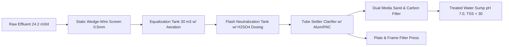

# UTILITY, WASTEWATER, AND ENVIRONMENTAL DESIGN (15 MT/DAY PLANT)
**Document ID:** ENG-REP-15T-013  
**Revision:** 1.0 | **Date:** 15 October 2026  
**Status:** `PRELIMINARY_CALCULATED` — **WARNING: PRELIMINARY—NOT FOR CONSTRUCTION**  
**Engineering Discipline:** Environmental & Utility Engineering  

---

## 1. Utility Demand Profile & Sizing Summary

The utility requirements for the 15 MT/day split pigeon pea processing facility are summarized below:

| Utility System | Normal Operating Duty | Peak Design Load | Supply Conditions | Equipment Specification | Estimated Daily Consumption |
| :--- | :--- | :--- | :--- | :--- | :--- |
| **Soft Process Water** | $1.73\text{ m}^3\text{/h}$ ($24.75\text{ m}^3\text{/day}$) | $4.50\text{ m}^3\text{/h}$ (Fast tank fill) | $3.0\text{ bar(g)}$, TDS $<200\text{ ppm}$, Hardness $<50\text{ ppm}$ | Duplex ion-exchange water softener skid ($5.0\text{ m}^3\text{/h}$) | $27.75\text{ m}^3\text{/day}$ (incl. CIP) |
| **Saturated Steam** | $482.8\text{ kg/h}$ ($288.4\text{ kW}$) | $600.0\text{ kg/h}$ (Cold start) | $2.5\text{ bar(g)}$ ($138.9^\circ\text{C}$) | Package horizontal biomass boiler ($600\text{ kg/h}$ rating) | $5,800\text{ kg steam/day}$ ($1.18\text{ T}$ briquettes) |
| **Compressed Air** | $28.5\text{ CFM}$ ($0.81\text{ m}^3\text{/min}$) | $45.0\text{ CFM}$ (Baghouse pulse) | $7.0\text{ bar(g)}$, $+3^\circ\text{C}$ PDP, Class 1:4:1 ISO 8573 | Rotary screw compressor ($7.5\text{ kW}$) + refrigerated dryer | Continuous duty ($180\text{ kWh/day}$) |
| **Electrical Power** | $50.35\text{ kW}$ running | $57.22\text{ kVA}$ running | $415\text{ V} \pm 10\%$, 3-phase, 50 Hz, PF 0.88 | $100\text{ kVA}$ Transformer $+ 100\text{ kVA}$ Standby DG Set | $805.6\text{ kWh/day}$ |

---

## 2. Process Effluent Treatment Plant (`ETP-101`)

### 2.1 Wastewater Characteristics:
- **Total Effluent Flow:** **$24.16\text{ m}^3\text{/day}$** ($19.11\text{ m}^3$ drained soak liquor $+ 2.05\text{ m}^3$ mist rinse runoff $+ 3.00\text{ m}^3$ CIP washdown).
- **Raw Effluent Quality:** pH $8.2 - 8.8$ (Alkaline due to bicarbonate residue), Total Suspended Solids (TSS) $\sim 450\text{ ppm}$, BOD $\sim 450\text{ ppm}$, COD $\sim 950\text{ ppm}$, Total Dissolved Solids (TDS) $\sim 5,200\text{ ppm}$.

### 2.2 ETP Unit Operations & Process Flow:

1. **Inlet Screening:** Fine static wedge-wire bar screen ($0.5\text{ mm}$ slot) captures stray broken dal cotyledons and husk fines ($25\text{ kg/day}$ wet biomass recovered).
2. **Equalization Tank (`ET-101`):** $30.0\text{ m}^3$ epoxy-lined RCC sump with coarse-bubble diffused aeration grid prevents anaerobic septic odor and homogenizes batch dump surges.
3. **pH Neutralization Tank (`NT-101`):** $1.5\text{ m}^3$ flash mix tank with high-speed agitator and automated pH control loop. Doses technical-grade sulfuric acid ($H_2SO_4$, $\sim 8.5\text{ kg/day}$) to adjust effluent from pH 8.8 down to neutral **pH $7.0 \pm 0.3$**.
4. **Coagulation & Clarification:** Flash dosing of polyaluminum chloride (PAC) and cationic polymer followed by a high-rate inclined tube settler removes colloidal starch and suspended protein fines.
5. **Tertiary Filtration:** Dual-media pressure sand filter (PSF) and activated carbon filter (ACF) removes residual turbidity and trace organics.
6. **Treated Water Discharge:** Complies fully with State Pollution Control Board general discharge standards ($BOD < 30\text{ ppm}$, $COD < 250\text{ ppm}$, $TSS < 30\text{ ppm}$, $pH\ 6.5 - 8.5$). Permitted for industrial estate greenbelt irrigation or secondary floor washing.

---

## 3. Atmospheric Emissions & Dust Control

- **Fluid-Bed Dryer Exhaust:** Primary SS304 cyclone separator (`CYC-101`) captures $>99\%$ of pulse fines down to $20\mu\text{m}$.
- **Exhaust Baghouse (`BH-101`):** Pulse-jet fabric filter fitted with $450\text{ g/m}^2$ PTFE-membrane needle felt filter bags. Online reverse compressed air pulse ($0.5\text{ MPa}$) cleans bags automatically.
- **Particulate Stack Emission:** Guaranteed clean air stack discharge with particulate matter concentration **$< 15\text{ mg/Nm}^3$**, well below the Central Pollution Control Board (CPCB) statutory industrial threshold of $50\text{ mg/Nm}^3$.
- **Boiler Flue Gas Stack:** $30\text{ m}$ high self-supporting MS chimney fitted with multi-cyclone dust collector (MDC) ensures clean combustion exhaust from biomass briquette fuel.
