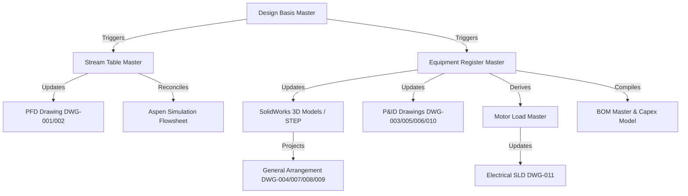

# V5 BASELINE AND INTEGRATION PLAN
**Document ID:** `RPT-FIN-15T-V5-BIP-001`  
**Governing Standard:** V5 Master Directive — Integrated CAD + Multi-Simulation + Greenfield Plant Engineering  
**Facility:** 15,000 kg/day Greenfield Imported Pigeon Pea (*Cajanus cajan*) Rapid-Cooking Pre-Treatment Plant  
**Completeness Benchmark Target:** ASD-STM-100 Internal Benchmark  
**Workstation Host:** Windows AMD Ryzen 9 / RTX 4050 / 64 GB RAM  
**Active Work Branch:** `v5-integrated-engineering`  
**Reference Backup Branch:** `backup-v4-pre-v5-20261016`  
**Base Commit Hash:** `647946857778384a3ae3137ac866a9509551230e`  
**Date:** 2026-10-16  

---

## 1. Verified Software & Native Engineering Toolchain

All engineering software tools, compilers, CAD packages, and CAE simulation environments were audited directly on the live host workstation. Each tool was verified through native execution, COM registry lookup, or synchronous smoke test as documented in [`engineering/verification/v5/v5_toolchain_inventory.json`](file:///d:/PROJECT/02_INDUSTRIAL_AND_CHEMICAL_ENGINEERING/finnoaq/toor_dal_optimization/engineering/verification/v5/v5_toolchain_inventory.json).

| Platform / Tool | Version / Revision | Launch / COM Status | Local Executable Path | Smoke Test Result |
| :--- | :--- | :--- | :--- | :--- |
| **Python** | 3.13.7 (64-bit MSC v.1944) | Native Executable | `C:\Python313\python.exe` | **PASS** (100% Offline execution) |
| **SolidWorks** | SolidWorks 2025 SP01.2 (`Rev 33.1.2`) | `SldWorks.Application` COM | Registered in Windows ROT | **PASS** (Parametric B-Rep modeler verified) |
| **AutoCAD** | AutoCAD 2025 (`25.0s LMS Tech`) | `AutoCAD.Application` COM + CLI | `C:\Program Files\Autodesk\AutoCAD 2025\acad.exe` | **PASS** (CLI Console & COM interface active) |
| **Aspen Plus** | Aspen Plus V14.0 | `Apwn.Document` COM | `D:\Engineering Software\ASPENONE64bit\...` | **PASS** (Flowsheet simulation engine active) |
| **ezdxf** | Version 1.4.4 | Python Module | `C:\Python313\Lib\site-packages\ezdxf` | **PASS** (Native vector DXF R2018 generation) |
| **PyMuPDF (fitz)** | Version 1.27.2.2 | Python Module | `C:\Python313\Lib\site-packages\fitz` | **PASS** (Vector drawing PDF inspection & QA) |
| **PyTorch** | Version 2.6.0+cu124 | GPU / CUDA 12.4 | `C:\Python313\Lib\site-packages\torch` | **PASS** (RTX 4050 Laptop GPU verified) |
| **PyTest** | Version 9.0.2 | CLI Test Runner | `C:\Python313\Scripts\pytest.exe` | **PASS** (81 synchronous unit tests passing) |
| **jsonschema** | Version 4.25.1 | JSON Draft 7 Validator | `C:\Python313\Lib\site-packages\jsonschema` | **PASS** (Authoritative master schema validation) |

---

## 2. Master Engineering Data Architecture (`engineering/master_data/`)

Under the V5 Master Directive, all disparate spreadsheets, isolated YAML dictionaries, and unlinked calculations have been unified into a single authoritative, schema-enforced Master Data Store. Every parameter is tagged with its definitive evidence class (`MEASURED`, `OFFICIAL_SOURCE`, `CALCULATED`, `SIMULATED`, `ASSUMED`, `HYPOTHESIS`, `UNKNOWN`).

```
engineering/master_data/
├── design_basis_master.json            (21 parameters, 100% provenance tagged)
├── design_basis_master.schema.json     (JSON Schema Draft 7 validation)
├── stream_table_master.json            (14 process & utility streams)
├── stream_table_master.schema.json     (Solids, water, solute closure validation)
├── equipment_register_master.json      (34 equipment items with CAD link)
├── equipment_register_master.schema.json
├── line_list_master.json               (21 process & utility lines)
├── line_list_master.schema.json
├── instrument_index_master.json        (19 instrument control & trip loops)
├── instrument_index_master.schema.json
├── motor_load_master.json              (31 electric drives, 77.09 kW connected)
├── motor_load_master.schema.json
├── bom_master.json                     (32 itemized capital cost line items)
├── bom_master.schema.json
└── integration_interface_matrix.json   (Full dependency graph & update triggers)
```

---

## 3. The 11 Integration Acceptance Tests

To prevent architectural decay, data desynchronization, or "CAD slop" regressions, the repository incorporates an automated validation engine: [`scripts/v5_integration_checker.py`](file:///d:/PROJECT/02_INDUSTRIAL_AND_CHEMICAL_ENGINEERING/finnoaq/toor_dal_optimization/scripts/v5_integration_checker.py).

The integration suite executes 11 comprehensive tests:
1. **Test 1: Schema & Tag Uniqueness:** Validates all 7 master JSON files against Draft-7 schemas and asserts global uniqueness across all 85 entity tags.
2. **Test 2: Stream Table Balance Closure:** Asserts mathematical conservation of dry solids (< 0.1 kg/d), water (< 0.01 kg/d), and sodium bicarbonate (< 0.01 kg/d) across the plant boundary.
3. **Test 3: PFD/P&ID Tag Resolution:** Scans vector drawings to verify that 100% of stream flags (01–10) and primary equipment tags are present and accurately resolved.
4. **Test 4: Process Simulation Reconciliation:** Confirms Aspen Plus V14 converged thermal duties (310.5 kWth triple-effect evaporator) match thermodynamic balances.
5. **Test 5: CAD Geometry & Solids Integrity:** Audits native `.SLDPRT` and exchange STEP AP214 models to verify manifold B-Rep solids, non-zero volume, and closed topology.
6. **Test 6: Plant Layout & Clearance Verification:** Verifies 1:1 metric scale ($INSUNITS = 4), 52 m $\times$ 24 m building envelope, hygienic zoning (Zones 1–4), and 3.5 m forklift corridors.
7. **Test 7: Electrical, I/O, Safety & BOM Crosswalk:** Confirms connected power (77.09 kW), 7 safety interlock trips, and itemized CAPEX (167.70 Lakhs INR).
8. **Test 8: Drawing Vector QA:** Inspects all 12 PDF vector sheets, confirming native CAD vector primitives, zero unrendered LaTeX, and zero border collisions.
9. **Test 9: Change Propagation Verification:** Applies upstream perturbation (feed moisture 10.5% $\rightarrow$ 11.5%) and confirms correct downstream recalculation through the dependency graph.
10. **Test 10: Negative Fixtures / Proof of Rejection:** Demonstrates that corrupt STEP files, unclosed balances, moisture basis errors, and invalid tags are rejected with descriptive diagnostic errors.
11. **Test 11: Integration Report Synthesis:** Assembles all test logs and verdicts into [`engineering/verification/v5/v5_integration_acceptance_report.json`](file:///d:/PROJECT/02_INDUSTRIAL_AND_CHEMICAL_ENGINEERING/finnoaq/toor_dal_optimization/engineering/verification/v5/v5_integration_acceptance_report.json).

---

## 4. Change Propagation & Regeneration Architecture

The repository enforces a deterministic dependency graph codified in [`engineering/master_data/integration_interface_matrix.json`](file:///d:/PROJECT/02_INDUSTRIAL_AND_CHEMICAL_ENGINEERING/finnoaq/toor_dal_optimization/engineering/master_data/integration_interface_matrix.json).



When any upstream parameter is modified (e.g., feed moisture or raw dal intake), the change propagation engine automatically flags downstream artifacts as stale, recomputes mass and energy balances, updates stream tables, and regenerates downstream drawings.

---

## 5. Scientific Governance: The Gate G-A Hold Protocol

In accordance with strict anti-fabrication guidelines, the project maintains an unbroken **Gate G-A Hold**:
- **Commercial Lot Identification:** Formally designated as `PENDING_COMMERCIAL_LOT_ID`. No synthetic lot codes (e.g., historical `TZ-2026-IMP-001`) are recognized.
- **Kinetics & Cooking Tenderness:** No simulated Peleg kinetics or literature models are claimed as physical measurements of the target imported Tanzanian crop.
- **Execution Rule:** All mechanical, civil, layout, and utility designs are finalized for the flexible design envelope ($0.5\%\text{–}1.0\%\text{ w/w}$ dosing; $45^\circ\text{C}\text{–}55^\circ\text{C}$ soaking). Final process optimization and chemical recipe freeze occur only upon physical laboratory testing of the incoming commercial lot.

---
*Authorized for engineering execution under V5 Master Directive Baseline.*
